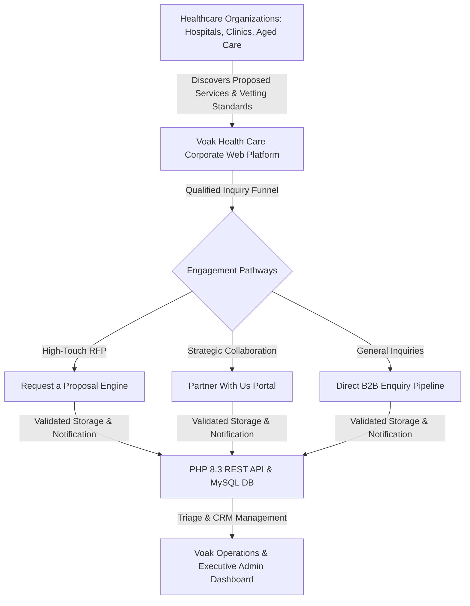

# Phase 0: Executive Summary & Project Charter
## Voak Health Care — Full B2B Healthcare Services Corporate Website

**Document Control**
- **Project:** Voak Health Care Corporate Digital Presence
- **Phase:** Phase 0 of 31 — Project Requirements & Hosting Audit
- **Author:** Principal Full-Stack Software Architect & Engineering Council
- **Target Environment:** Hostinger Shared Hosting (PHP 8.3 / MySQL / Static Vite Assets)
- **Status:** Corrected & Consolidated for Phase 0 Acceptance Audit

---

### 1. Executive Mission & Strategic Purpose

**Voak Health Care** is planned as a dedicated **B2B healthcare services company**, delivering operational, workforce staffing, administrative back-office, and compliance advisory support to institutional healthcare organizations. 

The website's primary commercial objective is **not** direct clinical consumer care, but rather **generating qualified enterprise partnerships, service contracts, and institutional proposals** from:
- Public and private hospital networks
- Multi-disciplinary medical clinics and health centres
- Aged care facilities and residential nursing operators
- Allied health practices and rehabilitation networks
- Medical imaging and diagnostic pathology centres
- Corporate health, occupational safety, and employee wellness programs

---

### 2. Explicit Anti-Goals & Architectural Boundaries

To avoid scope creep and prevent misdirection into clinical medical management software, the following boundaries are formally instituted:
1. **NOT an Electronic Medical Record (EMR) or Health Record (EHR) System:** The platform does not ingest, process, or store clinical patient medical histories, prescription charts, or diagnostic imagery.
2. **NOT a Patient Appointment Booking Portal:** The public cannot book doctor or specialist consultations for personal medical treatment.
3. **NOT a Patient Health Portal:** There is no patient login, health passport, or personal medical triage tool.
4. **NOT a Telehealth Video Platform:** Telemedicine video streaming and patient teleconsultation infrastructure are strictly outside scope.

---

### 3. Core Technical Decisions & Non-Negotiable Stack

| Layer | Selected Technology | Technical & Architectural Rationale |
| :--- | :--- | :--- |
| **Public Frontend** | **React 18+ / TypeScript / Vite / Tailwind CSS** | Highly responsive, component-driven architecture with zero runtime lock-in. Optimized for sub-second Core Web Vitals and interactive B2B user journeys. |
| **Animation & Micro-interactions** | **Motion for React** (`framer-motion`) | Subtle, accessible animations, bento-grid card reveals, and smooth page transitions with strict `prefers-reduced-motion` compliance. |
| **Admin Frontend** | **React / TypeScript / Tailwind CSS** | Dedicated administrative dashboard sharing design tokens and TypeScript API response schemas. |
| **Backend Engine** | **PHP 8.3+ (Hostinger Compatible)** | Native shared-hosting execution with low memory overhead, PDO prepared statements, and modular service-repository architecture. |
| **Database** | **MySQL 8.x** | Enterprise relational storage with foreign key constraints, explicit locking migrations, and automated backups. |
| **Hosting Target** | **Hostinger Shared Hosting** | Production environment utilizing PHP 8.3, Apache mod_rewrite, automated Let's Encrypt SSL, and co-located MySQL loopback (`127.0.0.1:3306`). |
| **Runtime Constraints** | **No Node.js Server Daemon / No VPS / No Redis** | Build-time compilation of frontend assets into static HTML/JS/CSS; PHP handles all runtime API requests synchronously. |

---

### 4. Approved Design Governance

The visual identity for Voak Health Care is firmly governed by the **approved second generated homepage design reference**, departing decisively from generic, clinical corporate blue-and-white templates.

**Approved Aesthetic Pillars:**
- **Warm, Welcoming & High-Trust:** Harmonious pastel backdrop featuring soft lavender (`#F2F0F8`), delicate blush pink (`#EEAFD7`), pastel buttercup yellow (`#FBDC62`), fresh mint green (`#54CB96`), and airy sky blue (`#63A5E6`).
- **High-Contrast Authority:** Deep plum/navy headlines (`#252B5E`) and vibrant royal purple primary CTA buttons (`#665CE9`) guaranteeing WCAG 2.2 AA accessibility.
- **Editorial Typography:** Elegant, authoritative serif headlines paired with crisp, clean geometric sans-serif body typography.
- **Bento-Grid & Asymmetry:** Rounded container cards (`rounded-3xl`), generous 8px-based spacing rhythms, layered imagery, and organic background shapes.
- **Human-Centric Imagery:** Authentic healthcare professionals and collaborative workforce teams rather than generic hospital architecture photographs.
- **No Invented Content:** No fabricated client counts, testimonials, certifications, or partner logos. All content placeholders are explicitly tagged as templates pending verified company assets.

---

### 5. Restored Original 32-Phase Roadmap (Phases 0–31)

Execution follows the strict, originally agreed 32-phase lifecycle across 4 overarching stages:

```mermaid
gantt
    title Voak Health Care Original 32-Phase Roadmap
    dateFormat  X
    axisFormat  Stage %s
    section Stage 1: Requirements & Design
    Phases 0-3 (Requirements, Specs, Architecture, UI/UX Design) :active, 0, 4
    section Stage 2: PHP Backend & MySQL
    Phases 4-17 (Backend Foundation, DB, Auth, Content, Services, CRM, APIs) : 4, 18
    section Stage 3: React Public & Admin
    Phases 18-26 (React Foundation, UI Components, Pages, Admin Dashboard) : 18, 27
    section Stage 4: Integration & Deploy
    Phases 27-31 (E2E Integration, A11y, SEO, Pentest, Hostinger Acceptance) : 27, 32
```

#### Restored Phase Index:
- **Stage 1: Requirements, Architecture and Design (Phases 0–3)**
  - Phase 0: Project Requirements & Hosting Audit `[CURRENT ACTIVE PHASE]`
  - Phase 1: Complete Functional Specification
  - Phase 2: System Architecture
  - Phase 3: Professional UI/UX Design (Tokenization, Bento Layouts, Wireframes)
- **Stage 2: PHP Backend, MySQL, APIs and Security (Phases 4–17)**
  - Phase 4: PHP Backend Foundation
  - Phase 5: MySQL Database
  - Phase 6: Admin Authentication & Security (incl. TOTP MFA & CSRF)
  - Phase 7: Website Content Management
  - Phase 8: Services Management
  - Phase 9: Industries Management
  - Phase 10: Media & Document Management
  - Phase 11: Contact Enquiry Management
  - Phase 12: Partnership & Proposal Management
  - Phase 13: Email Notification System
  - Phase 14: Careers & Recruitment
  - Phase 15: Resources & Corporate Content
  - Phase 16: SEO Management Backend
  - Phase 17: Administration, Auditing & API Verification
- **Stage 3: React Public Frontend and Admin Dashboard (Phases 18–26)**
  - Phase 18: React Foundation (Vite + TypeScript bootstrap, Tailwind)
  - Phase 19: Complete UI Component System
  - Phase 20: Full Professional Homepage
  - Phase 21: Corporate Information Pages
  - Phase 22: Services & Industries Pages
  - Phase 23: Business Enquiry Pages
  - Phase 24: Remaining Public Pages
  - Phase 25: React Admin Dashboard
  - Phase 26: Complete Admin Operations
- **Stage 4: Integration, Accessibility, SEO, Security, Testing and Hostinger Deployment (Phases 27–31)**
  - Phase 27: Complete End-to-End Integration
  - Phase 28: Responsive & Accessibility Audit
  - Phase 29: SEO & Performance Optimisation
  - Phase 30: Security & Production Readiness
  - Phase 31: Hostinger Deployment & Final Acceptance

- **Current Status:** **Phase 0 is the only authorized active phase.**
- **Governance Gate:** No application code for subsequent phases (Phase 1 through Phase 31) will be deployed until this comprehensive Phase 0 foundation document suite is formally reviewed and accepted.

---

### 6. Phase 0 Deliverables Index

The complete documentation suite in `docs/phase-00/` contains 18 governance artifacts:
1. `00_PHASE_0_EXECUTIVE_SUMMARY.md` (This document)
2. `01_BUSINESS_REQUIREMENTS.md`
3. `02_COMPLETE_FEATURE_MATRIX.md`
4. `03_PUBLIC_WEBSITE_SITEMAP.md`
5. `04_ADMIN_MODULES_AND_RBAC.md`
6. `05_APPROVED_DESIGN_SYSTEM.md`
7. `06_HOSTINGER_COMPATIBILITY_AUDIT.md`
8. `07_TECHNICAL_ARCHITECTURE.md`
9. `08_DATABASE_DOMAIN_MODEL.md`
10. `09_API_CONTRACT_PLAN.md`
11. `10_SECURITY_AND_PRIVACY_BASELINE.md`
12. `11_SEO_AND_RENDERING_STRATEGY.md`
13. `12_DEPLOYMENT_STRATEGY.md`
14. `13_COMPLETE_32_PHASE_TRACEABILITY.md`
15. `14_TESTING_AND_ACCEPTANCE_STRATEGY.md`
16. `15_UNVERIFIED_ASSUMPTIONS_AND_BLOCKERS.md`
17. `16_PHASE_0_FINAL_REPORT.md`
18. `17_PHASE_0_CORRECTION_AND_ACCEPTANCE_REPORT.md`
