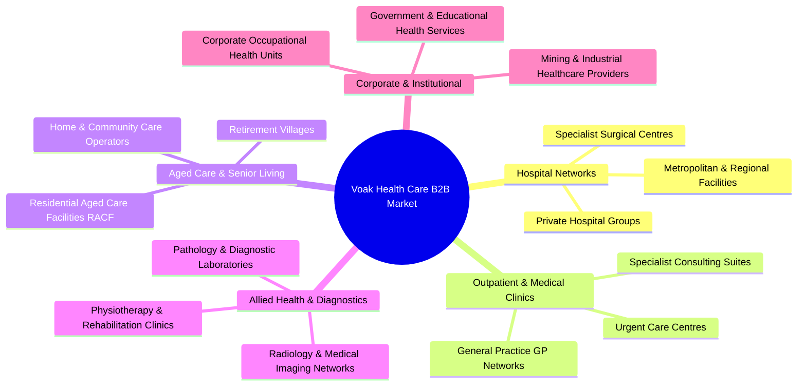
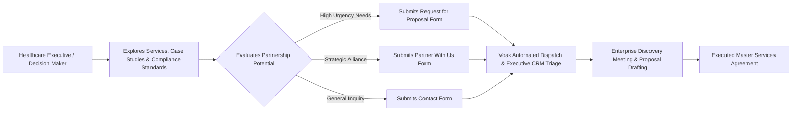

# Business Requirements Document (BRD)
## Voak Health Care — Corporate Digital Platform

**Document Reference:** `docs/phase-00/01_BUSINESS_REQUIREMENTS.md`  
**Phase:** Phase 0 — Project Requirements & Hosting Audit  
**Classification:** Business Architecture Specification  

---

### 1. Corporate Identity & Business Model

| Entity Attribute | Specification | Verification Status |
| :--- | :--- | :--- |
| **Legal Entity Name** | Voak Health Care | `[PROPOSED - UNCONFIRMED: Requires confirmation of exact legal registration e.g., Voak Health Care Pty Ltd]` |
| **Business Model** | B2B (Business-to-Business) Healthcare Services | `[CONFIRMED CONCEPT]` |
| **Primary Value Proposition** | Delivering enterprise operational support, specialized healthcare workforce staffing, back-office optimization, and compliance advisory to institutional healthcare providers. | `[PROPOSED - UNCONFIRMED]` |
| **Operating Jurisdictions** | Target markets to be confirmed (e.g., Australia / Regional APAC) | `[UNCONFIRMED - PENDING CLIENT INPUT]` |
| **Headquarters & Physical Address** | TBD — Official corporate registered address to be provided | `[UNCONFIRMED - PENDING CLIENT INPUT]` |
| **Official Corporate Contact** | TBD — Official corporate mailbox to be provisioned | `[UNCONFIRMED - PENDING CLIENT PROVISIONING]` |

---

### 2. Primary Target Institutional Clientele

Voak Health Care contracts with organizations, not individual consumer patients. The platform serves the following target segments:

---

### 3. Service Pillars: Proposed Scope & Capabilities

> [!IMPORTANT]
> The following 6 service categories represent the **proposed commercial capability model**. In accordance with Phase 0 governance, these capabilities are treated as **unconfirmed working hypotheses** until formally verified by executive leadership. The engineering team will not invent client guarantees, capabilities, or credentials.

#### Pillar 1: Healthcare Staffing & Workforce Support `[PROPOSED / UNCONFIRMED]`
- **Scope:** Permanent placement, locum medical staffing, specialized nursing pools, allied health practitioners, and clinical workforce rostering solutions.
- **Client Benefit:** Mitigates critical healthcare labor shortages, minimizes agency markup churn, and ensures credentialed clinical readiness.
- **Conversion Goal:** Institutional staffing contracts, locum pool master service agreements (MSAs).

#### Pillar 2: Healthcare Operational Support `[PROPOSED / UNCONFIRMED]`
- **Scope:** Clinical workflow streamlining, patient journey management, supply chain and medical inventory logistics, facility throughput optimization.
- **Client Benefit:** Enhances day-to-day healthcare service delivery, reduces wait times, and elevates clinical operating margins.
- **Conversion Goal:** Operational consulting engagements and managed service contracts.

#### Pillar 3: Administrative & Back-Office Services `[PROPOSED / UNCONFIRMED]`
- **Scope:** Medical billing, revenue cycle management (RCM), coding audits, transcription services, reception management, and clinical scheduling back-office support.
- **Client Benefit:** Reduces overhead costs, cuts claim rejection rates, and allows clinical leaders to focus strictly on patient care.
- **Conversion Goal:** Multi-year business process outsourcing (BPO) agreements.

#### Pillar 4: Healthcare Facility Support & Equipment Operations `[PROPOSED / UNCONFIRMED]`
- **Scope:** Medical equipment procurement coordination, maintenance scheduling, biomedical compliance tracking, facility sanitation standards management.
- **Client Benefit:** Assures clinical environment uptime, patient safety standards, and equipment lifecycle maximization.
- **Conversion Goal:** Facility support tenders and equipment management partnerships.

#### Pillar 5: Healthcare Consulting & Strategic Advisory `[PROPOSED / UNCONFIRMED]`
- **Scope:** New clinic establishment advisory, digital transformation roadmaps, clinical service expansion feasibility, merger and acquisition due diligence in healthcare.
- **Client Benefit:** Provides strategic clinical guidance backed by operational industry experience.
- **Conversion Goal:** Executive advisory retainers and strategic project fees.

#### Pillar 6: Quality, Clinical Governance & Regulatory Compliance `[PROPOSED / UNCONFIRMED]`
- **Scope:** Accreditation preparation (e.g., Australian Aged Care Quality Standards, RACGP, NSQHS, or regional equivalents), infection prevention protocols, clinical audit systems, risk management frameworks.
- **Client Benefit:** Protects provider licensing, supports clinical audit readiness, and elevates clinical governance.
- **Conversion Goal:** Compliance audit retainers and quality assurance subscriptions.

---

### 4. Primary Business Objectives & Conversion Funnel

The corporate digital platform is engineered as an **enterprise inbound engine**:

#### Key Performance Indicators (KPIs) for the Web Platform:
1. **Conversion on High-Intent Inquiries:** High-touch conversion of executive visitors into submitted RFPs or partnership inquiries.
2. **Inquiry Qualification Accuracy:** 100% of inbound submissions capture organization name, contact title, service area, and timeline.
3. **Sub-Second Digital Experience:** Page load time under 1.5s across all target networks to reinforce corporate reliability.
4. **Dual-Persistence Reliability:** All form submissions are persisted to MySQL with transactional email alerting.

---

### 5. Explicit Anti-Goals (Out-of-Scope Constraints)

To prevent architectural failure and regulatory exposure, the engineering team enforces strict scope boundaries:

| Excluded System | Rationale for Exclusion | Verification Status |
| :--- | :--- | :--- |
| **Electronic Medical Record (EMR/EHR)** | Voak Health Care does not maintain patient health charts or diagnostic records. Adding EMR features would breach regulatory mandates and introduce clinical liability. | `[VERIFIED - OUT OF SCOPE]` |
| **Patient Appointment Booking** | The platform is not a consumer clinic website. Individual patients cannot schedule doctor appointments. | `[VERIFIED - OUT OF SCOPE]` |
| **Patient Health Portal / Records Access** | No consumer login or medical document exchange. | `[VERIFIED - OUT OF SCOPE]` |
| **Telemedicine Video Streaming** | No WebRTC or telehealth consultation rooms. | `[VERIFIED - OUT OF SCOPE]` |
| **E-Commerce / Consumer Checkout** | Voak does not sell retail pharmaceutical or medical products online. B2B transactions are invoiced via enterprise contracts. | `[VERIFIED - OUT OF SCOPE]` |

---

### 6. Content Approval & Asset Provenance Standards

To preserve institutional truthfulness:
1. **Zero Fabricated Metrics:** No artificial statistics (e.g. "99.8% compliance", "38% cost reduction") will be published without signed, verified customer case records.
2. **Zero Fabricated Testimonials:** Testimonials in design mockups are strictly illustrative templates. No actual customer quote or client logo will be displayed without an executed media release.
3. **Zero Fabricated Partners:** Institutional partner badges require documented partnership agreements.
4. **Credential Verification:** Clinical governance claims will only cite regulatory frameworks that Voak Health Care is formally audited against or certified to advise on.

---

### 7. User Persona Archetypes & Journey Scenarios

*(Note: The following personas are design archetypes utilized for user experience modeling, not real individuals or clients.)*

#### Archetype A: Hospital Network Executive (C-Suite / Operations)
- **Need:** Emergency or planned clinical workforce shortages across regional facilities.
- **Journey:** Lands on `/services/healthcare-staffing` -> Reviews credentialing standards on `/quality-compliance` -> Navigates to `/request-proposal` -> Submits workforce requirements and timeline.

#### Archetype B: Clinic Operations Director (Multi-Site Practice)
- **Need:** High administrative overhead and billing reconciliation delays.
- **Journey:** Discovers back-office solutions -> Visits `/services/administrative-support` -> Reviews service deliverables -> Submits enquiry via `/partner-with-us`.

#### Archetype C: Aged Care Quality Manager
- **Need:** Preparing residential care facilities for regulatory accreditation review.
- **Journey:** Visits `/quality-compliance` -> Inspects audit methodology on `/how-we-work` -> Requests preliminary consultation via `/contact`.
