# Public Website Sitemap & Information Architecture
## Voak Health Care Corporate Digital Presence

**Document Reference:** `docs/phase-00/03_PUBLIC_WEBSITE_SITEMAP.md`  
**Phase:** Phase 0 — Project Requirements & Hosting Audit  
**Implementation Alignment:** Restored 32-Phase Roadmap (Phases 18–24)  

---

### 1. Master Information Architecture Diagram

```mermaid
graph TD
    Root["/ (Homepage) - Phase 20"]
    
    Root --> Corporate["Corporate Overview - Phase 21"]
    Corporate --> P02["/about (About Us)"]
    Corporate --> P07["/why-choose-voak (Why Choose Voak)"]
    Corporate --> P08["/how-we-work (How We Work)"]
    Corporate --> P09["/quality-compliance (Quality & Compliance)"]
    
    Root --> Services["Solutions & Services - Phase 22"]
    Services --> P03["/services (Services Overview)"]
    P03 --> P04A["/services/healthcare-staffing [PROPOSED]"]
    P03 --> P04B["/services/operational-support [PROPOSED]"]
    P03 --> P04C["/services/administrative-support [PROPOSED]"]
    P03 --> P04D["/services/facility-support [PROPOSED]"]
    P03 --> P04E["/services/healthcare-consulting [PROPOSED]"]
    P03 --> P04F["/services/compliance-governance [PROPOSED]"]
    
    Root --> Industries["Sectors & Verticals - Phase 22"]
    Industries --> P05["/industries (Industries Overview)"]
    P05 --> P06A["/industries/hospitals"]
    P05 --> P06B["/industries/medical-clinics"]
    P05 --> P06C["/industries/aged-care"]
    P05 --> P06D["/industries/allied-health"]
    P05 --> P06E["/industries/diagnostics"]
    P05 --> P06F["/industries/corporate-health"]
    
    Root --> Inbound["Business Enquiry Pages - Phase 23"]
    Inbound --> P17["/contact (Contact Us)"]
    Inbound --> P18["/partner-with-us (Partner Portal)"]
    Inbound --> P19["/request-proposal (Request a Proposal)"]
    
    Root --> Remaining["Remaining Public Pages - Phase 24"]
    Remaining --> P10["/partners (Partners & Clients)"]
    Remaining --> P11["/case-studies (Case Studies Index)"]
    Remaining --> P11A["/case-studies/:slug (Detail)"]
    Remaining --> P12["/careers (Careers Portal)"]
    Remaining --> P13["/careers/:slug (Job Application)"]
    Remaining --> P14["/insights (Insights & Resources)"]
    Remaining --> P15["/insights/:slug (Article Detail)"]
    Remaining --> P16["/faq (Frequently Asked Questions)"]
    Remaining --> P20["/privacy-policy"]
    Remaining --> P21["/terms"]
    Remaining --> P22["/404 & /500 Error Boundaries"]
```

---

### 2. Comprehensive Page-by-Page Specifications

#### 01. Homepage (`/`) — Implemented in Phase 20
- **Primary Objective:** Establish instant B2B credibility, articulate the value proposition, showcase approved bento aesthetics, and drive visitors to RFP or service pages.
- **Key Page Sections:**
  1. Sticky Header with branded Voak logo, navigation hierarchy, and "Request Proposal" action.
  2. Hero Section: Asymmetrical layout, high-contrast serif headline, pastel backdrop, verified trust indicators, primary purple CTA.
  3. Accreditation & Governance Alignment Ribbon: Institutional standards overview (pending verified client credentials).
  4. Bento-Grid Services: Interactive cards highlighting the 6 proposed service pillars with subtle hover lifts.
  5. Operational Capability Indicators: Template metrics structure (to be populated with verified company figures).
  6. Sector Selector: Tabbed overview of target sectors (Hospitals, Aged Care, Clinics).
  7. Clinical Governance Spotlight: Overview of vetting, credentialing, and compliance principles.
  8. Testimonials Section: Structured quotes layout (pending signed client releases).
  9. Final Global CTA Ribbon: "Partner With Voak Health Care Today".
  10. Corporate Footer: Complete legal, contact, and navigation directory.
- **SEO Title:** `Voak Health Care | B2B Healthcare Services & Operational Solutions`
- **SEO Description:** `Voak Health Care delivers enterprise healthcare staffing, operational support, back-office optimization, and compliance solutions to institutional healthcare facilities.`
- **Structured Data:** `Organization`, `WebSite`

#### 02. About Us (`/about`) — Implemented in Phase 21
- **Primary Objective:** Articulate Voak's history, corporate mission, leadership, and operational philosophy.
- **Key Page Sections:** Mission & Vision, Executive Leadership Team Grid, Clinical Advisory Principles, Regional Operating Footprint, Our Journey & Milestones.
- **SEO Title:** `About Us | Voak Health Care Leadership & Governance`
- **Structured Data:** `AboutPage`, `Organization`

#### 03. Our Services Overview (`/services`) — Implemented in Phase 22
- **Primary Objective:** Provide a structured catalog of all 6 proposed B2B operational service pillars with filterable views.
- **Key Page Sections:** Services Intro, Filter Bar (Workforce, Operations, Administration, Facilities, Consulting, Quality), Bento Service Cards with scope bullets, RFP Trigger.
- **SEO Title:** `Healthcare Services & B2B Solutions | Voak Health Care`
- **Structured Data:** `CollectionPage`

#### 04. Individual Service Detail Pages (`/services/:slug`) — Implemented in Phase 22
- **Dynamic Routes (Proposed):**
  - `/services/healthcare-staffing`
  - `/services/operational-support`
  - `/services/administrative-support`
  - `/services/facility-support`
  - `/services/healthcare-consulting`
  - `/services/compliance-governance`
- **Key Page Sections:** Breadcrumb trail, Service Hero, Deliverables & Scope Checklist, Client Case Template, SLA & Engagement Options, Dedicated Proposal Trigger.
- **Crawler Delivery:** Server-rendered semantic HTML containing full text scope, canonical tags, and JSON-LD Service schema before client React takeover.
- **SEO Title:** `{Service Title} | Voak Health Care B2B Solutions`
- **Structured Data:** `Service`, `BreadcrumbList`

#### 05. Industries We Serve Overview (`/industries`) — Implemented in Phase 22
- **Primary Objective:** Demonstrate understanding of sector-specific operational pressures.
- **Key Page Sections:** Industry Overview, Sector Grid with deep-links, Cross-sector Compliance Guarantee.
- **SEO Title:** `Healthcare Industries We Serve | Voak Health Care`
- **Structured Data:** `CollectionPage`

#### 06. Individual Industry Pages (`/industries/:slug`) — Implemented in Phase 22
- **Dynamic Routes:**
  - `/industries/hospitals` (Private & Public Hospital Networks)
  - `/industries/medical-clinics` (GP Practices & Multi-Discipline Clinics)
  - `/industries/aged-care` (Residential & Home Aged Care Facilities)
  - `/industries/allied-health` (Therapy, Rehab & Allied Networks)
  - `/industries/diagnostics` (Pathology & Diagnostic Imaging)
  - `/industries/corporate-health` (Occupational Health & Industrial Clinics)
- **Key Page Sections:** Sector Hero, Industry Pain Points vs. Voak Solutions, Compliance Standards Met, Sector RFP CTA.
- **SEO Title:** `Healthcare Solutions for {Industry Name} | Voak Health Care`
- **Structured Data:** `WebPage`, `BreadcrumbList`

#### 07. Why Choose Voak (`/why-choose-voak`) — Implemented in Phase 21
- **Primary Objective:** Provide unambiguous institutional differentiation against standard agencies.
- **Key Page Sections:** The Voak Advantage, Comparative Grid (Voak vs Traditional Staffing Agencies vs In-House Coordination), Credentialing Rigor, Real-Time SLA Frameworks.
- **SEO Title:** `Why Choose Voak | Enterprise Healthcare Partnership Advantage`

#### 08. How We Work (`/how-we-work`) — Implemented in Phase 21
- **Primary Objective:** Clarify the enterprise engagement model and eliminate procurement friction.
- **Key Page Sections:** 4-Stage Engagement Framework (Audit & Discovery -> Custom Architecture -> Integration & Onboarding -> Continuous Governance), Transition Timelines, Dedicated Account Governance.
- **SEO Title:** `How We Work | Enterprise Engagement & Implementation Framework`

#### 09. Quality and Compliance (`/quality-compliance`) — Implemented in Phase 21
- **Primary Objective:** Build institutional trust through transparent clinical governance and credentialing.
- **Key Page Sections:** Clinical Governance Framework, Practitioner Credentialing Protocol, Infection Prevention Standards, Data Privacy (APPs/GDPR), Audit Trail Readiness.
- **SEO Title:** `Clinical Governance, Quality & Compliance Standards | Voak Health Care`
- **Structured Data:** `WebPage`

#### 10. Partners and Clients (`/partners`) — Implemented in Phase 24
- **Primary Objective:** Showcase institutional alliances, healthcare consortia, and client relationships.
- **Key Page Sections:** Partner Tiers, Partnership Standards, Alliance Criteria, Partner Application Trigger. (Client logos published only upon executed release).
- **SEO Title:** `Partners & Strategic Healthcare Alliances | Voak Health Care`

#### 11. Case Studies (`/case-studies` & `/case-studies/:slug`) — Implemented in Phase 24
- **Primary Objective:** Provide verified proof of operational impact.
- **Format:** Structured Problem -> Voak Intervention -> Verified Outcomes format (pending client-verified metrics).
- **SEO Title:** `Healthcare Operational Case Studies | Voak Health Care`
- **Structured Data:** `ItemPage`, `BreadcrumbList`

#### 12. Careers Portal (`/careers`) — Implemented in Phase 24
- **Primary Objective:** Attract premium healthcare management, corporate, and clinical talent.
- **Key Page Sections:** Working at Voak, Values & Culture, Open Positions Directory, Filter by Discipline/Location.
- **SEO Title:** `Careers in Healthcare Management & Operations | Join Voak`
- **Structured Data:** `CollectionPage`

#### 13. Job Details & Application (`/careers/:slug`) — Implemented in Phase 24
- **Primary Objective:** Convert qualified candidates with a seamless, accessible application flow.
- **Key Page Sections:** Job Description, Responsibilities, Mandatory Qualifications, Secure Application Form with Resume Upload.
- **SEO Title:** `{Job Title} | Voak Health Care Careers`
- **Structured Data:** `JobPosting`, `BreadcrumbList`

#### 14. Insights and Resources (`/insights`) — Implemented in Phase 24
- **Primary Objective:** Drive organic B2B search traffic and establish thought leadership in healthcare operations.
- **Key Page Sections:** Featured Article, Category Filter, Search Bar, Article Grid, Briefing Signup.
- **SEO Title:** `Healthcare Operational Insights, Whitepapers & News | Voak`
- **Structured Data:** `Blog`, `CollectionPage`

#### 15. Individual Article Page (`/insights/:slug`) — Implemented in Phase 24
- **Primary Objective:** Engage executives with in-depth operational analysis and convert readers via contextual CTAs.
- **Key Page Sections:** Article Header, Full Text Body, In-Article Callout, Social Share Bar, Related Articles.
- **Crawler Delivery:** Server-rendered semantic HTML with route-specific OpenGraph and JSON-LD Article schema.
- **SEO Title:** `{Article Title} | Voak Healthcare Insights`
- **Structured Data:** `Article`, `BreadcrumbList`

#### 16. Frequently Asked Questions (`/faq`) — Implemented in Phase 24
- **Primary Objective:** Address common procurement, contracting, and compliance questions.
- **Key Page Sections:** Interactive Accordion categorized into Contracting, Staffing, Compliance, Onboarding, and Technology.
- **SEO Title:** `Frequently Asked Questions | Voak Health Care B2B Contracting`
- **Structured Data:** `FAQPage`

#### 17. Contact Us (`/contact`) — Implemented in Phase 23
- **Primary Objective:** Provide low-friction general communication channels.
- **Key Page Sections:** Inquiry Form (Name, Organization, Email, Phone, Message), Corporate Office Locations, Direct Corporate Directory.
- **SEO Title:** `Contact Voak Health Care | Corporate & Operations Inquiries`
- **Structured Data:** `ContactPage`

#### 18. Partner With Us (`/partner-with-us`) — Implemented in Phase 23
- **Primary Objective:** Onboard strategic healthcare partners, clinical consortiums, and specialized contractors.
- **Key Page Sections:** Partnership Scope, Intake Questionnaire (Organization Type, Capability Area, Proposed Collaboration Scope).
- **SEO Title:** `Partner With Us | Strategic Healthcare Consortium Portal`

#### 19. Request a Proposal (`/request-proposal`) — Implemented in Phase 23
- **Primary Objective:** Primary high-intent conversion engine for institutional tenders and custom proposals.
- **Key Page Sections:** Multi-Step RFP Form (1. Organization Profile -> 2. Required Services -> 3. Scope, Timeline & Budget -> 4. RFP Document Upload).
- **SEO Title:** `Request a Healthcare Services Proposal | Voak Health Care`

#### 20. Privacy Policy (`/privacy-policy`) — Implemented in Phase 24
- **Primary Objective:** Satisfy legal mandates under the Australian Privacy Act 1988 (APPs) / applicable data protection regulations.
- **Key Content:** B2B data collection disclosures, cookie handling, non-retention of clinical records, user rights, contact of privacy officer.
- **SEO Title:** `Privacy Policy | Voak Health Care Data Protection`

#### 21. Terms & Conditions (`/terms`) — Implemented in Phase 24
- **Primary Objective:** Legal terms governing website use, intellectual property, disclaimer of direct medical advice, and liability limitation.
- **SEO Title:** `Terms of Service & Legal Notices | Voak Health Care`

#### 22. Custom 404 & Error States (`/404`, `/500`) — Implemented in Phase 24
- **Primary Objective:** Retain visitors who reach broken or deprecated links while returning proper HTTP status codes.
- **Key Elements:** Branded message, quick links to core services, link to return home, HTTP 404 header returned by server.
