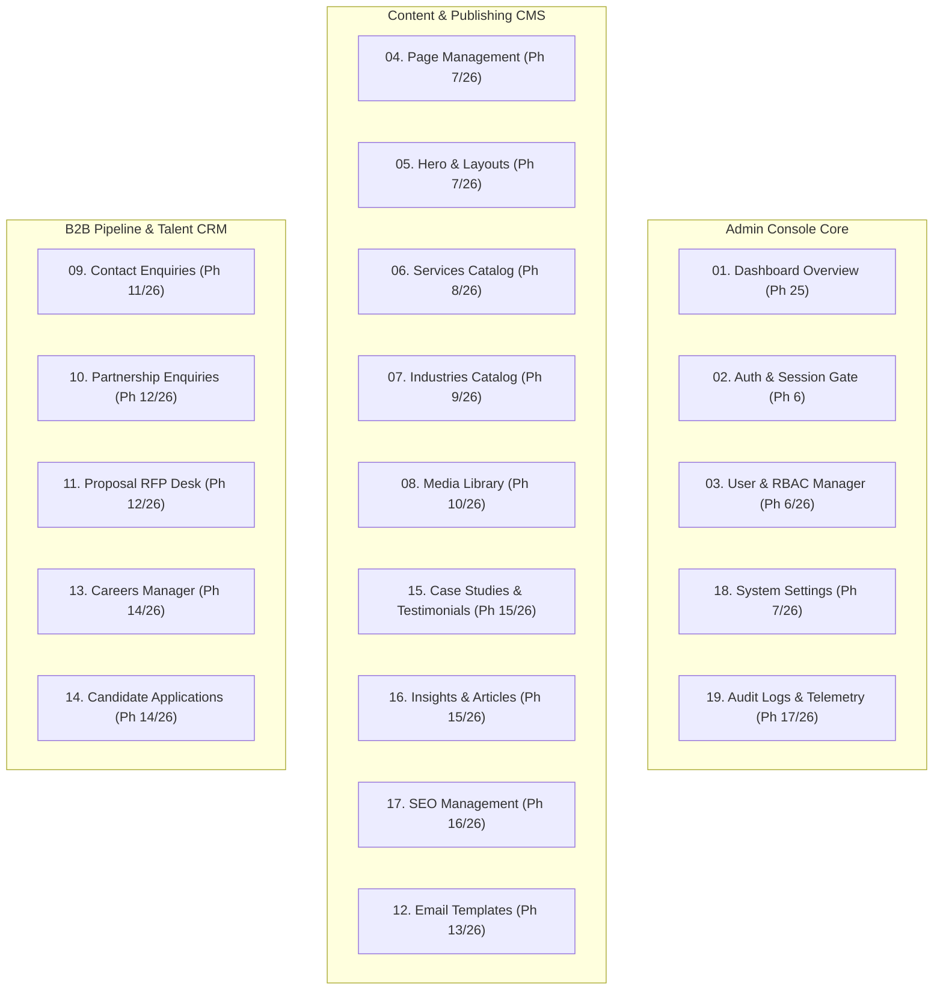
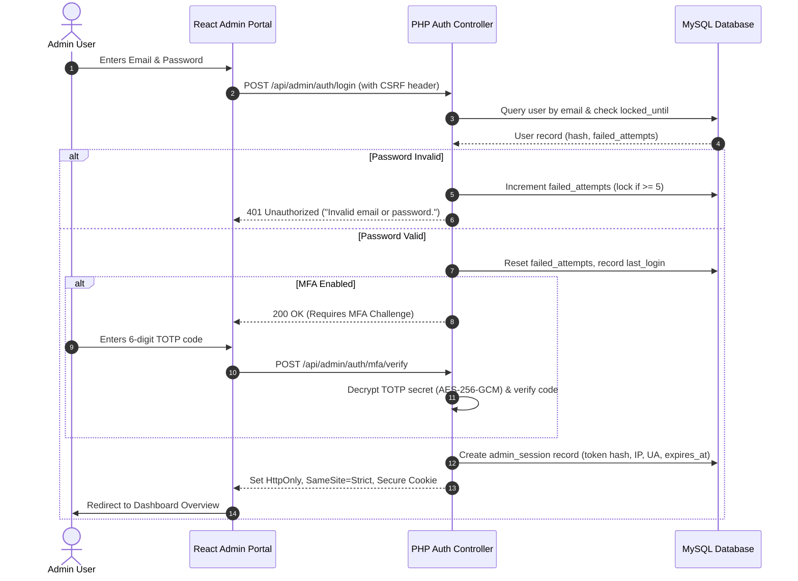

# Admin Dashboard Modules & Role-Based Access Control (RBAC)
## Voak Health Care Administrative Governance Engine

**Document Reference:** `docs/phase-00/04_ADMIN_MODULES_AND_RBAC.md`  
**Phase:** Phase 0 — Project Requirements & Hosting Audit  
**Security Standard:** OWASP ASVS v4.0.3 Level 2 Baseline  
**Implementation Alignment:** Restored 32-Phase Roadmap (Phases 6–17 Backend, Phases 25–26 Frontend)  

---

### 1. Administrative Architecture & Security Philosophy

The **Voak Health Care Admin Portal** is an enterprise-grade administrative console designed for executive operations, marketing publication, recruitment triage, and inbound proposal pipeline management.

**Core Tenets:**
- **Zero Public Exposure:** Admin APIs and routes reside behind strict authentication and CSRF gates (`/ash` or `/admin` entry route).
- **Least-Privilege RBAC:** Every endpoint and data action verifies explicit user permissions before execution.
- **Immutable Audit Trail:** All administrative actions (logins, creates, updates, deletes, document exports) are logged irrevocably in the `audit_logs` database table.
- **Strict Inactivity Timeouts:** Sessions invalidate automatically after 15 minutes of inactivity; absolute lifetime is capped at 8 hours.
- **No Default Admin Passwords:** Initial admin accounts are provisioned via controlled CLI setup with forced password change on first login.

---

### 2. The 19 Core Admin Modules (Mapped to Restored Roadmap)

#### Detailed Breakdown of Modules:

1. **Dashboard Overview & System Telemetry (`ADM-001` — Phase 25):**
   - Real-time KPI widgets: New Inquiries, Pending Proposals, Open Job Applications, Active Articles.
   - Activity feed displaying immutable audit events from the last 24 hours.
   - System health widget displaying database connection state (detailed diagnostics restricted to Super Admin).

2. **Secure Admin Authentication (`ADM-002` — Phase 6):**
   - Brute-force rate limiting: 5 consecutive failed attempts trigger a 15-minute account lock.
   - Timing-attack safe password verification (`password_verify` with bcrypt cost 12 / Argon2id).
   - Generates HttpOnly, SameSite=Strict session cookies with restricted path (`/api/admin`).

3. **Multi-Factor Authentication (MFA/TOTP) (`ADM-003` — Phase 6):**
   - RFC 6238 Time-based One-Time Password with QR code pairing.
   - TOTP secrets encrypted at rest via AES-256-GCM.
   - 8 single-use emergency recovery codes hashed using `password_hash`.

4. **User Management & Role Permissions (`ADM-004` — Phase 6 / 26):**
   - Provisioning staff accounts with mandatory corporate email domains.
   - Instant account deactivation and forced password resets.
   - Least-privilege role assignment (`Super Admin`, `Content Editor`, `BD Manager`, `HR Recruiter`, `Auditor`).

5. **Page Content Management (`ADM-005` — Phase 7 / 26):**
   - Markdown / rich text editor for static pages (About Us, Why Choose Voak, How We Work).
   - Version history tracking and revision comparisons.

6. **Homepage Hero & Layout Manager (`ADM-006` — Phase 7 / 26):**
   - Dynamic control over homepage headline, subtext, trust stats, and CTA destinations.
   - Re-ordering featured service pillars.

7. **Services Catalog Management (`ADM-007` — Phase 8 / 26):**
   - Full CRUD for the 6+ service pillars: title, slug, summary, icon selector, rich body, display order, publish toggle.
   - Per-service custom SEO title and meta description.

8. **Industries Catalog Management (`ADM-008` — Phase 9 / 26):**
   - Full CRUD for industry verticals: sector name, slug, overview, challenges, Voak solutions, display order, publish toggle.

9. **Media Library & Asset Manager (`ADM-009` — Phase 10 / 26):**
   - Drag-and-drop file uploader with automated conversion to WebP format.
   - Strict MIME-type validation via server-side `finfo` magic bytes.
   - Mandatory alt-text input for accessibility compliance.

10. **Contact Enquiries Management (`ADM-010` — Phase 11 / 26):**
    - Inbound general contact submissions triage: `New`, `In Progress`, `Resolved`, `Spam`.
    - Internal staff notes and assignment to specific account managers.
    - CSV export with date filtering.

11. **Partnership Enquiries Pipeline (`ADM-011` — Phase 12 / 26):**
    - High-level partnership relationship management.
    - Captures organization size, sector, proposed collaboration model, and scheduled discovery notes.

12. **Proposal Requests (RFP) Desk (`ADM-012` — Phase 12 / 26):**
    - Enterprise proposal triage desk for high-value tenders.
    - View client project briefs, estimated budgets, and delivery timelines.
    - Secure, authenticated streaming download of attached client RFP documents.

13. **Transactional Email Templates (`ADM-013` — Phase 13 / 26):**
    - Customization of email notification bodies for client inquiry confirmations and internal admin alerts.
    - Dynamic variable interpolation (`{{contact_name}}`, `{{organization}}`, `{{service_name}}`).

14. **Careers & Job Openings Manager (`ADM-014` — Phase 14 / 26):**
    - Publish and unpublish corporate and clinical job listings.
    - Specify department, employment type, location, and closing dates.

15. **Candidate Applications Triage (`ADM-015` — Phase 14 / 26):**
    - Candidate applicant tracking: view resumes, cover letters, and contact information.
    - Status transitions: `New`, `Reviewed`, `Shortlisted`, `Interviewing`, `Declined`, `Hired`.
    - Protected resume downloads (stored outside web root).

16. **Case Studies & Social Proof (`ADM-016` — Phase 15 / 26):**
    - Create and curate verified enterprise case studies in Problem -> Intervention -> Outcome format.
    - Manage client testimonial quotes with verified signed release documentation.

17. **Insights & Resources CMS (`ADM-017` — Phase 15 / 26):**
    - Rich text blog and article management.
    - Category tagging, reading time auto-calculation, featured image assignment, and publication scheduling.

18. **SEO Management & Meta Tag Control (`ADM-018` — Phase 16 / 26):**
    - Global default OpenGraph and Twitter cards.
    - Route-level metadata overrides.
    - Automated XML sitemap cache invalidation upon content publish.

19. **Audit Logs & Operational Reporting (`ADM-019` — Phase 17 / 26):**
    - Comprehensive, read-only audit log: `timestamp`, `user_id`, `user_email`, `action`, `entity_type`, `entity_id`, `ip_address`, `user_agent`.
    - Searchable by user, date range, or action type.

---

### 3. Role-Based Access Control (RBAC) Matrix

Five distinct administrative roles are defined to ensure strict operational separation of concerns:

| Granular Permission Code | Super Admin | Content Editor | Business Dev (BD) | HR Recruiter | Compliance Auditor |
| :--- | :---: | :---: | :---: | :---: | :---: |
| `dashboard.view` | Yes | Yes | Yes | Yes | Yes |
| `users.manage` | **Yes** | No | No | No | No |
| `content.manage` (Pages, Hero) | **Yes** | **Yes** | No | No | Read-Only |
| `services.manage` (Services CRUD) | **Yes** | **Yes** | Read-Only | No | Read-Only |
| `industries.manage` (Industries CRUD) | **Yes** | **Yes** | Read-Only | No | Read-Only |
| `media.manage` (Upload, Delete) | **Yes** | **Yes** | No | No | Read-Only |
| `casestudies.manage` | **Yes** | **Yes** | **Yes** | No | Read-Only |
| `articles.manage` (Insights CMS) | **Yes** | **Yes** | Read-Only | No | Read-Only |
| `seo.manage` | **Yes** | **Yes** | No | No | Read-Only |
| `enquiries.view` (Contact Leads) | **Yes** | No | **Yes** | No | Read-Only |
| `enquiries.manage` (Status, Notes) | **Yes** | No | **Yes** | No | No |
| `partnerships.manage` (B2B Partners) | **Yes** | No | **Yes** | No | No |
| `proposals.manage` (RFP Desk) | **Yes** | No | **Yes** | No | No |
| `careers.manage` (Job Postings) | **Yes** | No | No | **Yes** | Read-Only |
| `applications.view` (Candidate Resumes) | **Yes** | No | No | **Yes** | Read-Only |
| `settings.manage` (Corporate Config) | **Yes** | No | No | No | No |
| `audit.view` (Access Audit Logs) | **Yes** | No | No | No | **Yes** |
| `data.export` (CSV Inquiries/RFPs) | **Yes** | No | **Yes** | **Yes** | No |

---

### 4. Admin Session & Security Policies

- **Session Invalidation:** Terminating the session deletes the token from both the client cookie and the `admin_sessions` table immediately.
- **Concurrent Session Limits:** Maximum of 2 concurrent sessions permitted per administrator.
- **CSRF Token Lifetime:** Bound strictly to the active session; rotated on privilege change.
