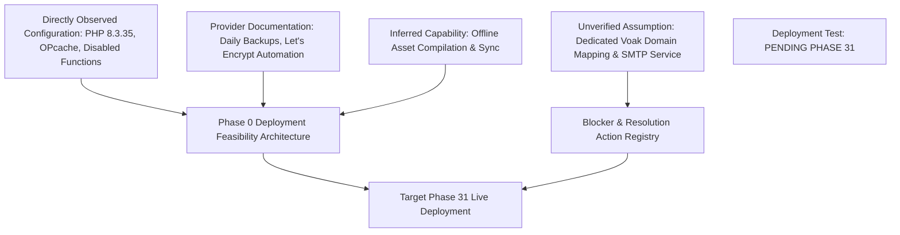

# Hostinger Technical Compatibility & Infrastructure Audit
## Empirical Assessment of Shared Hosting Capabilities & Evidence Classification

**Document Reference:** `docs/phase-00/06_HOSTINGER_COMPATIBILITY_AUDIT.md`  
**Phase:** Phase 0 — Project Requirements & Hosting Audit  
**Audit Target:** Hostinger Shared Hosting Node (Sanitized Identifier: `<HOSTINGER_ENV>`)  
**Evidence Source:** Live Read-Only Hostinger MCP Diagnostic Query (Oct 2026)  

---

### 1. Evidence Classification & Readiness Assessment

To distinguish empirical facts from provider documentation and assumptions, all hosting findings are classified into five explicit evidence tiers:

1. **Directly Observed Configuration (DOC):** Empirically verified via live API query of the server environment.
2. **Provider Documentation (PD):** Standard published Hostinger CloudLinux shared hosting specifications.
3. **Inferred Capability (IC):** Logical architectural deduction based on observed server features.
4. **Unverified Assumption (UA):** Requires external provider provisioning or customer input.
5. **Successful Deployment Test (SDT):** Fully verified live application deployment. *(Note: The Voak Health Care application is in Phase 0 planning and has **NOT** yet been deployed. Live deployment is scheduled for Phase 31).*



#### Readiness Verdict by Architectural Subsystem:

| Subsystem | Readiness Verdict | Evidence Tier | Architectural Reality & Constraints |
| :--- | :---: | :---: | :--- |
| **PHP Runtime (8.3.35)** | **COMPATIBLE** | **DOC** | PHP 8.3.35 active with Zend OPcache (256MB). Fully supports PSR standards and typed PHP 8.x. |
| **MySQL Database Engine** | **COMPATIBLE** | **DOC** | MySQL 8.x instances reachable via local loopback (`127.0.0.1:3306`). 3GB quota per database. |
| **Static React SPA Delivery** | **COMPATIBLE** | **IC** | Vite build compiles to static assets served by Apache with `.htaccess` rewrites. |
| **Background Processes / Daemons** | **INCOMPATIBLE** | **DOC** | Process execution functions (`exec`, `proc_open`, `system`) disabled by server policy. No continuous Node.js or Redis daemons allowed. |
| **Transactional Email** | **SMTP REQUIRED** | **DOC** | PHP `mail()` and `mb_send_mail` are disabled. External authenticated SMTP is mandatory. |
| **Voak Production Domain** | **PENDING SETUP** | **UA** | Voak domain not yet registered or mapped. (1 unassigned free domain credit is present on the account). |
| **Production Application Status**| **NOT DEPLOYED** | **SDT** | Application is currently in Phase 0; deployment will occur in Phase 31. |

---

### 2. Directly Observed Server Configuration (DOC)

The following directives were directly inspected via live read-only server telemetry:

| Server Directive | Observed Setting | Default Plan | Max Allowed | Technical Implication for Voak Platform |
| :--- | :---: | :---: | :---: | :--- |
| **PHP Version** | `8.3.35` | 8.3 | 8.5 | Native typed classes, readonly properties, union types supported. |
| **Memory Limit (`memory_limit`)** | `1536M` | 512M | 2048M | Ample memory for image resizing and JSON payload serialization. |
| **Max Execution Time** | `360s` | 300s | 360s | 6-minute timeout accommodates batch migrations and sitemap runs. |
| **Upload Max Filesize** | `2048M` | 256M | 2048M | Server allows large uploads; Voak application will cap resumes at 10MB. |
| **Post Max Size** | `2048M` | 256M | 2048M | Supports multi-part proposal submissions. |
| **Max Input Variables** | `5000` | 5000 | 5000 | Mitigates HashDOS while supporting large data tables. |
| **Zend OPcache** | `Enabled` | Enabled | 256MB | Sub-5ms bytecode execution latency for API requests. |
| **Display Errors** | `Off` | Off | Off | Production hardened; prevents path disclosure vulnerabilities. |

#### Observed Disabled Functions (`disable_functions`):
```
system, exec, shell_exec, passthru, mysql_list_dbs, ini_alter, dl, 
symlink, link, chgrp, leak, popen, apache_child_terminate, virtual, 
mb_send_mail, proc_open
```

**Direct Constraints Identified:**
1. **Zero Shell Execution:** CLI tools cannot be invoked at runtime from PHP. All vendor dependencies must be packaged prior to deployment.
2. **No Background Worker Daemons:** Background tasks must be triggered via HTTP web-cron jobs or external dispatchers.
3. **No Native Mail Dispatch:** Transactional email must connect to external SMTP over TLS sockets (`tls://smtp.provider.com:587`).

#### Observed Enabled Extensions:
`pdo`, `nd_pdo_mysql`, `openssl`, `mbstring`, `fileinfo`, `gd`, `imagick`, `curl`, `intl`, `zip`, `zlib`, `session` are active. `openssl` provides native AES-256-GCM encryption for TOTP secrets.

---

### 3. Provider Documentation & Platform Architecture (PD & IC)

- **Document Root Structure (PD):** Websites are hosted at `/home/<ACCOUNT_USER>/domains/<DOMAIN>/public_html`.
- **Database Connectivity (PD):** Local PHP applications must connect to `127.0.0.1:3306` (or Unix socket). External connection hostnames (`srv*.hstgr.io`) are for remote administrative tools only and must never be used in production code.
- **SSL / TLS Termination (PD):** Managed Let's Encrypt SSL certificates renew automatically via Hostinger edge infrastructure.
- **Backups (PD):** Automated daily snapshots of files and databases with 30-day retention.

---

### 4. Partition Isolation Architecture & Deployment Requirements

To ensure zero public exposure of application source code, credentials, and sensitive candidate resumes:

```
/home/<ACCOUNT_USER>/
├── app_voak/                        <-- PRIMARY TARGET: PRIVATE (Outside web root)
│   ├── app/                         (Core, Controllers, Services, Repositories)
│   ├── config/                      (Database & App configuration)
│   ├── database/                    (SQL Migrations)
│   ├── storage/                     (Quarantined resumes, logs, cache)
│   └── vendor/                      (Composer packages)
│
└── domains/
    └── <VOAK_DOMAIN>/
        └── public_html/             <-- PUBLIC WEB ROOT (Only publicly accessible files)
            ├── index.html           (React entry with PHP meta tags)
            ├── assets/              (Compiled Vite JS, CSS, fonts)
            ├── favicon.ico
            ├── robots.txt
            ├── sitemap.xml
            ├── api/
            │   ├── index.php        (Front Controller loading app_voak/app/Core/App.php)
            │   └── .htaccess        (Rewrites /api/* to index.php)
            └── .htaccess            (SPA fallback & security response headers)
```

> [!CAUTION]
> **Co-Located Fallback Classification:** If Hostinger Git auto-deployment forces the entire repository into `public_html/`, a strict root `.htaccess` rule will block all requests to `app/`, `config/`, `storage/`, `vendor/`, and `.env` with HTTP 403. However, this co-located model is classified as **less desirable** and will be subjected to automated negative-access penetration tests in Phase 30.

---

### 5. Production Protection Safeguards (Existing Websites)

Live inspection confirmed that other domains exist on this hosting account. In strict compliance with Phase 0 governance:
- **Zero Modifications:** No existing production websites, databases, or DNS records have been accessed, modified, or altered.
- **Zero Sanitization Breaches:** All specific account usernames, client numbers, and existing database names have been sanitized to protect infrastructure confidentiality.
- **Safe Staging Principle:** Voak Health Care will be deployed strictly into an isolated partition and dedicated database during Phase 31.
