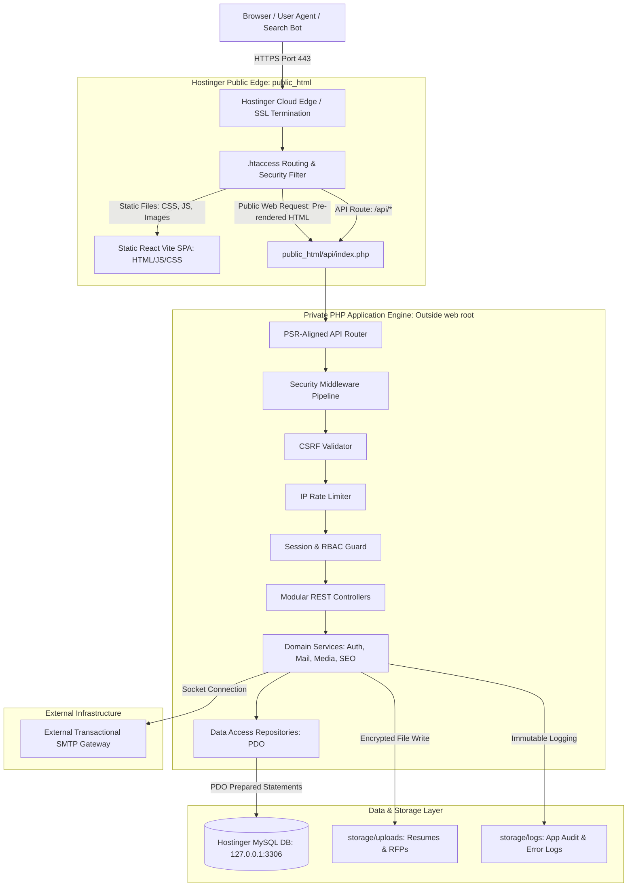
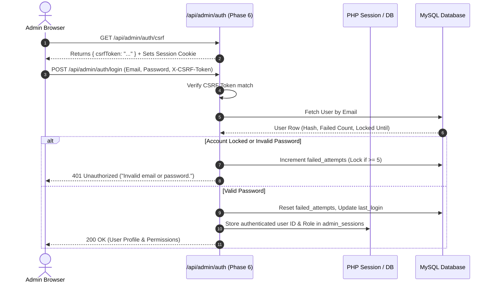

# Technical System Architecture Specification
## Voak Health Care Full-Stack Enterprise Platform

**Document Reference:** `docs/phase-00/07_TECHNICAL_ARCHITECTURE.md`  
**Phase:** Phase 0 — Project Requirements & Hosting Audit  
**Implementation Alignment:** Formalized for System Architecture in Phase 2  
**Pattern:** Decoupled React SPA + Modular PHP REST Engine + MySQL Relational Database  

---

### 1. Overall System Architecture & Request Lifecycle



---

### 2. Frontend Architectural Organization (Phases 18–26)

The frontend is engineered as a modern, modular **React 18+ / TypeScript** application bundled with **Vite** and styled with **Tailwind CSS**, mapped to the restored roadmap:

```
frontend/
├── public/                  # Static assets: favicon, manifest, robots.txt
├── src/
│   ├── apps/
│   │   ├── public/          # Public website routes, layouts, and pages (Phases 18-24)
│   │   │   ├── components/  # Hero (Ph 20), BentoGrid (Ph 20), Nav/Footer (Ph 19)
│   │   │   ├── pages/       # Home (Ph 20), Corporate (Ph 21), Services (Ph 22), 
│   │   │   │                # Enquiries (Ph 23), Remaining Public (Ph 24)
│   │   │   └── PublicApp.tsx
│   │   │
│   │   └── admin/           # Administrative portal application (Phases 25-26)
│   │       ├── components/  # AdminSidebar, DataGrid, StatCard, RichEditor
│   │       ├── pages/       # Dashboard (Ph 25), Proposals (Ph 26), CMS (Ph 26)
│   │       └── AdminApp.tsx
│   │
│   ├── shared/              # Master UI Component Library (Phase 19)
│   │   ├── api/             # Typed API client, CSRF header interceptors
│   │   ├── components/      # Button, Modal, Input, Badge, Accordion, Card
│   │   ├── tokens/          # Design tokens (Phase 3), color constants, typography
│   │   ├── types/           # Shared TypeScript contracts (API responses)
│   │   └── utils/           # Formatters, date helpers, sanitizers
│   │
│   ├── App.tsx              # Root router switching between Public and Admin
│   ├── main.tsx             # Application bootstrap (Phase 18)
│   └── index.css            # Tailwind directives & CSS custom variables (Phase 3)
├── tailwind.config.ts       # Tailored color palette & spacing tokens
├── tsconfig.json            # Strict TypeScript configuration
└── vite.config.ts           # Build optimization & bundle splitting
```

---

### 3. Backend Modular Framework Architecture (Phases 4–17)

The backend implements a lightweight, highly maintainable **Modular Service-Repository Pattern** in native PHP 8.3 with zero heavy external framework bloat, perfectly suited for Hostinger shared hosting:

```
backend/
├── app/
│   ├── Core/                # Foundation engine (Phase 4)
│   │   ├── App.php          # Container and application bootstrapper
│   │   ├── Request.php      # Encapsulated HTTP request object
│   │   ├── Response.php     # Standardized JSON response emitter
│   │   ├── Router.php       # Fast regex-based API route dispatcher
│   │   └── Database.php     # Singleton PDO manager with connection verification
│   │
│   ├── Middleware/          # Security filters (Phases 4 & 6)
│   │   ├── CorsMiddleware.php
│   │   ├── SecurityHeadersMiddleware.php
│   │   ├── CsrfMiddleware.php
│   │   ├── RateLimitMiddleware.php
│   │   └── AuthGuardMiddleware.php
│   │
│   ├── Controllers/         # Endpoint request handlers (Phases 6-17)
│   │   ├── Public/          # Services (Ph 8), Industries (Ph 9), Enquiries (Ph 11-12)
│   │   └── Admin/           # Auth (Ph 6), Content (Ph 7), CRM (Ph 11-12), Users (Ph 17)
│   │
│   ├── Services/            # Business logic (Phases 6-17)
│   │   ├── AuthService.php
│   │   ├── MfaService.php
│   │   ├── MailerService.php (Phase 13)
│   │   ├── MediaStorageService.php (Phase 10)
│   │   ├── SeoService.php (Phase 16)
│   │   └── AuditService.php (Phase 17)
│   │
│   ├── Repositories/        # Data access via PDO prepared statements (Phase 5)
│   │   ├── UserRepository.php
│   │   ├── ServiceRepository.php
│   │   ├── InquiryRepository.php
│   │   ├── ProposalRepository.php
│   │   └── AuditLogRepository.php
│   │
│   └── Models/              # Data transfer objects and domain entities
│
├── config/                  # Configuration loaders (Phase 4)
│   ├── app.php
│   ├── database.php         # PDO credentials with loopback defaults
│   └── mail.php             # SMTP settings
│
├── database/                # Schema management (Phase 5)
│   ├── migrations/          # Numbered SQL migration files
│   └── migrate.php          # Deployment CLI migration runner with mutex lock
│
├── storage/                 # Private runtime storage
│   ├── cache/
│   ├── logs/                # Application error and audit logs
│   └── uploads/             # Quarantined resumes and client RFPs
│
└── public/                  # Public web root entry
    └── index.php            # Single Entry Point Front controller
```

---

### 4. Admin Authentication & Session Management Flow



---

### 5. Standardized API Response Contracts

Every API response follows a strict, predictable JSON envelope structure:

#### Success Response Envelope (`200 OK`, `201 Created`):
```json
{
  "success": true,
  "data": {
    "id": 1,
    "title": "Healthcare Staffing & Workforce Support",
    "slug": "healthcare-staffing"
  },
  "meta": {
    "page": 1,
    "total": 1
  },
  "requestId": "e4f8d9b2-3c1a-4d7e-9f0a-1b2c3d4e5f6a",
  "timestamp": "2026-10-16T08:30:00Z"
}
```

#### Error Response Envelope (`400`, `401`, `403`, `404`, `422`, `429`, `500`):
```json
{
  "success": false,
  "error": {
    "code": "VALIDATION_ERROR",
    "message": "The submitted proposal data failed validation rules.",
    "details": [
      { "field": "email", "issue": "Please enter a valid corporate email address." },
      { "field": "organization", "issue": "Organization name is mandatory." }
    ]
  },
  "requestId": "e4f8d9b2-3c1a-4d7e-9f0a-1b2c3d4e5f6a",
  "timestamp": "2026-10-16T08:30:00Z"
}
```

---

### 6. Database Migration & Schema Safety

> [!WARNING]
> **MySQL DDL Implicit Commit Reality:** In MySQL, DDL statements (`CREATE TABLE`, `ALTER TABLE`, `DROP TABLE`) trigger an immediate **implicit commit** in the InnoDB storage engine. Arbitrary schema migrations **cannot** be rolled back using standard SQL transactions.

**Safe Migration Principles (Phase 5):**
1. **No Public Web Endpoints:** Schema migrations are strictly executed via an authorized CLI tool (`php database/migrate.php`) or controlled deployment script. There is no web-accessible migration URL.
2. **Migration Mutex Locking:** A `schema_migration_locks` table or MySQL `GET_LOCK()` guarantees that migrations cannot be executed concurrently.
3. **Mandatory Pre-Migration Backups:** A full database backup is taken immediately prior to running schema changes.
4. **Additive, Forward-Compatible Changes:** All migrations add new tables or nullable columns first, ensuring active application code continues functioning without downtime during rolling deployments.
5. **Reversible Schema Operations:** Each migration includes an explicit, tested `.down.sql` script for controlled rollbacks if needed.
