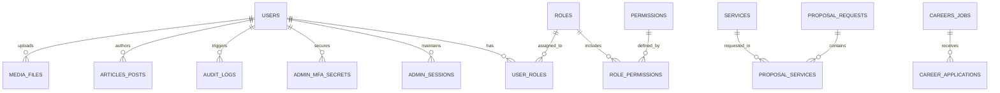

# Database Domain Model & Relational Schema
## Voak Health Care Relational MySQL Database Architecture

**Document Reference:** `docs/phase-00/08_DATABASE_DOMAIN_MODEL.md`  
**Phase:** Phase 0 — Project Requirements & Hosting Audit  
**Implementation Alignment:** Formalized for Database Implementation in Phase 5  
**Engine:** MySQL 8.x / InnoDB  
**Charset & Collation:** `utf8mb4` / `utf8mb4_unicode_ci`  

---

### 1. Entity-Relationship Diagram (ERD)



---

### 2. Core Authentication & RBAC Tables (Phase 5 / 6)

#### `users`
Stores administrative user accounts with strict security metadata.
```sql
CREATE TABLE `users` (
  `id` BIGINT UNSIGNED AUTO_INCREMENT PRIMARY KEY,
  `uuid` CHAR(36) NOT NULL UNIQUE,
  `name` VARCHAR(120) NOT NULL,
  `email` VARCHAR(191) NOT NULL UNIQUE,
  `password_hash` VARCHAR(255) NOT NULL,
  `phone` VARCHAR(30) NULL,
  `is_active` TINYINT(1) NOT NULL DEFAULT 1,
  `failed_attempts` INT UNSIGNED NOT NULL DEFAULT 0,
  `locked_until` DATETIME NULL,
  `last_login_at` DATETIME NULL,
  `last_login_ip` VARCHAR(45) NULL,
  `created_at` DATETIME NOT NULL DEFAULT CURRENT_TIMESTAMP,
  `updated_at` DATETIME NOT NULL DEFAULT CURRENT_TIMESTAMP ON UPDATE CURRENT_TIMESTAMP,
  INDEX `idx_users_email` (`email`),
  INDEX `idx_users_active` (`is_active`)
) ENGINE=InnoDB DEFAULT CHARSET=utf8mb4 COLLATE=utf8mb4_unicode_ci;
```

#### `roles` & `permissions` & `user_roles`
```sql
CREATE TABLE `roles` (
  `id` INT UNSIGNED AUTO_INCREMENT PRIMARY KEY,
  `slug` VARCHAR(50) NOT NULL UNIQUE,
  `name` VARCHAR(100) NOT NULL,
  `description` VARCHAR(255) NULL,
  `created_at` DATETIME NOT NULL DEFAULT CURRENT_TIMESTAMP
) ENGINE=InnoDB DEFAULT CHARSET=utf8mb4 COLLATE=utf8mb4_unicode_ci;

CREATE TABLE `permissions` (
  `id` INT UNSIGNED AUTO_INCREMENT PRIMARY KEY,
  `code` VARCHAR(80) NOT NULL UNIQUE,
  `module` VARCHAR(50) NOT NULL,
  `description` VARCHAR(255) NULL
) ENGINE=InnoDB DEFAULT CHARSET=utf8mb4 COLLATE=utf8mb4_unicode_ci;

CREATE TABLE `role_permissions` (
  `role_id` INT UNSIGNED NOT NULL,
  `permission_id` INT UNSIGNED NOT NULL,
  PRIMARY KEY (`role_id`, `permission_id`),
  FOREIGN KEY (`role_id`) REFERENCES `roles` (`id`) ON DELETE CASCADE,
  FOREIGN KEY (`permission_id`) REFERENCES `permissions` (`id`) ON DELETE CASCADE
) ENGINE=InnoDB DEFAULT CHARSET=utf8mb4 COLLATE=utf8mb4_unicode_ci;

CREATE TABLE `user_roles` (
  `user_id` BIGINT UNSIGNED NOT NULL,
  `role_id` INT UNSIGNED NOT NULL,
  PRIMARY KEY (`user_id`, `role_id`),
  FOREIGN KEY (`user_id`) REFERENCES `users` (`id`) ON DELETE CASCADE,
  FOREIGN KEY (`role_id`) REFERENCES `roles` (`id`) ON DELETE CASCADE
) ENGINE=InnoDB DEFAULT CHARSET=utf8mb4 COLLATE=utf8mb4_unicode_ci;
```

#### `admin_sessions` & `admin_mfa_secrets`
```sql
CREATE TABLE `admin_sessions` (
  `id` BIGINT UNSIGNED AUTO_INCREMENT PRIMARY KEY,
  `session_token_hash` CHAR(64) NOT NULL UNIQUE,
  `user_id` BIGINT UNSIGNED NOT NULL,
  `ip_address` VARCHAR(45) NOT NULL,
  `user_agent` VARCHAR(255) NULL,
  `last_active_at` DATETIME NOT NULL,
  `expires_at` DATETIME NOT NULL,
  `created_at` DATETIME NOT NULL DEFAULT CURRENT_TIMESTAMP,
  FOREIGN KEY (`user_id`) REFERENCES `users` (`id`) ON DELETE CASCADE,
  INDEX `idx_sessions_expiry` (`expires_at`)
) ENGINE=InnoDB DEFAULT CHARSET=utf8mb4 COLLATE=utf8mb4_unicode_ci;

CREATE TABLE `admin_mfa_secrets` (
  `id` BIGINT UNSIGNED AUTO_INCREMENT PRIMARY KEY,
  `user_id` BIGINT UNSIGNED NOT NULL UNIQUE,
  `encrypted_totp_secret` TEXT NOT NULL,
  `iv` VARCHAR(64) NOT NULL,
  `tag` VARCHAR(64) NOT NULL,
  `is_confirmed` TINYINT(1) NOT NULL DEFAULT 0,
  `recovery_codes_hash` JSON NULL,
  `created_at` DATETIME NOT NULL DEFAULT CURRENT_TIMESTAMP,
  `updated_at` DATETIME NOT NULL DEFAULT CURRENT_TIMESTAMP ON UPDATE CURRENT_TIMESTAMP,
  FOREIGN KEY (`user_id`) REFERENCES `users` (`id`) ON DELETE CASCADE
) ENGINE=InnoDB DEFAULT CHARSET=utf8mb4 COLLATE=utf8mb4_unicode_ci;
```

---

### 3. Catalog & Publishing Tables (Phases 7–10, 15)

#### `services`
Stores the B2B service pillars and dynamic detail content.
```sql
CREATE TABLE `services` (
  `id` INT UNSIGNED AUTO_INCREMENT PRIMARY KEY,
  `slug` VARCHAR(100) NOT NULL UNIQUE,
  `title` VARCHAR(150) NOT NULL,
  `category` VARCHAR(60) NOT NULL,
  `short_summary` VARCHAR(300) NOT NULL,
  `content_html` MEDIUMTEXT NOT NULL,
  `icon_svg` TEXT NULL,
  `display_order` INT NOT NULL DEFAULT 0,
  `is_published` TINYINT(1) NOT NULL DEFAULT 1,
  `meta_title` VARCHAR(150) NULL,
  `meta_description` VARCHAR(255) NULL,
  `created_at` DATETIME NOT NULL DEFAULT CURRENT_TIMESTAMP,
  `updated_at` DATETIME NOT NULL DEFAULT CURRENT_TIMESTAMP ON UPDATE CURRENT_TIMESTAMP,
  INDEX `idx_services_slug` (`slug`),
  INDEX `idx_services_published` (`is_published`, `display_order`)
) ENGINE=InnoDB DEFAULT CHARSET=utf8mb4 COLLATE=utf8mb4_unicode_ci;
```

#### `industries`
```sql
CREATE TABLE `industries` (
  `id` INT UNSIGNED AUTO_INCREMENT PRIMARY KEY,
  `slug` VARCHAR(100) NOT NULL UNIQUE,
  `title` VARCHAR(150) NOT NULL,
  `summary` VARCHAR(300) NOT NULL,
  `challenges_json` JSON NOT NULL,
  `solutions_json` JSON NOT NULL,
  `icon_svg` TEXT NULL,
  `display_order` INT NOT NULL DEFAULT 0,
  `is_published` TINYINT(1) NOT NULL DEFAULT 1,
  `meta_title` VARCHAR(150) NULL,
  `meta_description` VARCHAR(255) NULL,
  `created_at` DATETIME NOT NULL DEFAULT CURRENT_TIMESTAMP,
  `updated_at` DATETIME NOT NULL DEFAULT CURRENT_TIMESTAMP ON UPDATE CURRENT_TIMESTAMP,
  INDEX `idx_industries_slug` (`slug`)
) ENGINE=InnoDB DEFAULT CHARSET=utf8mb4 COLLATE=utf8mb4_unicode_ci;
```

#### `case_studies` & `testimonials`
```sql
CREATE TABLE `case_studies` (
  `id` INT UNSIGNED AUTO_INCREMENT PRIMARY KEY,
  `slug` VARCHAR(120) NOT NULL UNIQUE,
  `title` VARCHAR(200) NOT NULL,
  `client_sector` VARCHAR(80) NOT NULL,
  `challenge_text` TEXT NOT NULL,
  `solution_text` TEXT NOT NULL,
  `outcomes_json` JSON NOT NULL,
  `is_featured` TINYINT(1) NOT NULL DEFAULT 0,
  `is_published` TINYINT(1) NOT NULL DEFAULT 1,
  `created_at` DATETIME NOT NULL DEFAULT CURRENT_TIMESTAMP
) ENGINE=InnoDB DEFAULT CHARSET=utf8mb4 COLLATE=utf8mb4_unicode_ci;

CREATE TABLE `testimonials` (
  `id` INT UNSIGNED AUTO_INCREMENT PRIMARY KEY,
  `author_name` VARCHAR(120) NOT NULL,
  `author_title` VARCHAR(120) NOT NULL,
  `organization` VARCHAR(150) NOT NULL,
  `quote` TEXT NOT NULL,
  `display_order` INT NOT NULL DEFAULT 0,
  `is_published` TINYINT(1) NOT NULL DEFAULT 1
) ENGINE=InnoDB DEFAULT CHARSET=utf8mb4 COLLATE=utf8mb4_unicode_ci;
```

#### `articles_posts` & `faqs`
```sql
CREATE TABLE `articles_posts` (
  `id` BIGINT UNSIGNED AUTO_INCREMENT PRIMARY KEY,
  `slug` VARCHAR(191) NOT NULL UNIQUE,
  `title` VARCHAR(255) NOT NULL,
  `category` VARCHAR(80) NOT NULL,
  `author_id` BIGINT UNSIGNED NOT NULL,
  `excerpt` VARCHAR(400) NOT NULL,
  `content_html` LONGTEXT NOT NULL,
  `featured_image_url` VARCHAR(255) NULL,
  `read_time_minutes` INT UNSIGNED NOT NULL DEFAULT 5,
  `is_published` TINYINT(1) NOT NULL DEFAULT 0,
  `published_at` DATETIME NULL,
  `meta_title` VARCHAR(150) NULL,
  `meta_description` VARCHAR(255) NULL,
  `created_at` DATETIME NOT NULL DEFAULT CURRENT_TIMESTAMP,
  `updated_at` DATETIME NOT NULL DEFAULT CURRENT_TIMESTAMP ON UPDATE CURRENT_TIMESTAMP,
  FOREIGN KEY (`author_id`) REFERENCES `users` (`id`),
  INDEX `idx_articles_pub` (`is_published`, `published_at`)
) ENGINE=InnoDB DEFAULT CHARSET=utf8mb4 COLLATE=utf8mb4_unicode_ci;

CREATE TABLE `faqs` (
  `id` INT UNSIGNED AUTO_INCREMENT PRIMARY KEY,
  `category` VARCHAR(60) NOT NULL,
  `question` VARCHAR(255) NOT NULL,
  `answer_html` TEXT NOT NULL,
  `display_order` INT NOT NULL DEFAULT 0,
  `is_published` TINYINT(1) NOT NULL DEFAULT 1
) ENGINE=InnoDB DEFAULT CHARSET=utf8mb4 COLLATE=utf8mb4_unicode_ci;
```

---

### 4. Careers & Talent Acquisition Tables (Phase 14)

#### `careers_jobs` & `career_applications`
```sql
CREATE TABLE `careers_jobs` (
  `id` INT UNSIGNED AUTO_INCREMENT PRIMARY KEY,
  `slug` VARCHAR(120) NOT NULL UNIQUE,
  `title` VARCHAR(150) NOT NULL,
  `department` VARCHAR(80) NOT NULL,
  `employment_type` ENUM('Full-time', 'Part-time', 'Contract', 'Locum') NOT NULL,
  `location` VARCHAR(100) NOT NULL DEFAULT 'Australia-wide',
  `description_html` MEDIUMTEXT NOT NULL,
  `requirements_html` MEDIUMTEXT NOT NULL,
  `is_active` TINYINT(1) NOT NULL DEFAULT 1,
  `closing_date` DATE NULL,
  `created_at` DATETIME NOT NULL DEFAULT CURRENT_TIMESTAMP
) ENGINE=InnoDB DEFAULT CHARSET=utf8mb4 COLLATE=utf8mb4_unicode_ci;

CREATE TABLE `career_applications` (
  `id` BIGINT UNSIGNED AUTO_INCREMENT PRIMARY KEY,
  `job_id` INT UNSIGNED NOT NULL,
  `full_name` VARCHAR(120) NOT NULL,
  `email` VARCHAR(191) NOT NULL,
  `phone` VARCHAR(40) NOT NULL,
  `resume_file_path` VARCHAR(255) NOT NULL,
  `cover_letter` TEXT NULL,
  `status` ENUM('New', 'Reviewed', 'Shortlisted', 'Interviewing', 'Rejected', 'Hired') NOT NULL DEFAULT 'New',
  `internal_notes` TEXT NULL,
  `created_at` DATETIME NOT NULL DEFAULT CURRENT_TIMESTAMP,
  FOREIGN KEY (`job_id`) REFERENCES `careers_jobs` (`id`) ON DELETE CASCADE,
  INDEX `idx_app_status` (`status`)
) ENGINE=InnoDB DEFAULT CHARSET=utf8mb4 COLLATE=utf8mb4_unicode_ci;
```

---

### 5. Inbound Enterprise Pipeline Tables (Phases 11–12)

#### `contact_enquiries`
```sql
CREATE TABLE `contact_enquiries` (
  `id` BIGINT UNSIGNED AUTO_INCREMENT PRIMARY KEY,
  `full_name` VARCHAR(120) NOT NULL,
  `organization` VARCHAR(150) NOT NULL,
  `email` VARCHAR(191) NOT NULL,
  `phone` VARCHAR(40) NULL,
  `service_interest` VARCHAR(80) NULL,
  `message` TEXT NOT NULL,
  `status` ENUM('New', 'In Progress', 'Qualified', 'Closed', 'Spam') NOT NULL DEFAULT 'New',
  `assigned_to_user_id` BIGINT UNSIGNED NULL,
  `ip_address` VARCHAR(45) NOT NULL,
  `created_at` DATETIME NOT NULL DEFAULT CURRENT_TIMESTAMP,
  FOREIGN KEY (`assigned_to_user_id`) REFERENCES `users` (`id`) ON DELETE SET NULL,
  INDEX `idx_enquiries_status` (`status`)
) ENGINE=InnoDB DEFAULT CHARSET=utf8mb4 COLLATE=utf8mb4_unicode_ci;
```

#### `partnership_enquiries`
```sql
CREATE TABLE `partnership_enquiries` (
  `id` BIGINT UNSIGNED AUTO_INCREMENT PRIMARY KEY,
  `organization_name` VARCHAR(150) NOT NULL,
  `organization_type` VARCHAR(80) NOT NULL,
  `contact_person` VARCHAR(120) NOT NULL,
  `title` VARCHAR(100) NOT NULL,
  `email` VARCHAR(191) NOT NULL,
  `phone` VARCHAR(40) NOT NULL,
  `proposed_scope` TEXT NOT NULL,
  `status` ENUM('New', 'Discovery Scheduled', 'Negotiating', 'Partnered', 'Declined') NOT NULL DEFAULT 'New',
  `created_at` DATETIME NOT NULL DEFAULT CURRENT_TIMESTAMP
) ENGINE=InnoDB DEFAULT CHARSET=utf8mb4 COLLATE=utf8mb4_unicode_ci;
```

#### `proposal_requests` & `proposal_services`
```sql
CREATE TABLE `proposal_requests` (
  `id` BIGINT UNSIGNED AUTO_INCREMENT PRIMARY KEY,
  `reference_no` VARCHAR(30) NOT NULL UNIQUE,
  `organization_name` VARCHAR(150) NOT NULL,
  `facility_type` VARCHAR(80) NOT NULL,
  `contact_name` VARCHAR(120) NOT NULL,
  `contact_title` VARCHAR(100) NOT NULL,
  `email` VARCHAR(191) NOT NULL,
  `phone` VARCHAR(40) NOT NULL,
  `estimated_budget` VARCHAR(60) NULL,
  `target_start_date` VARCHAR(60) NULL,
  `project_brief` TEXT NOT NULL,
  `rfp_document_path` VARCHAR(255) NULL,
  `status` ENUM('New', 'Under Review', 'Drafting Proposal', 'Sent', 'Accepted', 'Rejected') NOT NULL DEFAULT 'New',
  `created_at` DATETIME NOT NULL DEFAULT CURRENT_TIMESTAMP,
  INDEX `idx_proposal_ref` (`reference_no`)
) ENGINE=InnoDB DEFAULT CHARSET=utf8mb4 COLLATE=utf8mb4_unicode_ci;

CREATE TABLE `proposal_services` (
  `proposal_id` BIGINT UNSIGNED NOT NULL,
  `service_id` INT UNSIGNED NOT NULL,
  PRIMARY KEY (`proposal_id`, `service_id`),
  FOREIGN KEY (`proposal_id`) REFERENCES `proposal_requests` (`id`) ON DELETE CASCADE,
  FOREIGN KEY (`service_id`) REFERENCES `services` (`id`) ON DELETE CASCADE
) ENGINE=InnoDB DEFAULT CHARSET=utf8mb4 COLLATE=utf8mb4_unicode_ci;
```

---

### 6. Media, Configuration & Security Ledger Tables (Phases 4, 7, 10, 17)

#### `media_files` & `site_settings`
```sql
CREATE TABLE `media_files` (
  `id` BIGINT UNSIGNED AUTO_INCREMENT PRIMARY KEY,
  `filename` VARCHAR(255) NOT NULL,
  `original_name` VARCHAR(255) NOT NULL,
  `mime_type` VARCHAR(80) NOT NULL,
  `file_size_bytes` BIGINT UNSIGNED NOT NULL,
  `storage_path` VARCHAR(255) NOT NULL,
  `alt_text` VARCHAR(255) NOT NULL DEFAULT '',
  `uploaded_by_user_id` BIGINT UNSIGNED NOT NULL,
  `created_at` DATETIME NOT NULL DEFAULT CURRENT_TIMESTAMP,
  FOREIGN KEY (`uploaded_by_user_id`) REFERENCES `users` (`id`)
) ENGINE=InnoDB DEFAULT CHARSET=utf8mb4 COLLATE=utf8mb4_unicode_ci;

CREATE TABLE `site_settings` (
  `setting_key` VARCHAR(80) PRIMARY KEY,
  `setting_value` TEXT NOT NULL,
  `setting_group` VARCHAR(50) NOT NULL,
  `updated_at` DATETIME NOT NULL DEFAULT CURRENT_TIMESTAMP ON UPDATE CURRENT_TIMESTAMP
) ENGINE=InnoDB DEFAULT CHARSET=utf8mb4 COLLATE=utf8mb4_unicode_ci;
```

#### `audit_logs` & `rate_limits`
```sql
CREATE TABLE `audit_logs` (
  `id` BIGINT UNSIGNED AUTO_INCREMENT PRIMARY KEY,
  `user_id` BIGINT UNSIGNED NULL,
  `action` VARCHAR(60) NOT NULL,
  `entity_type` VARCHAR(60) NOT NULL,
  `entity_id` VARCHAR(64) NULL,
  `old_values` JSON NULL,
  `new_values` JSON NULL,
  `ip_address` VARCHAR(45) NOT NULL,
  `user_agent` VARCHAR(255) NULL,
  `created_at` DATETIME NOT NULL DEFAULT CURRENT_TIMESTAMP,
  INDEX `idx_audit_user` (`user_id`),
  INDEX `idx_audit_action` (`action`),
  INDEX `idx_audit_created` (`created_at`)
) ENGINE=InnoDB DEFAULT CHARSET=utf8mb4 COLLATE=utf8mb4_unicode_ci;

CREATE TABLE `rate_limits` (
  `key_hash` CHAR(64) PRIMARY KEY,
  `hits` INT UNSIGNED NOT NULL DEFAULT 1,
  `reset_at` DATETIME NOT NULL,
  INDEX `idx_rate_reset` (`reset_at`)
) ENGINE=InnoDB DEFAULT CHARSET=utf8mb4 COLLATE=utf8mb4_unicode_ci;
```

---

### 7. Migration Governance & Schema Safety Tables (Phase 5)

To guarantee migration safety and handle MySQL implicit commits:

```sql
CREATE TABLE `schema_migrations` (
  `id` INT UNSIGNED AUTO_INCREMENT PRIMARY KEY,
  `migration_file` VARCHAR(255) NOT NULL UNIQUE,
  `batch` INT UNSIGNED NOT NULL,
  `checksum_sha256` CHAR(64) NOT NULL,
  `execution_time_ms` INT UNSIGNED NOT NULL,
  `applied_at` DATETIME NOT NULL DEFAULT CURRENT_TIMESTAMP
) ENGINE=InnoDB DEFAULT CHARSET=utf8mb4 COLLATE=utf8mb4_unicode_ci;

CREATE TABLE `schema_migration_locks` (
  `lock_key` VARCHAR(50) PRIMARY KEY,
  `is_locked` TINYINT(1) NOT NULL DEFAULT 0,
  `locked_by_host` VARCHAR(100) NULL,
  `locked_at` DATETIME NULL
) ENGINE=InnoDB DEFAULT CHARSET=utf8mb4 COLLATE=utf8mb4_unicode_ci;

INSERT INTO `schema_migration_locks` (`lock_key`, `is_locked`) VALUES ('migration_runner', 0);
```

#### Safe Migration Process (Authorized CLI via `php database/migrate.php`):
1. **Preflight Check:** Verifies database connectivity, character set (`utf8mb4`), table collision checks.
2. **Pre-Migration Snapshot:** Invokes `mysqldump` to create a point-in-time recovery backup.
3. **Mutex Lock Acquisition:** Obtains row lock in `schema_migration_locks`. Fails fast if another migration process is active.
4. **Execution of Additive DDL:** Executes unapplied SQL scripts in numerical order. Because DDL causes implicit commits, each script is verified individually.
5. **History Logging:** Records filename, batch number, SHA-256 checksum, and execution duration in `schema_migrations`.
6. **Lock Release:** Releases row lock. In the event of a DDL failure, the runner stops, logs the exact SQL error, and outputs the pre-migration restore command.
