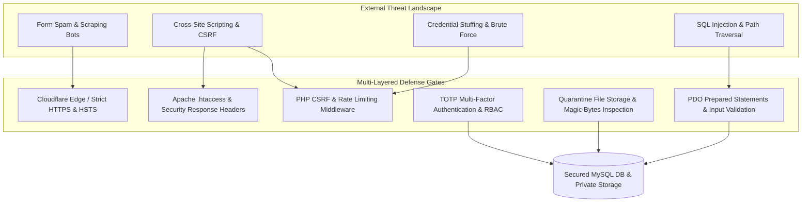
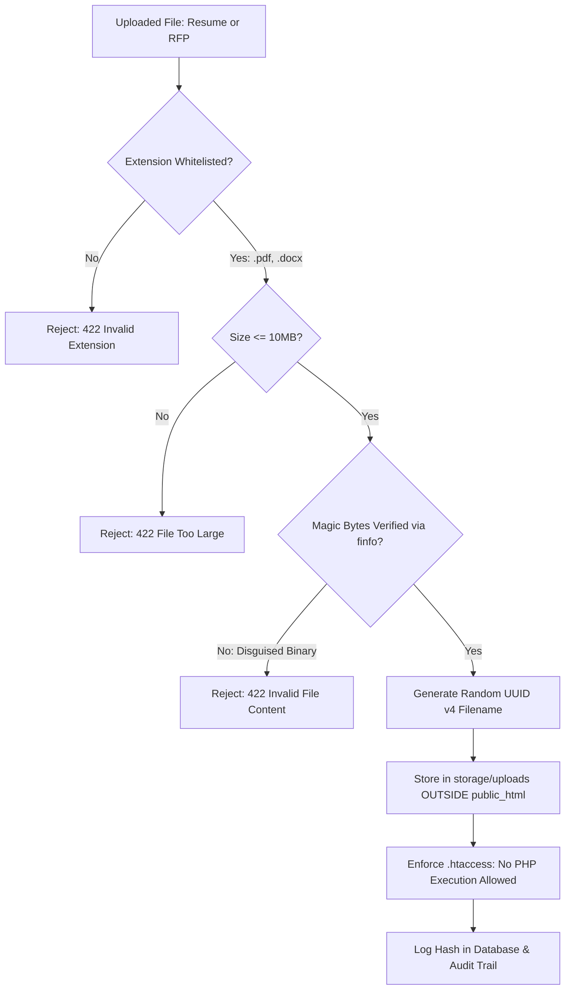

# Security & Privacy Baseline Architecture
## Enterprise Security Governance & OWASP ASVS v4.0.3 Compliance Specification

**Document Reference:** `docs/phase-00/10_SECURITY_AND_PRIVACY_BASELINE.md`  
**Phase:** Phase 0 — Project Requirements & Hosting Audit  
**Implementation Alignment:** Core Engine (Phases 4 & 6), Pentesting & Validation (Phase 30)  
**Baseline Standard:** OWASP Application Security Verification Standard (ASVS v4.0.3 Level 2)  
**Privacy Framework:** Australian Privacy Principles (Privacy Act 1988) & International B2B Data Standards  

---

### 1. Threat Modeling & Healthcare B2B Risk Profile

Because Voak Health Care engages with high-profile hospital networks, aged care providers, and institutional healthcare leadership, the digital platform must withstand targeted intrusion attempts while maintaining strict confidentiality over enterprise proposals and candidate resumes.



---

### 2. Authentication & Session Security (OWASP ASVS v4.0.3 V2 & V3)

| Security Control | Implementation Mechanism | Target Verification Standard |
| :--- | :--- | :--- |
| **Password Hashing** | `password_hash()` utilizing bcrypt (cost 12) or Argon2id. | Automated algorithm upgrade checks on every successful login. |
| **Brute-Force Rate Limiting** | Max 5 consecutive failed login attempts within 15 minutes triggers an immediate account lock. | Account unlocked via expiring email verification link or manual Super Admin intervention. |
| **Timing Attack Mitigation** | Authentication failures uniformly return generic `401 Unauthorized` (`"Invalid email or password."`) with simulated hash calculation time. | Zero discrepancy in response timing between existing and non-existing email addresses. |
| **Session Regeneration** | `session_regenerate_id(true)` invoked immediately upon successful privilege elevation or login. | Prevents session fixation attacks. |
| **Session Lifetime & Inactivity** | 15-minute inactivity timeout. Absolute session expiry forced at 8 hours. | Session tokens stored as SHA-256 hashes in `admin_sessions` table. |
| **Cookie Flags & Scope** | `HttpOnly; Secure; SameSite=Strict; Path=/api/admin; Max-Age=28800`. Restricted strictly to admin endpoints. | Complete immunity from JavaScript cookie extraction and cross-site leakage. |
| **Multi-Factor Authentication** | RFC 6238 Time-based One-Time Password (TOTP) with Google/Microsoft Authenticator. | Secrets encrypted at rest using AES-256-GCM. 8 emergency recovery codes hashed using `password_hash`. |

---

### 3. Cross-Site Request Forgery (CSRF) & Injection Defense (OWASP ASVS v4.0.3 V5)

#### A. CSRF Defense Architecture
- **Synchronizer Token Pattern:** A cryptographically strong, 256-bit random hex token is bound strictly to the user's active session.
- **Frontend Interceptor:** The React API client retrieves the token via `GET /api/admin/auth/csrf` and automatically injects it into the `X-CSRF-Token` header on all mutation requests (`POST`, `PUT`, `PATCH`, `DELETE`).
- **Validation Middleware:** Incoming requests are inspected before reaching controller logic:
```php
if (!hash_equals($_SESSION['csrf_token'], $requestHeaderToken)) {
    throw new ForbiddenException('CSRF token validation failed.', 'CSRF_INVALID');
}
```

#### B. SQL Injection Immunity
- **Mandatory PDO Prepared Statements:** All database interactions are strictly executed through parameter-bound PDO statements.
- **Zero Raw Interpolation:** Concatenating variables into SQL strings (e.g. `"SELECT * FROM users WHERE id = " . $id`) is strictly prohibited and flagged as a fatal error by automated linters.

---

### 4. Minimal Public Health vs. Protected Operational Telemetry

To eliminate information disclosure vulnerabilities (OWASP ASVS v4.0.3 V14.3):
- **Public Liveness Endpoint (`GET /api/health`):** Returns only `{ "status": "ok", "timestamp": "..." }`. It does **not** leak PHP versions, database names, server paths, or environment status.
- **Protected Diagnostics Endpoint (`GET /api/admin/system/diagnostics`):** Restricted to authenticated administrators with `system.diagnostics` permission and MFA verification.

---

### 5. File Upload Security & Document Quarantine (OWASP ASVS v4.0.3 V12)

Because the platform accepts candidate resumes (`/careers/:slug/apply`) and enterprise RFP tender briefs (`/request-proposal`), strict file upload security is non-negotiable:



- **MIME & Magic Bytes Inspection:** The server inspects the true binary signature of the file using PHP `finfo_file(FILEINFO_MIME_TYPE)`. Client-supplied `Content-Type` headers are never trusted.
- **Storage Isolation:** Files are written to `storage/uploads/` outside the web root. Public web visitors cannot access uploaded files directly via URL.
- **Authenticated Streaming Downloads:** Staff members download resumes and RFPs through an authenticated streaming controller that validates RBAC permissions before piping file bytes with `X-Content-Type-Options: nosniff`.

---

### 6. HTTP Security Response Headers (OWASP ASVS v4.0.3 V14)

The web server and PHP front controller emit the following hardened headers on all responses:

```apache
# Apache .htaccess Security Response Headers
<IfModule mod_headers.c>
    # Enforce strict HTTPS for 1 year including subdomains
    Header always set Strict-Transport-Security "max-age=31536000; includeSubDomains; preload"
    
    # Prevent MIME-type sniffing
    Header always set X-Content-Type-Options "nosniff"
    
    # Prevent clickjacking / iframe embedding
    Header always set X-Frame-Options "DENY"
    
    # Control referrer information leakage
    Header always set Referrer-Policy "strict-origin-when-cross-origin"
    
    # Restrict device sensor and camera access
    Header always set Permissions-Policy "camera=(), microphone=(), geolocation=()"
    
    # Content Security Policy (CSP)
    Header always set Content-Security-Policy "default-src 'self'; script-src 'self' 'unsafe-inline' https://challenges.cloudflare.com; style-src 'self' 'unsafe-inline' https://fonts.googleapis.com; font-src 'self' https://fonts.gstatic.com; img-src 'self' data: https:; connect-src 'self' https://challenges.cloudflare.com; frame-src https://challenges.cloudflare.com; object-src 'none';"
</IfModule>
```

---

### 7. Privacy Compliance & Data Governance

#### A. Australian Privacy Principles (Privacy Act 1988) Alignment
1. **APP 1 (Open & Transparent Management):** Clear, publicly accessible Privacy Policy (`/privacy-policy`) defining what B2B information is gathered and the legal purpose for processing.
2. **APP 3 (Collection of Solicited Information):** Only business contact details (name, organizational email, phone, corporate title) necessary to evaluate commercial partnership or candidate recruitment are collected.
3. **APP 11 (Security of Personal Information):** All candidate resumes and inquiries are encrypted in transit via TLS 1.3 and stored in protected non-public server partitions.

#### B. Explicit Non-Collection of Clinical Patient Records
> [!CAUTION]
> Voak Health Care operates exclusively as an operational and staffing service partner. The web platform is **strictly prohibited from accepting, storing, or indexing personal patient health records, diagnostic scans, Medicare claim numbers, or clinical health data**. Disclaimers are prominently displayed on all submission forms.
