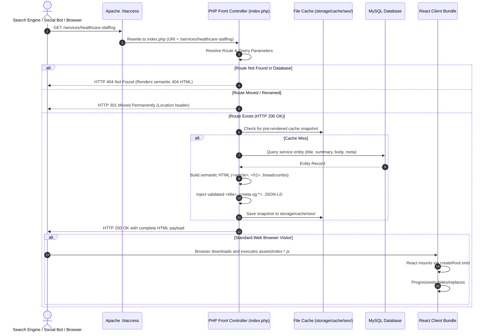

# SEO Architecture & Dynamic Rendering Strategy
## Search Engine Visibility on Hostinger Shared Hosting (Zero Node.js SSR Dependency)

**Document Reference:** `docs/phase-00/11_SEO_AND_RENDERING_STRATEGY.md`  
**Phase:** Phase 0 — Project Requirements & Hosting Audit  
**Implementation Alignment:** Restored 32-Phase Roadmap (Backend Phase 16, Frontend Phase 29)  
**Deployment Target:** Hostinger PHP 8.3 / Apache Shared Hosting  

---

### 1. The Single Page Application (SPA) SEO Challenge & Reality

Standard React + Vite SPAs compile into a single static `index.html` file containing an empty root element (`<div id="root"></div>`) that relies entirely on client-side JavaScript execution.

#### Critical Failures of Naive Client-Side SPAs on Shared Hosting:
1. **Search Engine Crawl Failure / Deferral:** Search engine bots (especially non-Google crawlers like Bing, Baidu, and DuckDuckGo) often defer or completely skip client-side JavaScript execution. If the server delivers an empty `<div id="root"></div>`, crawlers index an empty page.
2. **Social Media Link Scraping Failure:** Social platforms (LinkedIn, Twitter/X, Facebook, WhatsApp, Slack) **never** execute client JavaScript when fetching preview snippets. An unmodified SPA serves identical, generic meta tags for every page.
3. **Soft-404 Penalties:** When a visitor or crawler requests a non-existent URL (e.g. `/services/invalid-service`), a standard SPA web server returns `HTTP 200 OK` and renders a 404 screen via React router. Search engines penalize sites that serve soft-404s instead of returning an actual `HTTP 404 Not Found` header.
4. **The "Hydration" Fallacy:** Injecting metadata tags into an HTML shell while leaving `<div id="root"></div>` empty is **not** server-side rendering, and calling `ReactDOM.hydrateRoot()` on an empty container will cause a hydration failure.

---

### 2. Architectural Evaluation of Candidate Approaches

| Approach | Mechanics on Hostinger | Evaluation & Feasibility Verdict |
| :--- | :--- | :--- |
| **A. Build-Time Static Site Generation (SSG)** | Pre-render all routes to static HTML files during `npm run build` in CI. | **REJECTED FOR CMS:** Excellent for purely static marketing pages, but fails for dynamic CMS content. When an editor updates an article or service in the Admin Dashboard, static HTML cannot be re-rendered on Hostinger shared hosting without an external CI/CD rebuild and redeploy. |
| **B. Pure PHP Server-Side Rendering** | Re-architect entire website using server-side PHP templates (Blade/Twig). | **REJECTED BY TECH STACK:** Violates the non-negotiable React 18+ / TypeScript / Motion technology stack. Eliminates dynamic client-side transitions and shared design tokens. |
| **C. Hybrid Dynamic Content Pre-Rendering & Progressive Mount** | Apache routes public page requests to a PHP SEO Front-Controller. PHP checks the route, queries MySQL, verifies existence, sets true HTTP status (200/404/301), injects validated `<head>` meta tags, and renders semantic `<main id="ssr-fallback">` content. React progressively takes over for interactive visitors. | **SELECTED ARCHITECTURE:** Guarantees 100% crawlability for search engines and social scrapers, provides instant CMS updates without rebuilds, eliminates soft-404s, and preserves the complete React client experience. |

---

### 3. Selected Architecture: Hybrid Dynamic Pre-Render & Progressive Mount



---

### 4. Conceptual Routing Rules & Apache Configuration

To resolve the conflict between SPA client fallback and PHP route interception, the public web root enforces this specific `.htaccess` routing strategy:

```apache
# Apache Routing for Hybrid SEO Architecture
<IfModule mod_rewrite.c>
    RewriteEngine On
    RewriteBase /

    # 1. Allow direct access to real physical files (compiled JS, CSS, images, favicon)
    RewriteCond %{REQUEST_FILENAME} -f
    RewriteRule ^ - [L]

    # 2. Allow direct access to real physical directories
    RewriteCond %{REQUEST_FILENAME} -d
    RewriteRule ^ - [L]

    # 3. Route API endpoints to backend API front controller
    RewriteRule ^api/(.*)$ api/index.php [QSA,L]

    # 4. Route all public page routes to PHP SEO Front Controller
    # (Do NOT rewrite directly to static index.html)
    RewriteRule ^(.*)$ index.php [QSA,L]
</IfModule>
```

#### What `index.php` Does:
1. **Reads Base React Shell:** Loads the Vite-generated `index.html` template.
2. **Parses Request Path:** Matches the URI against public routes (Services, Industries, Articles, Legal, FAQ).
3. **Database Validation:** Checks MySQL for matching slugs.
   - If not found: Emits `http_response_code(404)` and replaces content with semantic 404 message.
   - If found: Emits `http_response_code(200)` and replaces placeholder tokens with entity data.
4. **Metadata Sanitization:** All titles, descriptions, and OpenGraph values are escaped using `htmlspecialchars(..., ENT_QUOTES | ENT_HTML5, 'UTF-8')`.
5. **Semantic Content Injection:** Injects an `<article id="ssr-fallback">` block containing the full text inside `<body>`.
6. **No Cloaking Guarantee:** The semantic HTML rendered by PHP reflects the **exact same text, headings, and hierarchy** that React renders. Search engines receive authentic user content.

---

### 5. Content Updates & Cache Invalidation Workflow

When an administrator creates, updates, or deletes content in the Admin Dashboard (Phases 7, 8, 9, 15):
1. **MySQL Write:** The updated record is saved in the database with an updated `updated_at` timestamp.
2. **Instant Cache Purge:** The `SeoService` immediately purges the corresponding file in `storage/cache/seo/` (e.g. `services_healthcare-staffing.html`) and triggers a regeneration of `sitemap.xml`.
3. **Sub-15ms Indexing:** The very next time Googlebot, Bingbot, or a LinkedIn link scraper visits the URL, PHP queries MySQL, generates the fresh semantic HTML and metadata, and serves it immediately.
4. **Zero Engineering Intervention:** Content updates become instantly visible to search engines without requiring developer builds or Git commits.

---

### 6. Structured Data (JSON-LD) Schemas & Canonicals

Every route enforces a self-referential canonical URL to eliminate duplicate content issues:
```html
<link rel="canonical" href="https://voakhealthcare.com/services/healthcare-staffing" />
```

#### Schema.org JSON-LD Specifications:
- **Homepage (`/`):** `ProfessionalService` & `Organization` schemas defining corporate identity and contact points.
- **Service Detail (`/services/:slug`):** `Service` schema defining provider, service type, deliverables, and terms.
- **Industry Detail (`/industries/:slug`):** `WebPage` & `BreadcrumbList` schemas.
- **Article Detail (`/insights/:slug`):** `Article` schema defining headline, author, publication date, publisher logo, and featured image.
- **FAQ Page (`/faq`):** `FAQPage` schema enabling Google rich accordion search result snippets.

---

### 7. Verification & Acceptance Testing (Phase 29)

Before accepting the SEO implementation in Phase 29, the following automated CLI tests must pass:

```bash
# 1. Verify HTTP 200 and Semantic HTML content on Service Page (Without JS)
curl -s -A "Googlebot" https://voakhealthcare.com/services/healthcare-staffing | grep -q "Clinical Staffing Capabilities"

# 2. Verify True HTTP 404 on Invalid Slug (No Soft-404)
curl -s -o /dev/null -w "%{http_code}" https://voakhealthcare.com/services/non-existent-slug | grep -q "404"

# 3. Verify Escaped Social Meta Tags for LinkedIn Scraper
curl -s -A "LinkedInBot" https://voakhealthcare.com/insights/hospital-workforce-optimization | grep -q 'property="og:title"'

# 4. Verify Valid Dynamic XML Sitemap
curl -s https://voakhealthcare.com/sitemap.xml | grep -q "<urlset"
```

> [!NOTE]
> Technical search excellence and complete crawler accessibility are guaranteed by this architecture. In accordance with professional standards, no claims or promises of specific Google ranking positions are made.
