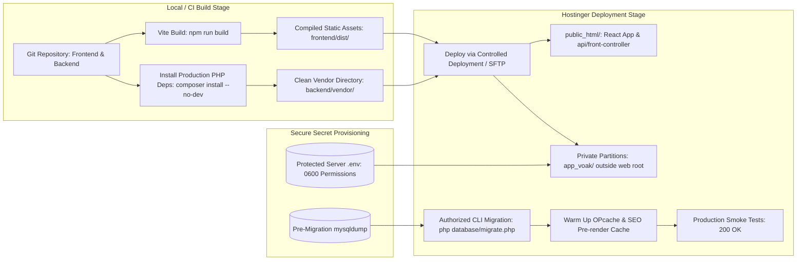

# Hostinger Production Deployment Strategy & Hardened Runbook
## Secure Deployment Architecture for Shared Hosting

**Document Reference:** `docs/phase-00/12_DEPLOYMENT_STRATEGY.md`  
**Phase:** Phase 0 — Project Requirements & Hosting Audit  
**Implementation Alignment:** Restored 32-Phase Roadmap (Final Acceptance in Phase 31)  
**Target Environment:** Hostinger CloudLinux Shared Hosting  

---

### 1. Build & Packaging Pipeline

Because Hostinger shared hosting does not run continuous Node.js processes or background build workers, the deployment pipeline executes the build phase **locally or in CI/CD**, producing an optimized, production-ready artifact package.



---

### 2. Hardened Secret Management Policy (Zero Secrets in Git)

> [!CAUTION]
> **Zero-Tolerance Secret Policy:**
> - NO database passwords in Git.
> - NO SMTP passwords in Git.
> - NO encryption keys in Git.
> - NO session secrets in Git.
> - NO default production administrator credentials.
> - NO hardcoded credentials in fallback files (e.g. `config/env.php` must NEVER contain fallback passwords).

#### Protected Secret Provisioning Strategy:
1. **Untracked Environment File:** Production secrets reside exclusively in an untracked `.env` file located **outside the public web root** at `/home/<ACCOUNT_USER>/app_voak/.env`.
2. **Strict File Permissions:** The `.env` file is set to permission `0600` (read and write only by the specific hosting system user).
3. **Deployment Exclusions (`.gitignore` & Deploy Filters):**
   ```gitignore
   # Sensitive configuration
   .env
   .env.*
   !.env.example
   
   # Storage & logs
   storage/logs/*.log
   storage/uploads/*
   storage/cache/*
   
   # Development files
   tests/
   docs/
   scratch/
   .git/
   ```
4. **Production Fail-Fast Validation:** At application boot, the configuration loader checks for mandatory production variables:
   - `DB_HOST`, `DB_NAME`, `DB_USER`, `DB_PASSWORD`
   - `APP_KEY` (32-byte hex for AES-256-GCM encryption)
   - `SESSION_SECRET`
   - `SMTP_HOST`, `SMTP_PORT`, `SMTP_USER`, `SMTP_PASSWORD`
   If any variable is missing, the application halts immediately with a generic HTTP 500 and logs an incident code to `storage/logs/error.log`. It **never** reveals missing variable names or paths in the HTTP response.
5. **Secret Rotation Runbook:**
   - Database credentials: Updated in Hostinger hPanel -> Updated in `/home/<ACCOUNT_USER>/app_voak/.env` -> OPcache purged.
   - Session keys: Rotating `SESSION_SECRET` invalidates all existing active admin sessions immediately.

---

### 3. Hostinger Directory Isolation Architecture

#### Primary Model: Dedicated Private Partition (Mandatory Target)
Private PHP application code, configuration secrets, and uploaded resumes reside **completely outside `public_html/`**:

```
/home/<ACCOUNT_USER>/
├── app_voak/                        <-- PRIVATE APP ROOT (Outside public_html)
│   ├── .env                         (Permissions 0600: DB & SMTP secrets)
│   ├── app/                         (Core, Controllers, Services, Repositories)
│   ├── config/                      (Application configs)
│   ├── database/                    (SQL migrations & CLI runner)
│   ├── storage/                     (Quarantined candidate resumes & client RFPs)
│   └── vendor/                      (Composer dependencies)
│
└── domains/
    └── <VOAK_DOMAIN>/
        └── public_html/             <-- PUBLIC WEB ROOT (Publicly accessible files only)
            ├── index.html           (React entry shell)
            ├── assets/              (Compiled Vite JS, CSS, WebP images)
            ├── favicon.ico
            ├── robots.txt
            ├── sitemap.xml
            ├── api/
            │   ├── index.php        (Front Controller requiring app_voak/app/Core/App.php)
            │   └── .htaccess        (Rewrites /api/* to index.php)
            └── .htaccess            (Public routing, security headers & compression)
```

#### Secondary Fallback: Co-Located Structure with Hardened `.htaccess`
If Hostinger Git auto-deployment forces the entire repository into `public_html/`:
- **Classification:** Classified as **less desirable** due to reliance on web server rewrite rules for security boundaries.
- **Enforcement:** A hardened `.htaccess` file blocks all access to private directories:
  ```apache
  RewriteRule ^(app|config|database|storage|vendor|tests|docs)/ - [F,L]
  RewriteRule (^\.env|\.git|\.htaccess|\.user\.ini) - [F,L]
  ```
- **Mandatory Negative Access Testing:** Deployment validation must execute negative curl checks verifying that `GET /.env` and `GET /config/database.php` return HTTP 403 Forbidden.

---

### 4. Database Migration Safety & Procedure

> [!WARNING]
> **MySQL DDL Implicit Commit Reality:**
> In MySQL, DDL statements (`CREATE TABLE`, `ALTER TABLE`, `DROP TABLE`) cause an **implicit commit** in the InnoDB storage engine. Arbitrary schema migrations **cannot** be rolled back with SQL `ROLLBACK` transactions. Therefore, "zero-downtime" and "atomic rollback" claims are false without strict deployment controls.

#### Hardened Migration Execution Standard:
1. **No Public Web Endpoint:** The previously proposed web migration URL (`/api/admin/system/migrate`) is completely eliminated. Migrations are executed strictly via an authorized CLI procedure (`php database/migrate.php`) through SSH or during controlled deployment pipeline execution.
2. **Migration Mutex Locking:** The migration runner checks `schema_migration_locks` or MySQL `GET_LOCK()` to prevent concurrent migration attempts.
3. **Mandatory Pre-Migration Database Snapshot:** Prior to executing any schema change, an automated snapshot is created:
   ```bash
   mysqldump -u <DB_USER> -p<DB_PASS> -h 127.0.0.1 <DB_NAME> > storage/backups/pre_migrate_$(date +%Y%m%d_%H%M%S).sql
   ```
4. **Additive, Forward-Compatible DDL:**
   - Migrations add new tables or nullable columns first.
   - Column renaming or dropping is strictly deferred until code utilizing the old schema has been completely deprecated and phased out.
5. **Idempotency & History:** The `schema_migrations` table records executed migration files, batch numbers, SHA-256 checksums, and execution times.
6. **Rollback & Recovery Procedure:** If a DDL migration fails:
   - The runner halts immediately, logs the failing query, and outputs the exact recovery command.
   - Recovery is performed by restoring the pre-migration snapshot:
     ```bash
     mysql -u <DB_USER> -p<DB_PASS> -h 127.0.0.1 <DB_NAME> < storage/backups/pre_migrate_<TIMESTAMP>.sql
     ```

---

### 5. Production Smoke Test Matrix (Phase 31 Acceptance)

Immediately following production deployment, the following automated checks must be executed:

| Test ID | Target URL / Command | Expected Response | Security & Functional Gate |
| :---: | :--- | :---: | :--- |
| **SMK-001** | `GET https://{domain}/api/health` | `200 OK` | Minimal `{ "status": "ok" }`. No PHP version or DB details. |
| **SMK-002** | `GET https://{domain}/api/admin/auth/csrf` | `200 OK` | Valid 64-char CSRF token; HttpOnly SameSite=Strict cookie set. |
| **SMK-003** | `GET https://{domain}/services/healthcare-staffing` | `200 OK` | Returns semantic HTML with `<article>` and valid Schema.org JSON-LD. |
| **SMK-004** | `GET https://{domain}/services/non-existent-service` | `404 Not Found` | True HTTP 404 header (verifies soft-404 elimination). |
| **SMK-005** | `GET https://{domain}/.env` | `403 Forbidden` | Negative-access test: verifies `.env` cannot be read via HTTP. |
| **SMK-006** | `GET https://{domain}/config/database.php` | `403 Forbidden` | Negative-access test: verifies private code is inaccessible. |
| **SMK-007** | `GET https://{domain}/storage/uploads/` | `403 Forbidden` | Negative-access test: verifies uploaded resumes cannot be browsed. |
| **SMK-008** | `GET https://{domain}/sitemap.xml` | `200 OK` | Valid XML syntax with all dynamic routes and correct priorities. |
