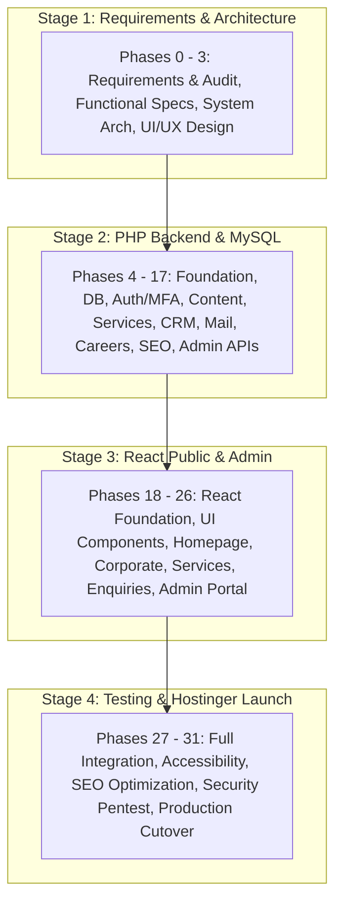

# Complete 32-Phase Roadmap Traceability & Governance
## Master Engineering Sequence (Phase 0 Through Phase 31)

**Document Reference:** `docs/phase-00/13_COMPLETE_32_PHASE_TRACEABILITY.md`  
**Phase:** Phase 0 — Project Requirements & Hosting Audit  
**Governance Standard:** Restored Original 32-Phase Numbering & Scope  

---

### 1. High-Level Stage Governance

> [!IMPORTANT]
> **Strict Governance Rule:** Roadmap numbering preserves the exact originally agreed definitions (Phases 0 through 31). Only **Phase 0** is currently active. Development of future phases will proceed sequentially upon client acceptance.

---

### 2. Comprehensive 32-Phase Traceability Matrix

#### STAGE 1: REQUIREMENTS, ARCHITECTURE AND DESIGN (PHASES 0–3)

| Phase | Phase Title | Core Objectives & Deliverables | Dependencies | Acceptance Criteria & Verification Gate |
| :---: | :--- | :--- | :--- | :--- |
| **0** | **Project Requirements & Hosting Audit** | Establish foundational project charter, BRD, empirical Hostinger hosting audit, unverified assumptions catalog, and 18-document foundation suite. | Initial User Request | Complete 18-document suite in `docs/phase-00/`, live Hostinger audit verified, no premature code written. **[CURRENT ACTIVE PHASE]** |
| **1** | **Complete Functional Specification** | Detailed functional specifications for all 22 public pages and 19 admin modules, user story mapping, form validation schemas, and edge case rules. | Phase 0 | Formal sign-off on functional specification catalog; zero ambiguous requirements. |
| **2** | **System Architecture** | Full system design specifications, request lifecycles, modular PHP architecture, database domain models, API envelopes, and directory partition isolation. | Phase 1 | Architectural design review sign-off; negative-access rules specified; API response contracts validated. |
| **3** | **Professional UI/UX Design** | Design system tokenization (colors, typography, spacing, radius), WCAG 2.2 AA contrast matrix, comprehensive wireframes, bento-grid layouts, and master UI component specifications adhering to approved second image reference. | Phase 2 | Design token CSS compiled; contrast verified via automated test; wireframes for 22 pages and 19 admin modules approved. |

---

#### STAGE 2: PHP BACKEND, MYSQL, APIS AND SECURITY (PHASES 4–17)

| Phase | Phase Title | Core Objectives & Deliverables | Dependencies | Acceptance Criteria & Verification Gate |
| :---: | :--- | :--- | :--- | :--- |
| **4** | **PHP Backend Foundation** | Lightweight PSR-aligned PHP router, Request/Response abstractions, CORS, security headers, production fail-fast environment loaders, and minimal `GET /api/health` endpoint. | Phase 2 | `GET /api/health` returns `{ "status": "ok" }` without leaking PHP version; fail-fast triggers tested. |
| **5** | **MySQL Database** | Idempotent CLI migration runner (`php backend/cli/migrate.php`), schema definitions for all 28 relational tables (reconciled from early 20-table roadmap estimate per Phase 2 architecture), migration mutex locking, preflight checks, and pre-migration backup protocols. | Phase 4 | Migrations run up and rollback cleanly on local MySQL 8.x; zero foreign key errors; DDL implicit commit handling verified. |
| **6** | **Admin Authentication & Security** | Admin login endpoint, bcrypt password hashing (cost 12), brute-force rate limiting (5 attempts = 15m lockout), CSRF synchronizer tokens, secure cookies (`SameSite=Strict`), and RFC 6238 TOTP MFA with AES-256-GCM secret encryption. | Phase 5 | Automated integration tests prove invalid passwords rejected; rate limiter locks IP after 5 attempts; TOTP challenge verified. |
| **7** | **Website Content Management** | Backend CMS APIs and storage for static corporate pages (About Us, Why Choose Voak, How We Work), homepage hero copy, and site settings. | Phase 6 | Admin content CRUD endpoints operate with version history; unauthenticated requests rejected. |
| **8** | **Services Management** | REST CRUD endpoints for the 6 proposed service pillars: slug generation, category assignment, ordering, and publishing toggles. | Phase 6 | Public endpoints return published services; admin endpoints permit CRUD with audit logging. |
| **9** | **Industries Management** | REST CRUD endpoints for the 6 customer industry verticals: challenges, solutions, custom SVG iconography, and ordering. | Phase 6 | Public endpoints return industry verticals; admin endpoints allow full content curation. |
| **10** | **Media & Document Management** | Secure file upload handler, automated WebP image conversion, magic bytes MIME verification via `finfo`, alt-text enforcement, and quarantined storage outside `public_html/`. | Phase 5 | Disguised executable files rejected; images converted to WebP with proper permissions. |
| **11** | **Contact Enquiry Management** | General contact submission endpoint (`POST /api/enquiries/contact`), triage status CRM (`New`, `In Progress`, `Qualified`), internal notes, and CSV export. | Phase 6 | Submissions generate DB records, calculate unique reference IDs, and trigger notifications. |
| **12** | **Partnership & Proposal Management** | Enterprise partnership intake and high-touch Request for Proposal (RFP) workflow with tender document attachment and authenticated streaming download. | Phase 10 | Attached client RFPs stored in quarantined partition; download requires valid admin session. |
| **13** | **Email Notification System** | Socket-based authenticated SMTP transport (PHPMailer / native socket) dispatching client confirmations and staff alerts with dynamic HTML templates. | Phase 11, 12 | Mock SMTP test dispatches email notifications within 800ms of form submission. |
| **14** | **Careers & Recruitment** | Job posting management, applicant intake endpoint (`POST /api/careers/:slug/apply`), encrypted resume storage, and authenticated streaming downloads. | Phase 10 | Candidate application persists in DB; resume stored outside web root; streaming download verified. |
| **15** | **Resources & Corporate Content** | Insights article CMS backend, rich text / Markdown storage, tag taxonomy, reading time calculation, case studies, and FAQ management. | Phase 6 | Full CRUD on articles and FAQs; published articles queryable via public API with pagination. |
| **16** | **SEO Management Backend** | Dynamic meta tag injection logic, canonical URLs, XML sitemap generation engine, cache invalidation hooks, and robots.txt. | Phase 8, 9, 15 | Sitemaps reflect live published content; semantic HTML fallback generated for crawlers. |
| **17** | **Administration, Auditing & API Verification** | Immutable audit logging service recording all admin mutations, logins, and downloads; protected diagnostics endpoint (`GET /api/admin/system/diagnostics`); comprehensive backend API verification. | Phase 6-16 | Every admin write operation generates a valid row in `audit_logs` table; 100% of backend tests pass. |

---

#### STAGE 3: REACT PUBLIC FRONTEND AND ADMIN DASHBOARD (PHASES 18–26)

| Phase | Phase Title | Core Objectives & Deliverables | Dependencies | Acceptance Criteria & Verification Gate |
| :---: | :--- | :--- | :--- | :--- |
| **18** | **React Foundation** | Initialize React 18+ / TypeScript project with Vite, configure Tailwind CSS with Phase 3 design tokens, establish root routing shell, and configure API client with CSRF interceptor. | Phase 3 | `npm run build` succeeds cleanly; base layout renders; API client attaches CSRF tokens. |
| **19** | **Complete UI Component System** | Master component library: Buttons, inputs, bento cards, badges, accordions, modals, navigation header, and corporate footer with Motion micro-interactions. | Phase 18 | Components documented and tested; keyboard navigation focus traps operate; reduced-motion compliant. |
| **20** | **Full Professional Homepage** | Implement approved homepage: Asymmetrical hero layout, bento-grid service cards, operational capability indicators, and primary purple CTA ribbon matching approved 2nd image reference. | Phase 19, 8 | Visual fidelity matches approved design reference; micro-animations honor reduced-motion settings. |
| **21** | **Corporate Information Pages** | Implementation of About Us, Why Choose Voak, How We Work, and Quality & Compliance pages with responsive typography and governance timelines. | Phase 19, 7 | Responsive layout; cards render cleanly on mobile, tablet, and desktop viewports. |
| **22** | **Services & Industries Pages** | Filterable services catalog, dynamic service detail pages (`/services/:slug`), industries overview, and sector pages (`/industries/:slug`). | Phase 19, 8, 9 | Dynamic routing operates smoothly; client-side search and category filtering response < 50ms. |
| **23** | **Business Enquiry Pages** | Interactive forms for Contact Us, Partner With Us, and the multi-step Request a Proposal (RFP) workflow with drag-and-drop document uploader. | Phase 19, 11, 12 | Forms integrate with backend APIs, show real-time validation errors, and display instant success states. |
| **24** | **Remaining Public Pages** | Careers portal, Job details & application flow, Insights blog feed, Article detail, FAQ accordion, Case Studies index, Privacy Policy, Terms, and custom 404/500 error boundaries. | Phase 19, 14, 15 | All remaining public pages render cleanly; error boundaries catch broken routes with HTTP 404 headers. |
| **25** | **React Admin Dashboard** | Admin portal application shell: Layout, sidebar navigation, admin auth login screen, MFA challenge modal, and executive KPI overview widgets. | Phase 6, 19 | Super Admin can sign in, complete MFA, and view real-time inquiry metrics. |
| **26** | **Complete Admin Operations** | Complete operational screens: Proposal review desk, Enquiry triage, Job applicant review, Media library manager, Content CMS, SEO settings, and Audit log viewer. | Phase 7-17, 25 | All 19 admin modules fully functional with role-based permission enforcement. |

---

#### STAGE 4: INTEGRATION, ACCESSIBILITY, SEO, SECURITY, TESTING AND HOSTINGER DEPLOYMENT (PHASES 27–31)

| Phase | Phase Title | Core Objectives & Deliverables | Dependencies | Acceptance Criteria & Verification Gate |
| :---: | :--- | :--- | :--- | :--- |
| **27** | **Complete End-to-End Integration** | Full-stack integration connecting React public and admin apps to live backend APIs; automated Playwright user journeys; global error handling and toast notifications. | Phase 17, 26 | Automated Playwright test executes end-to-end user journeys from proposal submission to admin triage. |
| **28** | **Responsive & Accessibility Audit** | Automated axe-core auditing, manual screen reader navigation, keyboard tab order verification, and Core Web Vitals optimization (LCP < 2.5s, CLS < 0.1). | Phase 27 | Lighthouse Accessibility score >= 95; zero contrast or ARIA violations; LCP < 1.5s on mobile. |
| **29** | **SEO & Performance Optimisation** | Production pre-rendering verification, JSON-LD schema testing, bundle splitting, asset compression (Gzip/Brotli), and dynamic sitemap validation. | Phase 27 | Google Rich Results Test validates Organization, Service, Article, and FAQ schemas without warnings. |
| **30** | **Security & Production Readiness** | Dynamic Application Security Testing (DAST), SQLi/XSS injection fuzzing, CSRF validation, rate limit exhaustion, negative-access tests on `.env` and `/config/`, and OWASP ASVS v4.0.3 Level 2 sign-off. | Phase 27 | Zero high or medium severity findings; negative access tests return HTTP 403; fail-fast verified. |
| **31** | **Hostinger Deployment & Final Acceptance** | Package production bundle, deploy to Hostinger shared hosting, run authorized CLI migrations, configure SSL, perform live smoke tests, and execute client handover. | Phase 28-30 | Live production website online; all smoke tests pass; admin portal accessible; client handover complete. |
