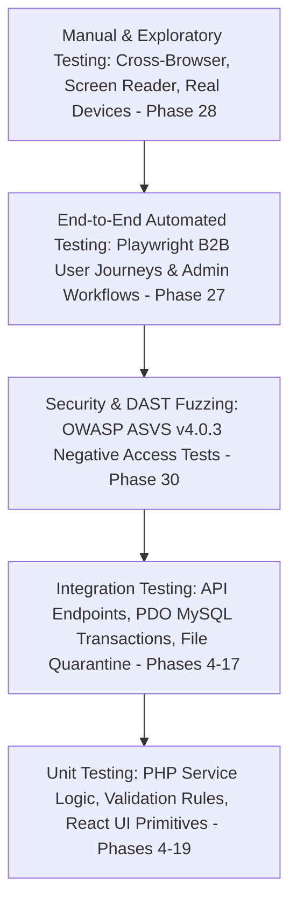

# Quality Assurance, Testing & Acceptance Strategy
## Multilayered Verification Standards for Production Readiness

**Document Reference:** `docs/phase-00/14_TESTING_AND_ACCEPTANCE_STRATEGY.md`  
**Phase:** Phase 0 — Project Requirements & Hosting Audit  
**Implementation Alignment:** Restored 32-Phase Roadmap (Audits in Phases 27–31)  
**Acceptance Principle:** A phase is never accepted on code generation alone; empirical verification is mandatory.  

---

### 1. The Quality Assurance Pyramid



---

### 2. Testing Levels & Tooling Framework

| Testing Layer | Target Scope | Primary Tooling | Pass / Acceptance Standard |
| :--- | :--- | :--- | :--- |
| **Backend Unit & Service Testing** | Data validation, authentication logic, TOTP encryption, password hashing, mail interpolation. | **PHPUnit 10+** | 100% pass rate across all test cases. Minimum 85% code coverage on core domain services. |
| **Frontend Unit & Component Testing** | Bento card rendering, button states, form input masks, date helpers, custom hooks. | **Vitest / React Testing Library** | Zero console errors, clean snapshot/DOM assertion matches. |
| **API Integration Testing** | HTTP request/response envelopes, CSRF middleware validation, rate limiting, PDO prepared statements. | **PHPUnit / Postman CLI / curl** | All public and admin endpoints return expected status codes and schema structures against test DB. |
| **End-to-End (E2E) Browser Testing** | Complete B2B user journeys: Proposal submission, resume attachment, admin login, CMS publishing. | **Playwright** | Automated browser execution succeeds headlessly across Chromium, Firefox, and WebKit (mobile & desktop). |
| **Accessibility (A11y) Auditing** | WCAG 2.2 AA compliance, color contrast, keyboard tab order, ARIA attributes, focus traps. | **axe-core / Lighthouse / WAVE** | Lighthouse Accessibility score >= 95. Zero critical or serious axe-core violations. Normal text >= 4.5:1. |
| **Performance & Core Web Vitals** | Page load speed, script execution latency, Cumulative Layout Shift, image optimization. | **Google Lighthouse / WebPageTest** | LCP < 2.5s, INP < 200ms, CLS < 0.1 on emulated mobile 4G networks. |
| **Security & Pentesting** | OWASP Top 10 vulnerabilities, SQL injection, XSS escaping, CSRF bypass, negative access tests. | **OWASP ZAP / Custom SAST & DAST** | Zero high or medium severity vulnerabilities discovered. Negative access returns HTTP 403. |

---

### 3. Detailed Verification Scenarios for Critical Workflows

#### A. Enterprise Proposal Submission (`/request-proposal` — Phase 23 / 27)
1. **Scenario 1 (Valid Submission with RFP PDF):**
   - User completes all required fields and uploads a valid 4MB `.pdf` document.
   - **Verification:** System accepts upload, validates magic bytes, writes PDF to non-public `storage/uploads/`, generates DB record with unique reference ID (`RFP-2026-xxxx`), dispatches SMTP alert, and renders confirmation message with calendar booking link.
2. **Scenario 2 (Malicious File Masking):**
   - User attempts to upload an executable `.exe` or `.php` file disguised with a `.pdf` extension.
   - **Verification:** PHP `finfo` detects executable magic bytes, rejects request with `422 Unprocessable Entity`, deletes temporary file, and logs security incident in `audit_logs`.
3. **Scenario 3 (Rate Limiting Exhaustion):**
   - Automated script submits proposal form 15 times within 5 minutes.
   - **Verification:** System throttles requests after 5 submissions, returning `429 Too Many Requests` with `Retry-After` header.

#### B. Administrative Authentication & MFA Workflow (Phase 6 / 25 / 27)
1. **Scenario 1 (Brute-Force Account Lockout):**
   - Attacker enters 5 consecutive incorrect passwords for `admin@voakhealthcare.com`.
   - **Verification:** Account is locked for 15 minutes. 6th attempt returns `401 Unauthorized` without querying password hash. Audit log records `AUTH_LOCKOUT` event with source IP.
2. **Scenario 2 (TOTP Multi-Factor Verification):**
   - Valid credentials entered; system requests 6-digit TOTP code.
   - **Verification:** Invalid code rejected. Valid code issues secure session cookie with `SameSite=Strict`, `HttpOnly`, `Secure` flags.

#### C. Database Migration Safety & Recovery (Phase 5)
1. **Scenario 1 (Concurrent Execution Lock):**
   - Attempting to run `php database/migrate.php` concurrently from two sessions.
   - **Verification:** Second process fails immediately with `"Migration runner locked by another process"`.
2. **Scenario 2 (DDL Failure & Snapshot Restore):**
   - Intentionally faulty SQL syntax injected into a test migration.
   - **Verification:** Runner detects failure, outputs failed statement, halts, and restores database state using the pre-migration snapshot without leaving corrupt intermediate state.

#### D. Security Negative-Access Testing (Phase 30)
1. **Scenario 1 (Direct Environment Secret Access):**
   - Executing `curl -i https://{domain}/.env`.
   - **Verification:** Server must return `HTTP 403 Forbidden` or `HTTP 404 Not Found`. Never `200 OK`.
2. **Scenario 2 (Direct Sensitive Directory Traversal):**
   - Executing `curl -i https://{domain}/config/database.php` and `curl -i https://{domain}/storage/uploads/`.
   - **Verification:** Server must return `HTTP 403 Forbidden`.

---

### 4. Non-Functional Quality Thresholds (Phase Acceptance Gates)

Before any phase is marked as accepted, the engineering team must satisfy the following quantified benchmarks:

```
[+] WCAG 2.2 Level AA Compliance (Phase 28):
    - Minimum 4.5:1 text-to-background contrast for all body paragraphs.
    - Minimum 3.0:1 contrast for UI controls and graphical objects.
    - All interactive elements accessible via Tab, Shift+Tab, Enter, and Space keys.

[+] Core Web Vitals (Target: Desktop & Mobile - Phase 28 / 29):
    - Largest Contentful Paint (LCP): <= 2.2 seconds
    - Interaction to Next Paint (INP): <= 150 milliseconds
    - Cumulative Layout Shift (CLS): <= 0.05
    - First Contentful Paint (FCP): <= 1.0 second

[+] Code Quality & Static Analysis (Phases 4-26):
    - PHPStan level 8 static analysis on backend codebase (zero errors).
    - TypeScript strict mode enabled (noImplicitAny: true, strictNullChecks: true).
    - ESLint with zero warnings on production builds.
```
