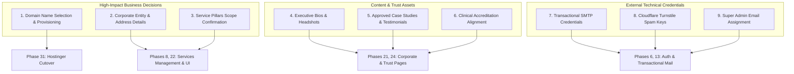

# Unverified Assumptions, External Dependencies & Action Plan
## Comprehensive Catalog of Pending Business Inputs

**Document Reference:** `docs/phase-00/15_UNVERIFIED_ASSUMPTIONS_AND_BLOCKERS.md`  
**Phase:** Phase 0 — Project Requirements & Hosting Audit  
**Implementation Alignment:** Restored 32-Phase Roadmap Dependencies  
**Governance Principle:** Never invent company capabilities, credentials, or client endorsements.  

---

### 1. Executive Summary of Open Items

To maintain absolute institutional integrity, the engineering team has cataloged all unverified business attributes, external service dependencies, and operational assumptions. 

Each item is categorized with its **Impact Level**, **Blocking Phase**, **Responsible Owner**, and **Exact Resolution Action Required**.



---

### 2. Comprehensive Open Items & Blockers Registry

| Item ID | Category | Item Description | Impact & Blocking Phase | Current Working Assumption | Action Required to Resolve | Owner |
| :---: | :--- | :--- | :--- | :--- | :--- | :--- |
| **BLK-001** | Infrastructure | **Production Domain Selection & Provisioning** | **High**  <br>Blocks Phase 31 (Deploy) & Phase 16/29 (SEO) | The project assumes a domain such as `voakhealthcare.com` or `voakhealth.com.au` will be provisioned on Hostinger. (Account holds 1 unassigned free domain credit). | Select final domain, register/claim in Hostinger hPanel, and configure DNS A-records pointing to server IP. | Client / Executive Lead |
| **BLK-002** | Corporate Legal | **Registered Corporate Entity & Physical Address** | **Medium**  <br>Blocks Phase 7 / 21 (Legal & Contact) | Assumes "Voak Health Care" is the trading name, operating primarily in regional B2B healthcare markets. | Provide exact legal company name (e.g. Voak Health Care Pty Ltd), registration number, registered office address, and contact phone. | Client Legal / Operations |
| **BLK-003** | Commercial | **Confirmation of 6 Proposed Service Pillars** | **High**  <br>Blocks Phase 8 (Services DB) & Phase 22 (Services UI) | The 6 proposed pillars (Staffing, Operations, Administration, Facilities, Consulting, Compliance) are working hypotheses based on B2B healthcare market standards. | Confirm whether all 6 pillars are active at launch, or if certain services should be phased or renamed. | Managing Director |
| **BLK-004** | Trust & Proof | **Client Case Studies, Metrics & Testimonials** | **Medium**  <br>Blocks Phase 15 & Phase 24 (Social Proof) | Anonymized case study placeholders and metric frameworks have been designed. | Provide real, approved institutional case study metrics and signed testimonial releases. | BD / Marketing Lead |
| **BLK-005** | Content & Team | **Executive Leadership Team Profiles** | **Low**  <br>Blocks Phase 21 (About Us) | Layout supports 4-6 executive profiles with titles and LinkedIn links. | Provide names, official executive titles, professional headshot photographs, and short bios. | HR / Executive Team |
| **BLK-006** | Compliance | **Accreditation & Clinical Governance Frameworks** | **Medium**  <br>Blocks Phase 7 & Phase 21 (Compliance Page) | Assumes alignment with regional healthcare standards (e.g. NSQHS, RACGP, or Aged Care Quality Standards). | Specify exact accreditation bodies, certification standards, or ISO frameworks Voak complies with or audits against. | Clinical Governance Director |
| **BLK-007** | Infrastructure | **Transactional Email SMTP Service Credentials** | **High**  <br>Blocks Phase 13 (Email Dispatch) | Shared hosting `mail()` is disabled. Requires external SMTP host (e.g., Zoho Mail, Hostinger Business Mail, SendGrid). | Provision corporate email mailbox, generate SMTP credentials, and configure SPF/DKIM in DNS. | Technical / Hosting Admin |
| **BLK-008** | Security | **Cloudflare Turnstile Anti-Spam API Keys** | **Medium**  <br>Blocks Phase 23 (Public Forms) | Modern CAPTCHA-less bot defense to protect proposal and contact forms without frustrating executives. | Register domain in Cloudflare Turnstile dashboard; provide Site Key (public) and Secret Key (backend). | Lead Architect |
| **BLK-009** | Administration | **Initial Super Administrator Account Credentials** | **Low**  <br>Blocks Phase 6 (Auth Seeding) | Local development will use a temporary seed with forced password change upon first login. | Designate primary executive email address to receive initial Super Admin credentials and MFA activation key. | Executive Lead |

---

### 3. Immediate Action Plan & Resolution Timeline (Restored Roadmap)

```
Milestone 1 (Prior to Phase 4 - Backend Kickoff):
  [ ] Client resolves BLK-007 (SMTP Mailer setup)
  [ ] Client resolves BLK-009 (Super Admin email designation)

Milestone 2 (Prior to Phase 8 - Services Management Kickoff):
  [ ] Client confirms BLK-003 (6 Service Pillars verification)
  [ ] Client confirms BLK-002 (Corporate entity & legal disclosures)

Milestone 3 (Prior to Phase 18 - React Frontend Kickoff):
  [ ] Client provides BLK-004 & BLK-005 (Case studies, team headshots)
  [ ] Technical team registers BLK-008 (Cloudflare Turnstile keys)

Milestone 4 (Prior to Phase 31 - Production Cutover):
  [ ] Client finalizes BLK-001 (Production domain mapping in Hostinger)
```
