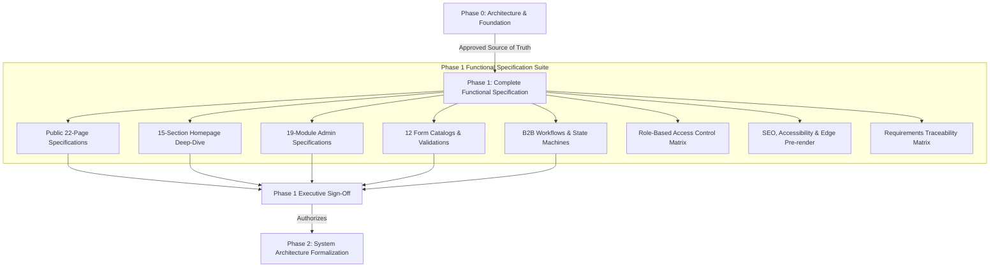

# Phase 1: Executive Summary & Specification Charter
## Voak Health Care — Full B2B Healthcare Services Corporate Platform

**Document Reference:** `docs/phase-01/00_PHASE_1_EXECUTIVE_SUMMARY.md`  
**Phase:** Phase 1 of 31 — Complete Functional Specification  
**Author:** Principal Enterprise Software Architect & Engineering Council  
**Baseline Authority:** Approved Phase 0 Foundation Documentation Suite (`docs/phase-00/`)  
**Status:** Complete for Phase 1 Review  

---

### 1. Executive Purpose & Scope

Phase 1 elevates the verified architectural foundation established in Phase 0 into a **complete, unambiguous, implementation-ready functional specification** for the entire **Voak Health Care** digital platform.

The specifications authored in Phase 1 define the exact expected behaviors, data constraints, validation rules, state machines, and user experience flows for:
1. **Public B2B Healthcare Website:** 22 complete public pages and interactive components designed to educate healthcare executives and convert enterprise inbound inquiries.
2. **Administrative Management Portal:** 19 secure modules providing content management, inquiry triage, proposal workflow tracking, job applicant review, and system auditing.
3. **Enterprise Inbound Workflows:** Comprehensive state machines for General Inquiries, Strategic Partnerships, and high-touch Requests for Proposals (RFPs).
4. **Backend REST Contracts & Data Schemas:** Functional data mapping for 20 relational database tables and 30+ versioned REST endpoints.
5. **Security, Privacy & SEO Baseline:** Enforcing OWASP ASVS v4.0.3 Level 2, Australian Privacy Principles (APPs), and hybrid semantic pre-rendering on Hostinger shared hosting.

---

### 2. Strict Governance Boundaries & Anti-Goals

> [!IMPORTANT]
> **Phase 1 Boundary Rule:** Phase 1 is strictly a **functional specification phase**. 
> - No application feature code is generated in Phase 1.
> - Phase 2 (System Architecture) will NOT be initiated until Phase 1 is formally reviewed and accepted.
> - Zero modifications have been or will be made to the user's existing production websites (`atspecialists.com.au`, `healthonus.com.au`, `physiocareandrehabservices.com.au`).
> - No live deployment or database modifications are performed in this phase.

#### Strict Non-Goals (Explicit Exclusions):
1. **NOT an Electronic Medical Record (EMR) or Health Record (EHR) System:** The platform does not capture, store, or process clinical patient health histories, prescriptions, or diagnostic scans.
2. **NOT a Patient Appointment Booking Portal:** The public cannot book doctor or specialist appointments.
3. **NOT a Patient Health Portal:** No patient login, medical record retrieval, or personal health triage is supported.
4. **NOT a Telehealth Video Platform:** Telemedicine video conferencing and virtual consultations are strictly out of scope.
5. **No Invented Business Claims:** All 6 proposed service pillars remain marked as configurable proposals (`[PROPOSED / UNCONFIRMED]`). Zero fabricated statistics, client testimonials, partner logos, or corporate addresses are represented as facts.

---

### 3. Preserved Non-Negotiable Technology Stack

The technology stack agreed in Phase 0 remains strictly preserved:

| Subsystem | Preserved Technology | Architectural Execution Model |
| :--- | :--- | :--- |
| **Public Frontend** | **React 18+ / TypeScript / Vite** | Component-driven architecture with client-side routing, optimized for Core Web Vitals. |
| **Styling** | **Tailwind CSS** | Custom design tokens formalized in Phase 3 based on approved Phase 0 palette. |
| **Micro-Animations** | **Motion for React** (`framer-motion`) | Subtle, accessible animations respecting `prefers-reduced-motion`. |
| **Admin Frontend** | **React + TypeScript** | Dedicated administrative application sharing design tokens and TypeScript schemas. |
| **Backend Engine** | **PHP 8.3+** | Lightweight, modular Service-Repository architecture running natively on Hostinger shared hosting. |
| **Database Engine** | **MySQL 8.x** | Relational storage via local loopback (`127.0.0.1:3306`) with CLI migrations and mutex locking. |
| **API Protocol** | **Versioned REST API (`/api/`)** | Standard JSON envelopes, CSRF synchronizer tokens, and rate limiting. |
| **Production Hosting** | **Hostinger Shared Hosting** | Static React build + Apache mod_rewrite + PHP API. Zero production Node.js daemon dependency. |

---

### 4. Preserved Design Authority

The visual direction remains governed by the **approved second generated homepage design reference**:
- **Palette:** Soft lavender canvas (`#F2F0F8`), blush pink (`#EEAFD7`), buttercup yellow (`#FBDC62`), mint green (`#54CB96`), sky blue (`#63A5E6`), royal purple CTA (`#665CE9`), deep plum/navy text (`#252B5E`), and mathematically verified muted text (`#50567A` yielding 6.30:1 contrast).
- **Layout:** Bento-grid service cards, rounded containers (`rounded-3xl`), generous 8px spacing rhythm, asymmetrical balance.
- **Typography:** Expressive editorial serif headlines (`Fraunces` / `Playfair Display`) paired with clean geometric sans-serif body typography (`Plus Jakarta Sans` / `Inter`).
- **Imagery:** Authentic, collaborative healthcare professionals rather than generic, empty hospital corridors.

---

### 5. Restored 32-Phase Roadmap Traceability

Phase 1 maintains the exact, originally agreed 32-phase sequence (Phases 0 through 31):
- **Stage 1: Requirements, Architecture and Design (Phases 0–3)**
  - Phase 0: Project Requirements & Hosting Audit `[ACCEPTED]`
  - Phase 1: Complete Functional Specification `[CURRENT ACTIVE PHASE]`
  - Phase 2: System Architecture
  - Phase 3: Professional UI/UX Design
- **Stage 2: PHP Backend, MySQL, APIs and Security (Phases 4–17)**
  - Phases 4 to 17: Foundation, DB, Auth, Content, Services, Industries, Media, CRM, Proposals, Email, Careers, Resources, SEO Backend, and Auditing.
- **Stage 3: React Public Frontend and Admin Dashboard (Phases 18–26)**
  - Phases 18 to 26: React Foundation, UI Components, Homepage, Corporate Pages, Services/Industries, Inbound Pages, Remaining Pages, Admin Dashboard, and Complete Operations.
- **Stage 4: Integration, Accessibility, SEO, Security, Testing and Hostinger Deployment (Phases 27–31)**
  - Phases 27 to 31: Full Integration, Accessibility/Responsiveness, SEO Performance, Security Pentest, and Hostinger Deployment Acceptance.

---

### 6. Phase 1 Deliverables Catalog (19 Documents)

The complete functional specification suite in `docs/phase-01/` includes:
1. `00_PHASE_1_EXECUTIVE_SUMMARY.md` (This document)
2. `01_MASTER_FUNCTIONAL_REQUIREMENTS.md`
3. `02_PUBLIC_PAGE_BY_PAGE_SPECIFICATIONS.md`
4. `03_HOMEPAGE_SECTION_SPECIFICATIONS.md`
5. `04_SERVICES_AND_INDUSTRIES_FUNCTIONAL_SPEC.md`
6. `05_ADMIN_19_MODULE_SPECIFICATIONS.md`
7. `06_COMPLETE_RBAC_PERMISSION_MATRIX.md`
8. `07_FORM_FIELDS_AND_VALIDATION_CATALOG.md`
9. `08_BUSINESS_WORKFLOWS_AND_STATE_MACHINES.md`
10. `09_CMS_AND_PUBLISHING_WORKFLOWS.md`
11. `10_EMAIL_NOTIFICATION_REQUIREMENTS.md`
12. `11_API_AND_DATABASE_REQUIREMENT_MAPPING.md`
13. `12_SEO_ACCESSIBILITY_AND_RESPONSIVENESS.md`
14. `13_ERROR_STATES_AND_EDGE_CASES.md`
15. `14_SECURITY_PRIVACY_AND_AUDIT_REQUIREMENTS.md`
16. `15_REQUIREMENTS_TRACEABILITY_MATRIX.md`
17. `16_BUSINESS_INPUTS_AND_OPEN_DECISIONS.md`
18. `17_PHASE_1_ACCEPTANCE_TEST_CATALOG.md`
19. `18_PHASE_1_FINAL_COMPLETION_REPORT.md`
