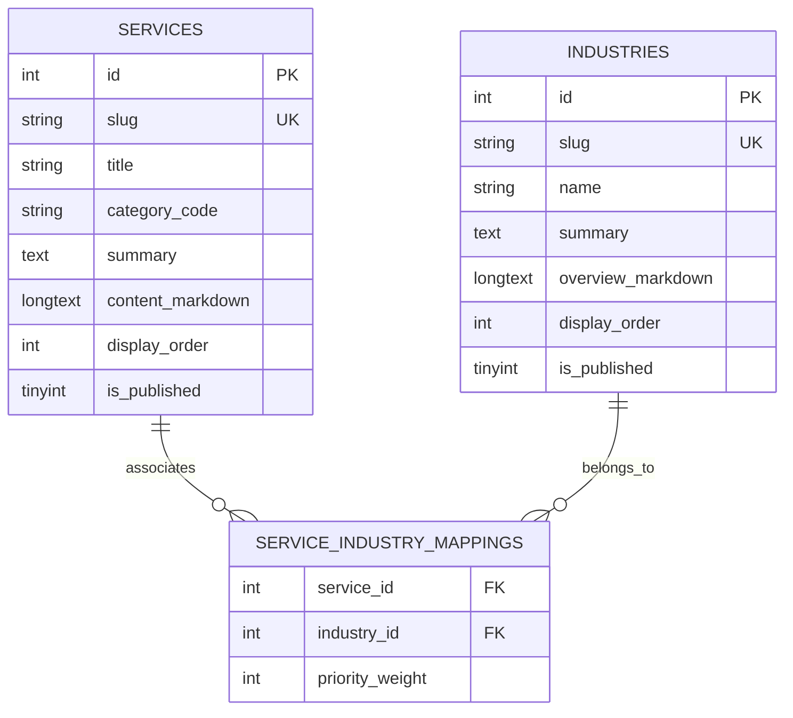

# Services & Industries Functional Specification
## Architecture, Filtering, Slugs, Unpublishing Rules, and Domain Mappings

**Document Reference:** `docs/phase-01/04_SERVICES_AND_INDUSTRIES_FUNCTIONAL_SPEC.md`  
**Phase:** Phase 1 of 31 — Complete Functional Specification  
**Baseline Authority:** Approved Phase 0 Feature Matrix (`02_COMPLETE_FEATURE_MATRIX.md`), Technical Architecture (`07_TECHNICAL_ARCHITECTURE.md`), and Database Model (`08_DATABASE_DOMAIN_MODEL.md`).

---

### 1. Conceptual Governance: Configurable Service Proposals

#### Mandatory Business Rule:
As established in Phase 0 governance, the 6 core service pillars represent **unconfirmed configurable proposals** designed to reflect realistic enterprise B2B healthcare capabilities. They must not be treated as legally verified historical claims, but rather as customizable operational solutions subject to client confirmation and contract scoping.

The platform architecture treats all services and industry verticals as **dynamic data entities** managed through the MySQL database and administrative console, allowing rapid renaming, re-ordering, unpublishing, or addition of new operational offerings without modifying application source code.

---

### 2. The 6 Configurable Service Offerings

| Pillar Code | Default Service Title | Primary Operational Domain | Proposed Deliverables & Scope | Default Slug |
| :--- | :--- | :--- | :--- | :--- |
| **SVC-01** | Clinical Workforce Solutions | Staffing & Credentialing | Rapid deployment of credentialed Registered Nurses, Enrolled Nurses, Nurse Practitioners, Allied Health Professionals, and locum medical specialists for acute and aged care facilities. | `clinical-workforce-solutions` |
| **SVC-02** | Healthcare Facility Operations | Facility & Environment | Integrated environmental hygiene, infection control management, clinical waste logistics, linen services, and healthcare facilities asset maintenance. | `healthcare-facility-operations` |
| **SVC-03** | Health Administration & Medical Support | Operational Administration | Turnkey medical reception, clinical ward clerks, patient billing and coding assistance, transcription, and health record management staffing. | `health-administration-support` |
| **SVC-04** | Healthcare Compliance & Clinical Governance | Governance & Regulatory | Comprehensive clinical audit readiness, NSQHS accreditation preparation, AHPRA credentialing verification services, and clinical incident escalation architecture. | `clinical-compliance-governance` |
| **SVC-05** | Healthcare Logistics & Supply Chain Support | Procurement Logistics | Medical consumables supply chain coordination, inventory management, point-of-care replenishment, and emergency personal protective equipment (PPE) distribution. | `healthcare-logistics-supply` |
| **SVC-06** | Healthcare Consulting & Operational Advisory | Strategic Advisory | Hospital roster optimization, healthcare operational cost-containment reviews, digital workflow transformation, and bed-management efficiency consulting. | `healthcare-consulting-advisory` |

---

### 3. The 6 Healthcare Industry Verticals

| Vertical Code | Default Industry Sector | Target Facility Profile | Core Sector Challenges | Default Slug |
| :--- | :--- | :--- | :--- | :--- |
| **IND-01** | Hospitals & Health Services | Public & Private Hospital Networks | Severe emergency department surges, surgical ward vacancies, 24/7 staffing volatility, and complex NSQHS compliance. | `hospitals-health-services` |
| **IND-02** | Residential Aged Care Facilities | Aged Care Homes & Retirement Villages | Mandatory direct-care minute targets, 24/7 RN coverage requirements, Aged Care Quality Standards audits, and staff retention. | `residential-aged-care` |
| **IND-03** | Primary Care & General Practice | Medical Centers & GP Clinics | Receptionist turnover, billing administrative overhead, procedural nurse shortages, and Practice Accreditation standards. | `primary-care-general-practice` |
| **IND-04** | Allied Health Networks | Multi-Disciplinary Clinics & Rehab | Scheduling inefficiencies, NDIS compliance reporting, specialized physiotherapist / OT credentialing, and multi-site coordination. | `allied-health-networks` |
| **IND-05** | Diagnostic & Pathology Centers | Pathology Labs & Imaging Facilities | Specimen handling turnaround requirements, specialized lab technician staffing, and NATA accreditation compliance. | `diagnostic-pathology-centers` |
| **IND-06** | Corporate & Occupational Health | Corporate Campuses & Industrial Sites | Employee health surveillance, flu vaccination drives, executive health assessments, and workplace injury management. | `corporate-occupational-health` |

---

### 4. Cross-Domain Relationship Mapping (Services <-> Industries)

The relationship between services and industries is modeled as a **many-to-many (`m:n`) associative entity** (`service_industry_mappings` table) in the database, allowing any service to be associated with multiple target sectors and vice versa.

#### Default Matrix Mapping:

| Service Pillar | Hospitals | Aged Care | Primary Care | Allied Health | Diagnostics | Corporate |
| :--- | :---: | :---: | :---: | :---: | :---: | :---: |
| **SVC-01: Clinical Workforce** | **PRIMARY** | **PRIMARY** | SECONDARY | SECONDARY | SECONDARY | SECONDARY |
| **SVC-02: Facility Operations** | **PRIMARY** | **PRIMARY** | SECONDARY | — | SECONDARY | — |
| **SVC-03: Health Administration**| **PRIMARY** | SECONDARY | **PRIMARY** | **PRIMARY** | **PRIMARY** | — |
| **SVC-04: Compliance & Governance**| **PRIMARY** | **PRIMARY** | SECONDARY | SECONDARY | SECONDARY | SECONDARY |
| **SVC-05: Logistics & Supply** | **PRIMARY** | SECONDARY | — | — | **PRIMARY** | — |
| **SVC-06: Consulting & Advisory** | **PRIMARY** | **PRIMARY** | SECONDARY | SECONDARY | — | **PRIMARY** |

---

### 5. Services Catalog Functional Requirements

#### 5.1 Service Listing & Category Filtering
- **Route:** `/services`
- **Behavior:**
  - Displays category filter tabs: `All Services`, `Clinical Staffing`, `Operations & Facilities`, `Administration`, `Governance & Advisory`.
  - Filter state is reflected in the URL query string (e.g., `/services?category=clinical-staffing`).
  - Filtering operates with zero page reload via React state, with instant URL synchronization via `useSearchParams()`.
  - Live filter counter announces results for assistive technologies (`aria-live="polite"`).

#### 5.2 Dynamic Slug Routing & Pre-Rendering
- **Route:** `/services/:slug`
- **Resolution Strategy:**
  1. User/Crawler requests `/services/clinical-workforce-solutions`.
  2. Public PHP front controller (`index.php`) queries `SELECT * FROM services WHERE slug = :slug LIMIT 1`.
  3. If found and `is_published = 1`:
     - Emits `HTTP 200 OK`.
     - Injects customized `<title>`, `<meta name="description">`, OpenGraph tags, and Schema.org `Service` JSON-LD into `<head>`.
     - Injects server-rendered semantic HTML into `
` for crawlers and JS-disabled users.
     - React mounts via `createRoot(document.getElementById('root'))` and takes over client-side interactivity, seamlessly replacing/hiding `#ssr-fallback`.
  4. If record not found or `is_published = 0`:
     - Emits authentic `HTTP 404 Not Found` header.
     - Renders branded 404 error page.

#### 5.3 Service Unpublishing & Archival Rules
- When an administrator unpublishes a service (`is_published = 0`):
  1. The service is **immediately excluded** from all public service catalogs (`/services`), homepage bento grid, header navigation dropdowns, and sitemap XML.
  2. Any direct request to `/services/:slug` returns `HTTP 404 Not Found`.
  3. The service record remains preserved in the database for historical reporting, active RFP linkage, and audit integrity.
  4. Any active RFP submissions referencing this service ID retain their foreign key association without data loss.

#### 5.4 Safe Slug Renaming & 301 Redirect Engine
- When an administrator modifies a service slug (e.g., from `clinical-workforce-solutions` to `healthcare-clinical-staffing`):
  1. System checks that the new slug does not collide with existing routes or slugs.
  2. Old slug is automatically inserted into `url_redirects` table (`old_path = '/services/clinical-workforce-solutions'`, `new_path = '/services/healthcare-clinical-staffing'`, `http_code = 301`).
  3. Subsequent requests to the old slug receive an authentic `HTTP/1.1 301 Moved Permanently` header with `Location: /services/healthcare-clinical-staffing`, preserving SEO authority and preventing broken bookmarks.

---

### 6. Industries Catalog Functional Requirements

#### 6.1 Industry Listing & Sector Discovery
- **Route:** `/industries`
- **Behavior:**
  - Presents high-impact overview cards for all 6 active industry verticals.
  - Highlights specific regulatory bodies governing each sector (e.g., NSQHS for Hospitals, Aged Care Quality and Safety Commission for Aged Care).
  - Hover states subtly elevate cards and display primary mapped services.

#### 6.2 Dynamic Industry Slug Routing
- **Route:** `/industries/:slug`
- **Behavior:**
  - Follows identical hybrid pre-rendering and authentic 404 emission pipeline as service detail pages.
  - Dynamically fetches and renders the primary services mapped to this specific industry vertical.
  - Provides a direct contextual inquiry trigger: "Request a Proposal for [Industry Name]".

---

### 7. Administrative CMS Controls (Modules 07 & 08)

The Administrative Management Portal provides dedicated CRUD consoles for Services (Module 07) and Industries (Module 08):

#### 7.1 Services CMS Form Fields:
- `title` (text, max 120 chars, required)
- `slug` (text, max 140 chars, unique, auto-generated from title with override)
- `category_code` (dropdown: Clinical Staffing, Operations, Administration, Governance, Advisory)
- `summary` (textarea, max 250 chars, required)
- `content_markdown` (Markdown editor with live preview, required)
- `deliverables` (dynamic tag/repeater list of deliverables)
- `sla_specifications` (structured repeater: Metric Name, Threshold, Audit Interval)
- `display_order` (integer, default 0)
- `is_featured` (boolean toggle: feature on homepage bento grid)
- `is_published` (boolean toggle)
- `seo_meta_title` (text, max 70 chars)
- `seo_meta_description` (text, max 160 chars)
- `industry_mappings` (multi-select checkbox group of active industries)

#### 7.2 Industries CMS Form Fields:
- `name` (text, max 120 chars, required)
- `slug` (text, max 140 chars, unique)
- `headline` (text, max 150 chars)
- `summary` (textarea, max 250 chars)
- `overview_markdown` (Markdown editor, required)
- `regulatory_frameworks` (dynamic list: Body Name, Compliance Scope)
- `display_order` (integer)
- `is_published` (boolean toggle)
- `seo_meta_title` (text, max 70 chars)
- `seo_meta_description` (text, max 160 chars)

---

### 8. Acceptance Criteria & Automated Verification

| Canonical Test ID | Target Feature | Verification Rule | Test Method |
| :--- | :--- | :--- | :--- |
| **TEST-PUB-005** | Services Catalog Filter | Selecting category updates URL to `?category=...` and filters cards without reload. | Playwright E2E |
| **TEST-PUB-006** | True 404 Emission | Requesting `/services/unregistered-slug` returns exact HTTP 404 header and renders error boundary. | Curl / Automated Spec |
| **TEST-WF-006** | Slug 301 Redirect | Renaming a slug creates a 301 redirect entry; navigating to old slug redirects with 301 to new slug. | Integration Test |
| **TEST-ADM-007** | Instant Unpublishing | Setting `is_published = 0` removes service from catalog and sitemap instantly. | E2E CMS Test |
| **TEST-PUB-008** | Service-Industry Mapping | Industry detail page accurately displays only the services linked in `service_industry_mappings`. | Unit & E2E Test |
