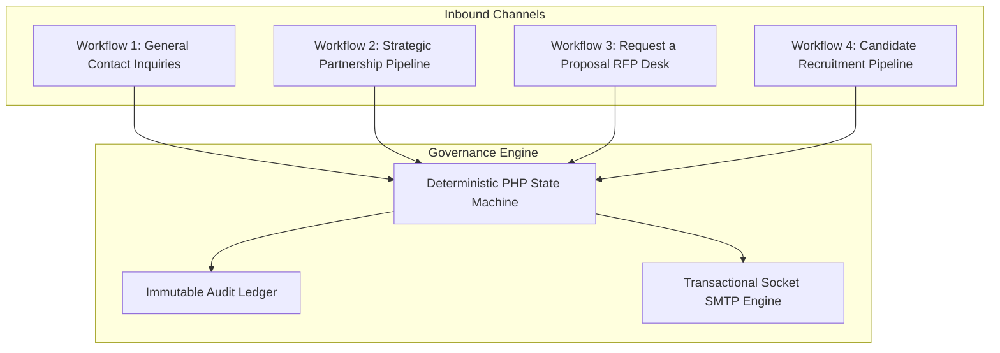
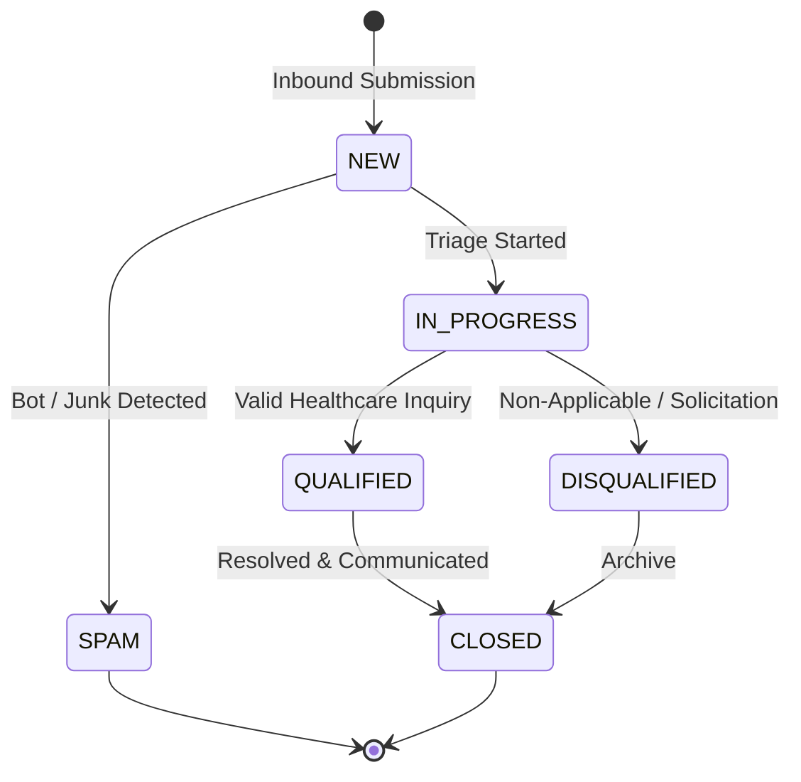
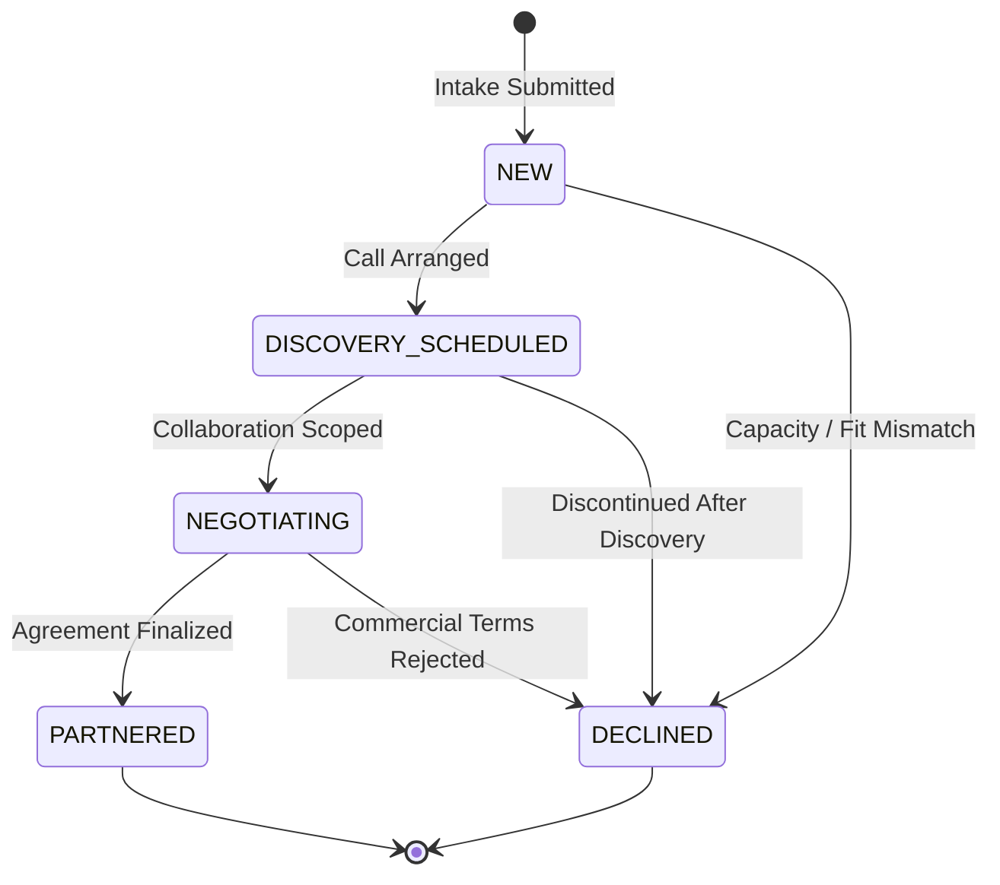
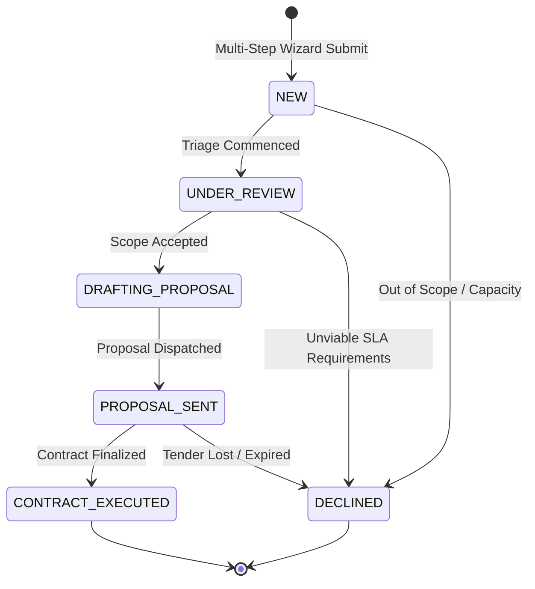
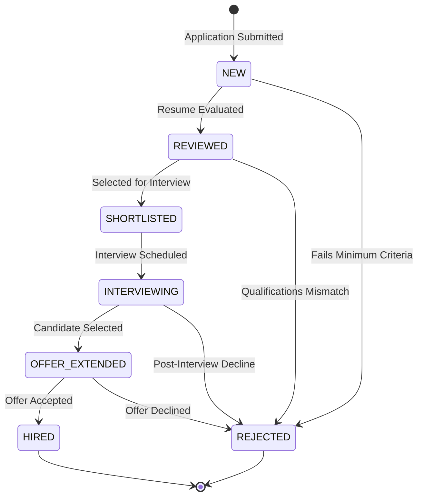

# Business Workflows & State Machine Specifications
## Complete End-to-End Inbound Pipelines, Status Models, and Transition Enforcements

**Document Reference:** `docs/phase-01/08_BUSINESS_WORKFLOWS_AND_STATE_MACHINES.md`  
**Phase:** Phase 1 of 31 — Complete Functional Specification  
**Baseline Authority:** Master Functional Requirements (`01_MASTER_FUNCTIONAL_REQUIREMENTS.md`) and Technical Architecture (`07_TECHNICAL_ARCHITECTURE.md`).

---

### 1. Inbound Pipeline Architecture Overview

The Voak Health Care platform operates 4 distinct inbound commercial and recruitment pipelines, plus 1 content lifecycle engine. Each pipeline is governed by a **deterministic finite state machine (FSM)** enforced in PHP backend domain service classes (`src/Workflow/StateMachine.php`).

#### Transition Rule Principles:
1. **Invalid Transitions Blocked:** Any attempt to jump states outside the permitted transition graph returns `HTTP 422 Unprocessable Entity` with error: `Invalid workflow transition from [CURRENT_STATE] to [REQUESTED_STATE]`.
2. **Permission Gated:** Transitions require specific RBAC permission keys (e.g., only `ROLE_BD_MANAGER` or `ROLE_SUPER_ADMIN` can transition an RFP to `CONTRACT_EXECUTED`).
3. **Mandatory Audit Event:** Every state change logs the actor, previous state, new state, timestamp, and optional transition reason.

---

### 2. Workflow 1: General Contact Inquiries State Machine

#### 2.1 State Diagram:

#### 2.2 Transition Specifications:

| Initial State | Allowed Target State | Authorized Roles | Mandatory Inputs / Validation | Triggered Notifications | Emitted Audit Event |
| :--- | :--- | :--- | :--- | :--- | :--- |
| **`[*]`** | **`NEW`** | Public (Unauthenticated) | Valid Contact Form, Turnstile check | User Ack Email, Internal Alert | `INQUIRY_CREATED` |
| **`NEW`** | **`IN_PROGRESS`** | Super Admin, Website Admin, BD | Assignment to an admin staff ID | None | `INQUIRY_ASSIGNED` |
| **`NEW`** | **`SPAM`** | Super Admin, Website Admin, BD | Transition note ("Marked as spam") | None | `INQUIRY_MARKED_SPAM` |
| **`IN_PROGRESS`** | **`QUALIFIED`** | Super Admin, Website Admin, BD | Qualification note (e.g., "Routed to workforce desk") | Internal notification to specialist | `INQUIRY_QUALIFIED` |
| **`IN_PROGRESS`** | **`DISQUALIFIED`** | Super Admin, Website Admin, BD | Reason selected: Solicitations, Patient emergency | None | `INQUIRY_DISQUALIFIED` |
| **`QUALIFIED`** | **`CLOSED`** | Super Admin, Website Admin, BD | Resolution summary note (min 20 chars) | Optional follow-up email | `INQUIRY_CLOSED` |
| **`DISQUALIFIED`**| **`CLOSED`** | Super Admin, Website Admin, BD | Closure note | None | `INQUIRY_CLOSED` |

---

### 3. Workflow 2: Strategic Partnership Inbound Pipeline

#### 3.1 End-to-End Process Flow:
1. **Inbound Submission:** Prospective healthcare consortium executive visits `/partner-with-us`, completes the organizational intake form, and submits.
2. **Immediate System Action:** Database inserts inquiry with status `NEW`. Transactional confirmation email with reference `PTN-YYYYMMDD-XXXX` dispatched to executive; high-priority internal alert sent to BD Manager.
3. **Executive Triage:** BD Manager reviews organizational tier and scale. If viable, sets status to `DISCOVERY_SCHEDULED` and logs the meeting date.
4. **Commercial Negotiation:** Following discovery, status transitions to `NEGOTIATING`. Internal commercial terms and partnership model notes recorded.
5. **Outcome:** Transitions either to `PARTNERED` (formal agreement executed) or `DECLINED` with reason.

#### 3.2 State Diagram:

#### 3.3 Transition Specifications:

| Initial State | Target State | Authorized Roles | Mandatory Validation Rules | Notifications Dispatched | Audit Event Key |
| :--- | :--- | :--- | :--- | :--- | :--- |
| **`[*]`** | **`NEW`** | Public User | Valid corporate domain, Turnstile pass | User Acknowledgement, BD Alert | `PTN_INQUIRY_SUBMITTED` |
| **`NEW`** | **`DISCOVERY_SCHEDULED`** | Super Admin, BD Manager | Future discovery meeting datetime, assigned lead | Calendar invite dispatched (if SMTP active) | `PTN_DISCOVERY_SCHEDULED` |
| **`NEW`** | **`DECLINED`** | Super Admin, BD Manager | Mandatory rejection reason code | None (internal record) | `PTN_INQUIRY_DECLINED` |
| **`DISCOVERY_SCHEDULED`** | **`NEGOTIATING`** | Super Admin, BD Manager | Proposed partnership model selected, scoping notes | Internal notification to MD | `PTN_STAGE_NEGOTIATING` |
| **`DISCOVERY_SCHEDULED`** | **`DECLINED`** | Super Admin, BD Manager | Post-discovery decline notes | Optional courtesy notification | `PTN_POST_DISCOVERY_DECLINED` |
| **`NEGOTIATING`** | **`PARTNERED`** | Super Admin, BD Manager | Target contract effective date, commercial tier | Notification to Executive Leadership | `PTN_PARTNERED_FINALIZED` |
| **`NEGOTIATING`** | **`DECLINED`** | Super Admin, BD Manager | Detailed commercial decline rationale | None | `PTN_NEGOTIATION_DECLINED` |

---

### 4. Workflow 3: Request a Proposal (RFP) Desk

#### 4.1 End-to-End Process Flow:
1. **RFP Generation:** Hospital procurement officer completes 4-step wizard at `/request-proposal`, attaches tender brief, and submits.
2. **Quarantine & Intake:** File stored in quarantined storage (`storage/uploads/proposals/`). DB creates proposal in `NEW` state with reference `RFP-YYYYMMDD-XXXX`. Acknowledgement email sent.
3. **Scoping Review:** BD Manager reviews facility profile and bed scale. Transitions status to `UNDER_REVIEW`.
4. **Drafting Proposal:** BD assigns operational pricing lead and clinical director; transitions to `DRAFTING_PROPOSAL`.
5. **Proposal Dispatch:** Formal proposal sent to client out-of-band; status moved to `PROPOSAL_SENT` with target decision date.
6. **Execution / Closure:** If accepted, status moves to `CONTRACT_EXECUTED`. If declined or tender awarded to another vendor, moves to `DECLINED`.

#### 4.2 State Diagram:

#### 4.3 Transition Specifications:

| Initial State | Target State | Authorized Roles | Mandatory Inputs & Validation | Triggered Notifications | Emitted Audit Event |
| :--- | :--- | :--- | :--- | :--- | :--- |
| **`[*]`** | **`NEW`** | Public User | Valid 4-step data, Turnstile verification | Inquirer Ack with Ref Code, BD Alert | `RFP_SUBMITTED` |
| **`NEW`** | **`UNDER_REVIEW`** | Super Admin, BD Manager | Assigned procurement officer ID | None | `RFP_UNDER_REVIEW` |
| **`NEW`** | **`DECLINED`** | Super Admin, BD Manager | Non-compliance or capacity reason | Courteous decline notification | `RFP_DECLINED_PRELIM` |
| **`UNDER_REVIEW`** | **`DRAFTING_PROPOSAL`**| Super Admin, BD Manager | Estimated proposal delivery date, assigned drafter | Alert to drafting team | `RFP_DRAFTING_COMMENCED` |
| **`UNDER_REVIEW`** | **`DECLINED`** | Super Admin, BD Manager | Operational rejection notes | Decline notification | `RFP_DECLINED_SCOPE` |
| **`DRAFTING_PROPOSAL`**| **`PROPOSAL_SENT`** | Super Admin, BD Manager | Dispatched proposal reference number | Proposal dispatch alert | `RFP_PROPOSAL_DISPATCHED` |
| **`PROPOSAL_SENT`** | **`CONTRACT_EXECUTED`**| Super Admin, BD Manager | Contract start date, total contracted value band | High-priority notification to Board | `RFP_CONTRACT_EXECUTED` |
| **`PROPOSAL_SENT`** | **`DECLINED`** | Super Admin, BD Manager | Loss reason (e.g., Price, Incumbent retained) | None | `RFP_TENDER_LOST` |

---

### 5. Workflow 4: Candidate Recruitment Lifecycle

#### 5.1 State Diagram:

#### 5.2 Transition Specifications:

| Initial State | Target State | Authorized Roles | Mandatory Validation Rules | Notifications Dispatched | Audit Event Key |
| :--- | :--- | :--- | :--- | :--- | :--- |
| **`[*]`** | **`NEW`** | Public Applicant | Valid resume PDF/DOCX, AHPRA format (if clinical) | Candidate Ack Email, HR Alert | `APP_SUBMITTED` |
| **`NEW`** | **`REVIEWED`** | Super Admin, HR Manager | Screening score / notes recorded | None | `APP_REVIEWED` |
| **`NEW`** | **`REJECTED`** | Super Admin, HR Manager | Rejection reason code | Standard candidate regret email | `APP_REJECTED` |
| **`REVIEWED`** | **`SHORTLISTED`** | Super Admin, HR Manager | Shortlist recommendation notes | Internal notification to hiring lead | `APP_SHORTLISTED` |
| **`SHORTLISTED`** | **`INTERVIEWING`** | Super Admin, HR Manager | Interview date & time, interviewer name | Interview invitation email to candidate | `APP_INTERVIEW_SCHEDULED` |
| **`INTERVIEWING`** | **`OFFER_EXTENDED`** | Super Admin, HR Manager | Proposed salary/rate, anticipated start date | Formal offer notification | `APP_OFFER_EXTENDED` |
| **`OFFER_EXTENDED`** | **`HIRED`** | Super Admin, HR Manager | Signed contract confirmation, AHPRA verification | Onboarding team notification | `APP_CANDIDATE_HIRED` |
| **`OFFER_EXTENDED`** | **`REJECTED`** | Super Admin, HR Manager | Reason: Candidate declined or offer rescinded | Archive recruitment record | `APP_OFFER_DECLINED` |

---

### 6. Data Retention & Privacy Erasure Lifecycle

In accordance with the Australian Privacy Principles (APPs):
1. **Contact Inquiries:** Retained for 24 months post-closure for audit and correspondence history; soft-deleted thereafter.
2. **Partnership & Proposal Records:** Retained for 7 years post-execution for corporate taxation and commercial legal governance.
3. **Candidate Resumes:** Unsuccessful candidate applications retained for 12 months for prospective talent pooling (with explicit candidate consent); permanently purged after 12 months via automated CLI cleanup task (`php cron/purge_applications.php`).
4. **Right to Erasure (Privacy Act):** Super Admin can execute a cryptographically verified `APPLY_DATA_ERASURE` command which overwrites candidate PII with `[ANONYMIZED_PER_PRIVACY_REQUEST]` and deletes the physical resume binary file from disk while maintaining referential integrity in `audit_logs`.
