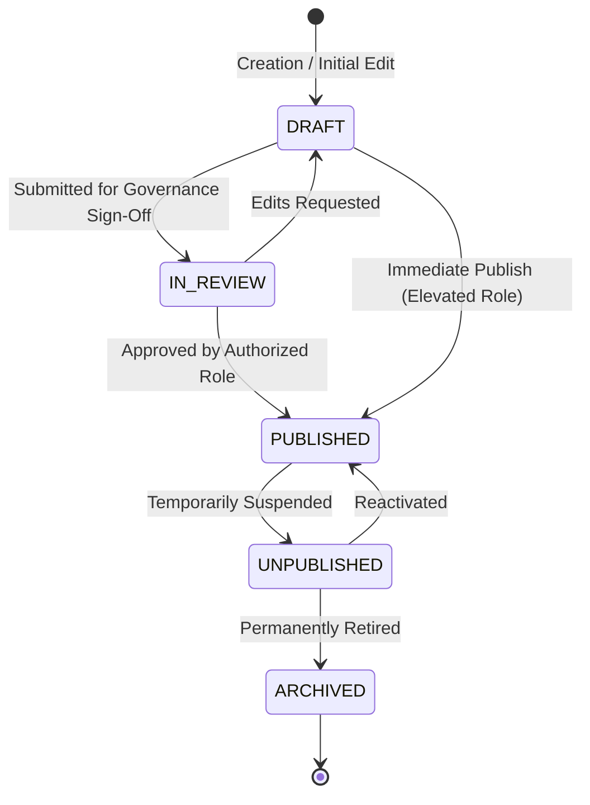
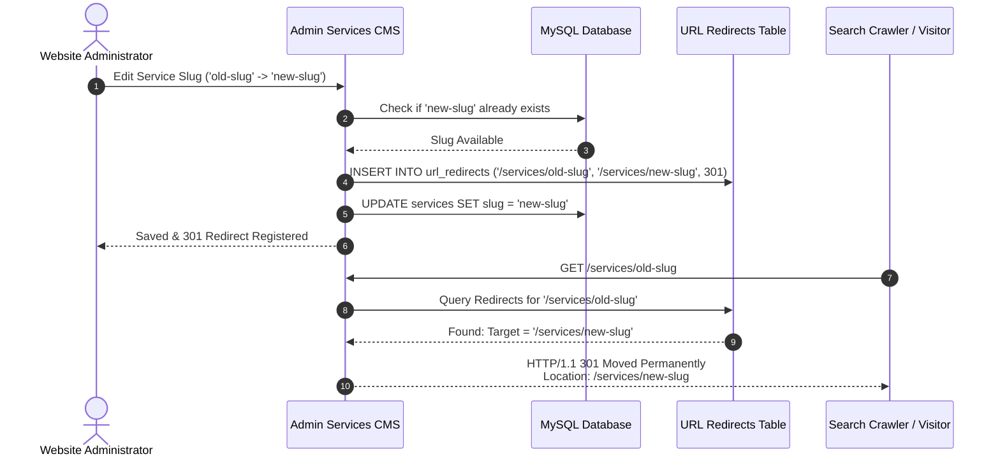

# CMS & Editorial Publishing Workflows
## Content Lifecycles, Version History, Revision Rollback, Unpublishing Cascades, and Slug Management

**Document Reference:** `docs/phase-01/09_CMS_AND_PUBLISHING_WORKFLOWS.md`  
**Phase:** Phase 1 of 31 — Complete Functional Specification  
**Baseline Authority:** Master Functional Requirements (`01_MASTER_FUNCTIONAL_REQUIREMENTS.md`) and Technical Architecture (`07_TECHNICAL_ARCHITECTURE.md`).

---

### 1. Unified Content Entity Lifecycle

Every managed content type in the Voak Health Care CMS (Pages, Services, Industries, Articles, Case Studies, Testimonials, FAQs) follows a deterministic lifecycle model:



#### State Definitions:
1. **`DRAFT`:** Content is actively being written or revised. Accessible solely within the Admin Portal; invisible to the public, search engines, and sitemaps.
2. **`IN_REVIEW`:** Editorial work complete; awaiting clinical governance, legal, or administrative approval before live display.
3. **`PUBLISHED`:** Content is live on the public website, indexed in dynamic XML sitemaps, included in hybrid pre-rendered HTML, and cacheable.
4. **`UNPUBLISHED`:** Content temporarily hidden from public view. Direct URL requests return authentic `HTTP 404 Not Found`; entity excluded from navigation menus and sitemaps, but all internal historical relationships and audit records remain intact.
5. **`ARCHIVED`:** Read-only historical state. Excluded from active CMS lists unless "Show Archived" filter is toggled. Cannot be published without explicit de-archiving.

---

### 2. Entity-by-Entity Publishing Governance

| Content Entity | Supported Lifecycle States | Authoring Roles | Publishing Roles | Version History Tracked? | Scheduling Feasibility on Shared Hosting |
| :--- | :--- | :--- | :--- | :---: | :---: |
| **Static Pages** | `DRAFT`, `PUBLISHED` | Content Editor, Web Admin | Web Admin, Super Admin | **YES (Full Diff)** | Not Applicable |
| **Homepage Sections** | `DRAFT`, `PUBLISHED` | Content Editor, Web Admin | Web Admin, Super Admin | **YES (JSON Snapshot)** | Not Applicable |
| **Services Catalog** | `DRAFT`, `PUBLISHED`, `UNPUBLISHED` | Content Editor, Web Admin | Web Admin, Super Admin | **YES** | Not Recommended |
| **Industries** | `DRAFT`, `PUBLISHED`, `UNPUBLISHED` | Content Editor, Web Admin | Web Admin, Super Admin | **YES** | Not Recommended |
| **Insights & Articles**| `DRAFT`, `IN_REVIEW`, `PUBLISHED`, `ARCHIVED` | Content Editor, Web Admin | Content Editor, Web Admin, Super Admin | **YES (Full Diff)** | **YES (via Hostinger cPanel Cron)** |
| **Case Studies** | `DRAFT`, `IN_REVIEW`, `PUBLISHED` | Content Editor, Web Admin | Web Admin, Super Admin (Requires consent) | **YES** | Not Recommended |
| **Testimonials** | `DRAFT`, `PUBLISHED` | Content Editor, Web Admin | Web Admin, Super Admin (Requires consent) | NO (Simple entity) | Not Applicable |
| **FAQs** | `DRAFT`, `PUBLISHED` | Content Editor, Web Admin | Content Editor, Web Admin, Super Admin | NO (Simple entity) | Not Applicable |
| **Media Assets** | `ACTIVE`, `DELETED` | Content Editor, Web Admin | Auto-published upon valid upload | NO (Physical file) | Not Applicable |
| **SEO Metadata** | `ACTIVE` | Web Admin, Super Admin | Web Admin, Super Admin | **YES (Audit Log)** | Not Applicable |
| **Global Config** | `ACTIVE` | Super Admin | Super Admin | **YES (Audit Log)** | Not Applicable |

> [!NOTE]
> **Scheduled Publishing on Hostinger Shared Hosting:**  
> In shared hosting environments lacking long-running Node.js or Redis daemons, publishing schedules for Articles are evaluated via a lightweight PHP CLI cron job scheduled in Hostinger cPanel (`* * * * * php /home/<USER>/app_voak/cli/publish_scheduled.php`). If cron fails, a lazy trigger runs on the next public article index request, checking for past-due `published_at <= NOW()` rows.

---

### 3. Version History & Revision Restoration Engine

#### 3.1 Data Model:
Whenever a static page, service, or article is updated, the previous state is preserved in the `content_revisions` table before the update executes:

```sql
CREATE TABLE content_revisions (
    id BIGINT UNSIGNED AUTO_INCREMENT PRIMARY KEY,
    entity_type VARCHAR(50) NOT NULL, -- 'pages', 'services', 'articles'
    entity_id INT UNSIGNED NOT NULL,
    revision_number INT UNSIGNED NOT NULL,
    title VARCHAR(255) NOT NULL,
    content_payload LONGTEXT NOT NULL, -- JSON snapshot of markdown, meta, deliverables
    created_by_user_id INT UNSIGNED NOT NULL,
    created_at TIMESTAMP DEFAULT CURRENT_TIMESTAMP,
    INDEX idx_entity_rev (entity_type, entity_id, revision_number)
);
```

#### 3.2 Restoration Flow:
1. Administrator navigates to the Revision History screen for an entity.
2. System displays a chronological list of revisions: timestamp, author name, revision number, and summary diff.
3. User selects a previous revision and clicks "Compare / Restore".
4. The system presents a side-by-side visual diff (additions highlighted in soft mint `#54CB96/20`, deletions in soft pink `#EEAFD7/30`).
5. On clicking "Confirm Restoration":
   - The current state is saved as a new revision `N+1`.
   - The historical payload is restored as the active draft or published record.
   - Emits audit event `CONTENT_REVISION_RESTORED`.

---

### 4. Referential Integrity & Unpublishing Cascades

When a referenced entity is unpublished or archived, the platform prevents visual voids, broken links, or application crashes across the public website:

#### 4.1 Case Study A: Service Unpublished
- **Trigger:** An administrator changes Service `SVC-02` (`healthcare-facility-operations`) to `is_published = 0`.
- **System Cascade Behavior:**
  1. **Public Catalog:** Removed immediately from `/services` list. Filter counts re-calculate.
  2. **Homepage Bento Grid:** If `SVC-02` was a featured bento card, it is immediately omitted from the homepage payload. The CSS bento grid reflows dense layout automatically.
  3. **Industry Detail Pages:** Any industry page referencing `SVC-02` as a recommended service omits `SVC-02` from its recommendation list. If zero recommended services remain for an industry, the section gracefully falls back to the general services CTA.
  4. **Direct Route Access:** Navigating to `/services/healthcare-facility-operations` returns authentic `HTTP 404 Not Found`.
  5. **Historical RFP Inquiries:** Proposals in the database that requested `SVC-02` maintain their historical foreign key linkage (`service_id = 2`); the service name remains visible in the admin proposal review desk with an amber badge: `[Service Unpublished]`.
  6. **XML Sitemap:** `/sitemap.xml` cache is invalidated; `SVC-02` is excluded from the generated XML.

#### 4.2 Case Study B: Industry Unpublished
- **Trigger:** Industry `IND-05` (`diagnostic-pathology-centers`) is set to `is_published = 0`.
- **System Cascade Behavior:**
  1. Removed from `/industries` directory and header dropdown.
  2. Navigating to `/industries/diagnostic-pathology-centers` returns authentic `HTTP 404 Not Found`.
  3. Related services retain their catalog status; only the cross-link to this sector is suppressed.

#### 4.3 Case Study C: Media Asset Deleted
- **Trigger:** An administrator attempts to delete an image asset from Module 08.
- **Safety Gate:**
  1. System executes a cross-table check (`SELECT count(*) FROM services WHERE hero_image_id = :id ...`).
  2. If the asset is currently referenced by any active page, service, industry, or article:
     - **Deletion is blocked.**
     - UI modal warns: "Cannot delete asset. It is currently referenced in: [Service: Clinical Workforce Solutions]. Please reassign or remove the image reference before deleting."

---

### 5. Safe Slug Renaming & 301 Redirect Architecture

Modifying a public slug on a published service, industry, or article can destroy established search engine rankings and break external bookmarks. The platform enforces an automated 301 redirect management system:



#### 5.1 Slug Collision Prevention:
- A new slug cannot collide with any reserved system routes:
  - `/about`, `/services`, `/industries`, `/why-choose-voak`, `/how-we-work`, `/quality-compliance`, `/partners-clients`, `/case-studies`, `/careers`, `/insights`, `/faqs`, `/contact`, `/partner-with-us`, `/request-proposal`, `/privacy-policy`, `/terms`, `/admin`, `/api`.
- A slug cannot collide with an existing active slug in the same entity domain.

#### 5.2 Redirect Loop Protection:
- If an admin renames `A -> B`, and later renames `B -> A`:
  - System detects the circular reference and updates the original redirect record instead of creating an infinite loop.

---

### 6. Acceptance Criteria & Editorial Verification

| Verification ID | Canonical Test ID | Test Scenario | Expected Outcome | Verification Tooling |
| :--- | :--- | :--- | :--- | :--- |
| **CMS-VER-01** | `TEST-PUB-005` / `TEST-ADM-005` | Content Editor saves draft of new service | Status is `DRAFT`; does NOT appear on public `/services` | Playwright E2E |
| **CMS-VER-02** | `TEST-ADM-005` | Web Admin restores Revision 2 of About Us page | Active content matches Revision 2; Revision 4 created as backup | Vitest Integration |
| **CMS-VER-03** | `TEST-WF-006` / `TEST-ADM-005` | Service unpublished | Immediate 404 on slug; removed from homepage bento grid | Playwright E2E |
| **CMS-VER-04** | `TEST-ADM-007` / `TEST-SEO-004` | Slug renamed from `test-a` to `test-b` | Navigating to `/services/test-a` issues HTTP 301 to `/services/test-b` | PHPUnit / cURL |
| **CMS-VER-05** | `TEST-ADM-009` | Deleting image currently in use | Deletion blocked with clear warning list of referencing pages | Vitest / PHPUnit |
