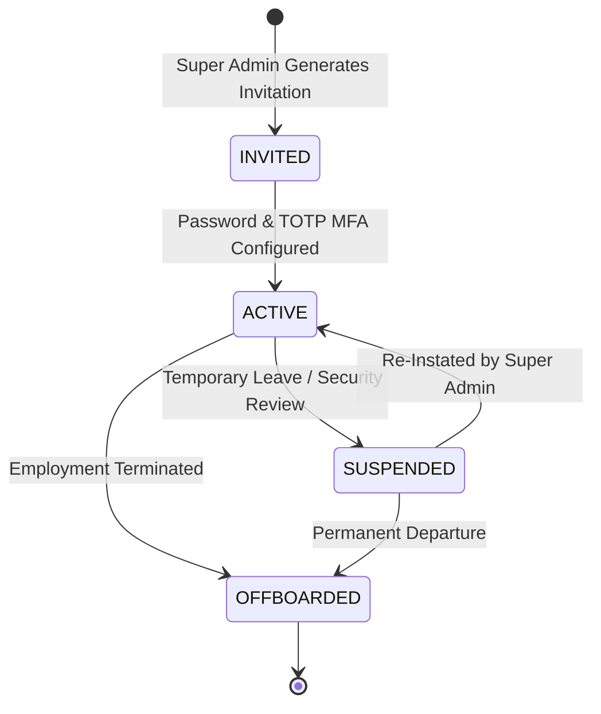

# Security, Privacy & Audit Functional Requirements
## OWASP ASVS v4.0.3 Level 2 Alignment, Privacy Governance, Lifecycle Controls, and Audit Telemetry

**Document Reference:** `docs/phase-01/14_SECURITY_PRIVACY_AND_AUDIT_REQUIREMENTS.md`  
**Phase:** Phase 1 of 31 — Complete Functional Specification  
**Baseline Authority:** Security & Privacy Baseline (`docs/phase-00/10_SECURITY_AND_PRIVACY_BASELINE.md`) and Technical Architecture (`07_TECHNICAL_ARCHITECTURE.md`).

---

### 1. Security Architecture & Threat Model

The Voak Health Care platform handles sensitive B2B commercial tenders, corporate partnerships, and recruitment candidate data. In accordance with the **OWASP Application Security Verification Standard (ASVS v4.0.3 Level 2)**, all data interactions adhere to strict zero-trust principles:

1. **Defense in Depth:** Multiple independent security barriers (WAF / Turnstile -> Apache `.htaccess` -> PHP Auth Middleware -> RBAC Middleware -> PDO Parameterized Statements).
2. **Fail-Closed Default:** Unauthenticated or unauthorized requests terminate immediately with `401 Unauthorized` or `403 Forbidden`.
3. **Non-Clinical Boundary Mandate:** Under no circumstances does the platform solicit, store, or process individual patient clinical records or medical histories.

---

### 2. Functional Security Specifications

#### 2.1 Authentication & Password Policy
- **Hashing Standard:** Password storage uses **bcrypt** with an algorithmic work factor cost of **12** (`PASSWORD_BCRYPT, ['cost' => 12]`), or Argon2id if available in Hostinger PHP 8.3 build.
- **Complexity Requirements:**
  - Minimum length: 12 characters.
  - Mandatory character diversity: At least 1 uppercase letter, 1 lowercase letter, 1 numeric digit, and 1 special symbol (`[!@#$%^&*()_+\-=\[\]{}|]`).
  - Common password dictionary check (blocks passwords found in the top 100,000 compromised lists).
- **Brute-Force Protection:**
  - Tracked via `failed_attempts` column in `users` table and IP rate limiting bucket.
  - Threshold: 5 failed login attempts triggers an immediate **15-minute account lockout** (`locked_until = NOW() + INTERVAL 15 MINUTE`).
  - Generic error message: "Invalid email or password" (strictly eliminates user account enumeration).

#### 2.2 Multi-Factor Authentication (MFA / 2FA)
- **Standard:** RFC 6238 Time-Based One-Time Password (TOTP) algorithm using SHA-1 with a 30-second time step.
- **Enforcement:** Mandatory for `ROLE_SUPER_ADMIN`; optional for operational roles.
- **Secret Storage:** TOTP secret keys are encrypted at rest using **AES-256-GCM** before persistence in `admin_mfa_secrets`.
- **Emergency Recovery:** 8 single-use recovery codes generated during enrollment; hashed via SHA-256 at rest. Using a recovery code invalidates it permanently and triggers a security notification.

#### 2.3 Session Management & Lifecycle
- **Cookie Attributes:**
  ```http
  Set-Cookie: voak_admin_session=<token>; Path=/api/admin; Max-Age=28800; Secure; HttpOnly; SameSite=Strict
  ```
- **Inactivity Timeout:** A session inactive for **15 minutes** is automatically invalidated on the server (`last_activity_at` check).
- **Absolute Session Lifetime:** Maximum **8 hours** continuous lifetime. After 8 hours, re-authentication is strictly enforced regardless of activity.
- **Logout Behavior:** Calling `POST /api/v1/admin/auth/logout`:
  1. Deletes session row from `admin_sessions` table.
  2. Overwrites client cookie with expired timestamp (`Max-Age=0`).
  3. Logs audit event `AUTH_LOGOUT`.

#### 2.4 CSRF Protection
- **Mechanism:** Cryptographically strong Synchronizer Token Pattern.
- **Token Generation:** 256-bit entropy via `bin2hex(random_bytes(32))`, bound to the user's active session.
- **Verification:** Enforced on **all** state-changing HTTP requests (`POST`, `PUT`, `PATCH`, `DELETE`). The token must be supplied via the `X-CSRF-Token` request header. Mismatch or missing token results in `403 Forbidden`.

#### 2.5 Role-Based Authorization Enforcement
- Checked on **every protected API call** by PHP middleware (`AuthorizeRole`).
- Frontend button hiding is purely ergonomic; backend checks are authoritative.

#### 2.6 Quarantined File Upload Architecture
- **Location:** Resumes and RFP tender attachments are stored in `storage/uploads/` located **outside the public web document root** (`public_html/`).
- **File Renaming:** Uploaded files are immediately renamed to randomized UUID v4 identifiers with `.bin` extension (e.g., `4f9b2e8a-1123-4c91-9e22-89b1c7a8e291.bin`), stripping original client filenames to prevent path traversal attacks.
- **Execution Disabled:** Storage directory contains `.htaccess` with `php_flag engine off` and `Options -Indexes -ExecCGI`.
- **Streaming Controller:** Authorized downloads occur via `src/Controllers/DownloadController.php`, which verifies user permissions and streams the binary with `Content-Type: application/octet-stream` and `Content-Disposition: attachment`.

---

### 3. Privacy Governance & Compliance Controls

#### 3.1 Applicable Legal Framework
While designed to comply with the **Australian Privacy Principles (APPs)** under the *Privacy Act 1988 (Cth)*, the platform's privacy architecture is configurable to support evolving state and international data protection standards depending on confirmed commercial operating jurisdictions.

#### 3.2 Non-Clinical Data Boundary
The platform explicitly excludes patient health information. Under no circumstances are individual patient names, diagnoses, clinical treatment notes, or Medicare numbers collected. Any inbound inquiry containing apparent patient clinical emergencies is flagged and directed to public emergency services (000 in Australia).

#### 3.3 Data Retention & Erasure Protocols
- **Candidate Resumes:** Retained for a maximum of 12 months with explicit consent; permanently wiped after 12 months via automated cron.
- **Commercial Proposals:** Retained for 7 years for corporate governance and taxation audit compliance.
- **Right to Erasure (Privacy Act / GDPR equivalent):** Super Admin can trigger `APPLY_DATA_ERASURE` on an applicant record:
  - Overwrites candidate personal fields (`name`, `email`, `phone`, `ahpra_no`) with anonymized hash string.
  - Unlinks and permanently deletes the physical resume file from disk.
  - Preserves immutable event row in `audit_logs` recording that erasure was lawfully executed.

#### 3.4 Authorized Data Export Controls
- Only `ROLE_SUPER_ADMIN`, `ROLE_BD_MANAGER` (for commercial inquiries), and `ROLE_HR_MANAGER` (for applicant rosters) can export CSV records.
- Every export requires an active session, emits an immediate audit record (`DATA_EXPORTED: Entity [NAME], Rows [COUNT]`), and streams directly without saving temporary plaintext CSV files in public directories.

---

### 4. Administrator Onboarding & Offboarding Lifecycle



#### 4.1 Administrator Onboarding Procedure:
1. Super Admin enters new staff member's corporate name, email, and assigned RBAC role in Module 03.
2. System generates a secure 64-character cryptographic invitation token (`bin2hex(random_bytes(32))`), stores SHA-256 hash in database, and dispatches an invitation email (`EMAIL-06`) expiring in 24 hours.
3. User opens activation link, configures compliant password, and scans QR code to enroll in RFC 6238 TOTP MFA.
4. Account transitions to `ACTIVE`. Audit log records `USER_ONBOARDED`.

#### 4.2 Administrator Offboarding Procedure:
1. Super Admin clicks "Offboard / Revoke User" in Module 03.
2. **Immediate Actions Executed Atomically:**
   - User status set to `OFFBOARDED` (`is_active = 0`).
   - All active sessions for this user deleted from `admin_sessions` (immediate termination of any active browser sessions).
   - MFA secrets marked revoked.
   - Any API requests using previous session tokens rejected with 401.
3. System emits high-priority audit event: `USER_OFFBOARDED_SESSIONS_REVOKED`.

---

### 5. Immutable Audit Telemetry Specifications

The `audit_logs` database table is an **append-only ledger** designed to support forensic auditing and legal compliance.

#### Schema:
```sql
CREATE TABLE audit_logs (
    id BIGINT UNSIGNED AUTO_INCREMENT PRIMARY KEY,
    actor_user_id INT UNSIGNED NULL, -- NULL indicates public user or automated system
    actor_role VARCHAR(50) NOT NULL DEFAULT 'ANONYMOUS',
    event_category ENUM('AUTH', 'CRUD', 'SECURITY', 'EXPORT', 'CONFIG') NOT NULL,
    action_code VARCHAR(100) NOT NULL,
    target_entity VARCHAR(100) NULL,
    target_id VARCHAR(100) NULL,
    payload_diff JSON NULL, -- Captures old vs new values (sensitive fields redacted)
    ip_address VARCHAR(45) NOT NULL,
    user_agent VARCHAR(255) NOT NULL,
    created_at TIMESTAMP DEFAULT CURRENT_TIMESTAMP,
    INDEX idx_audit_event (event_category, action_code, created_at),
    INDEX idx_audit_actor (actor_user_id, created_at)
);
```

#### Immutability & Tamper-Evident Guardrails:
1. **Application-Level Repository Restriction:** The application codebase (`src/Repository/AuditLogRepository.php`) strictly exposes `insert()` and `find()` operations. No `update()`, `delete()`, or `truncate()` methods exist in application classes.
2. **Cryptographic Hash Chaining (Tamper-Evidence):** Because shared hosting environments (such as Hostinger cPanel) may assign a single database user with standard privileges without granular table-level `REVOKE` support, every audit log entry incorporates a cryptographic hash chain:
   ```
   row_hash = SHA256(previous_row_hash + created_at + actor_user_id + action_code + payload_diff)
   ```
   If any historical record is modified or deleted directly via phpMyAdmin or database credentials, the cryptographic chain is severed, which is flagged immediately by an automated CLI audit check (`php cli/verify_audit_integrity.php`).
3. **Database-Level Privilege Separation (Where Supported):** On hosting environments that support multi-user table grants, the primary application connection is granted only `SELECT, INSERT` on `audit_logs`, with `UPDATE` and `DELETE` revoked.
4. **Compliance Status Boundary Notice:** The security, privacy, and OWASP ASVS v4.0.3 Level 2 controls documented herein represent **mandatory architectural specifications and quality verification targets** to be implemented and tested in subsequent phases (specifically Phase 6, Phase 14, Phase 17, and Phase 30), not assertions of pre-existing production certification.

---

### 6. Acceptance Criteria & Security Test Scenarios

| Test ID | Security Requirement | Verification Rule | Test Method | Target Phase |
| :--- | :--- | :--- | :--- | :---: |
| **TEST-SEC-001** | CSRF Synchronizer Validation | State mutation without `X-CSRF-Token` fails with 403 Forbidden | Curl / PHPUnit | Phase 6 |
| **TEST-SEC-002** | Secure Session Cookie | Cookie has `HttpOnly`, `Secure`, `SameSite=Strict`, `Max-Age=28800` | HTTP Header Audit | Phase 6 |
| **TEST-SEC-003** | Document Upload Quarantine | Files stored outside web root with UUID `.bin` naming and no PHP exec | Filesystem Inspection | Phase 10 |
| **TEST-SEC-004** | Authenticated Document Streaming | Direct URL request to upload directory returns 403; requires auth role | Integration Test | Phase 10 / 12 / 14 |
| **TEST-SEC-005** | Production Fail-Fast Validation | Application halts immediately at boot if DB or encryption keys missing | Unit / Boot Test | Phase 4 |
| **TEST-SEC-006** | Zero Secrets in Git | Production `.env` not tracked; local test environments use `.env.example` | Git Audit Script | Phase 4 / 31 |
| **TEST-SEC-007** | Safe CLI Migration Process | CLI migration runner enforces mutex lock; no public web trigger | CLI Execution Test | Phase 5 |
| **TEST-ADM-019** | Audit Hash Chain Integrity | Mutating a historical audit row breaks SHA-256 chain and fails integrity audit | PHPUnit Security Spec | Phase 17 |
