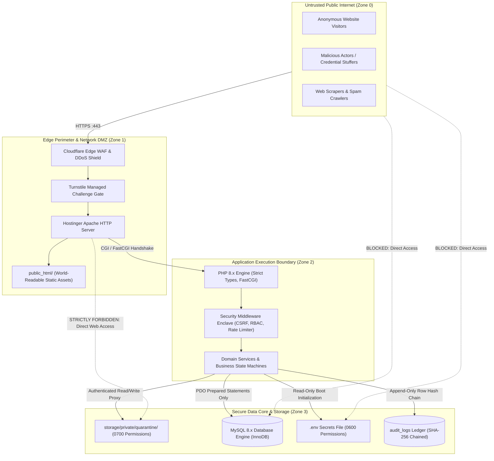
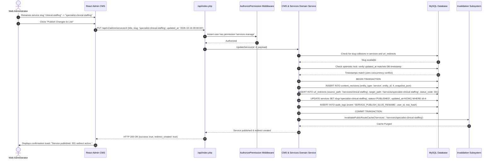

# Complete System Architecture & Engineering Blueprints

**Document Reference:** `docs/phase-02/01_COMPLETE_SYSTEM_ARCHITECTURE.md`  
**Phase:** Phase 2 of 31 — Complete System Architecture  
**Project:** Voak Health Care — Enterprise B2B Healthcare Operations Platform  
**Executing Roles:** Principal Full-Stack Software Architect, Senior React Architect, Staff PHP Backend Engineer, Database Architect, Application Security Architect  
**Baseline Authority:** Accepted Phase 0 Architecture (`docs/phase-00/07_TECHNICAL_ARCHITECTURE.md`) and Accepted Phase 1 Requirements (`docs/phase-01/01_MASTER_FUNCTIONAL_REQUIREMENTS.md`)  
**Status:** **AUTHORITATIVE ARCHITECTURAL SPECIFICATION**

---

## 1. High-Level Architecture Overview

The Voak Health Care platform is architected as an integrated B2B healthcare operational system engineered specifically for Hostinger shared hosting environments. The architecture reconciles modern single-page application (SPA) user experiences with server-authoritative security, search engine discoverability, and resilient asynchronous notification workflows.

### 1.1 Complete System Architecture Diagram

```mermaid
graph TB
    subgraph ClientLayer ["Client Browser Layer"]
        PublicUser["Public Healthcare Executive / Evaluator"]
        AdminUser["Authenticated Administrator (5 Roles)"]
        SearchCrawler["Search Engine Crawler (Googlebot)"]
    end

    subgraph EdgeLayer ["Edge & CDN Layer (Cloudflare)"]
        CF_DNS["Cloudflare DNS & Strict SSL Termination"]
        CF_Turnstile["Cloudflare Turnstile Bot Defense"]
        CF_Cache["Edge Asset Caching (Static JS, CSS, WebP)"]
    end

    subgraph HostingerRuntime ["Hostinger Domain Root (/domains/voakhealthcare.com/)"]
        subgraph WebRoot ["Public Web Root (public_html/)"]
            Apache["Apache Web Server 2.4.x (.htaccess Engine)"]
            PublicHTMLIndex["public_html/index.php (Front Controller Pre-Renderer)"]
            ReactPublicApp["Compiled React Public Bundle (/assets/app-*.js)"]
            ReactAdminApp["Compiled React Admin SPA (/assets/admin-*.js)"]
            APIGateway["public_html/api/index.php (API Gateway)"]
            StaticMedia["public_html/assets/uploads/ (Optimized WebP Images)"]
        end

        subgraph PrivateRoot ["Private Application Root (outside web root)"]
            ComposerVendor["vendor/ (PSR-4 Autoloader & Dependencies)"]
            PHP_AppCore["src/Core/ (Application Kernel & DI Container)"]
            PHP_Middleware["src/Middleware/ (CORS, CSRF, Session, RBAC)"]
            PHP_DomainServices["src/Services/ (20 Domain Business Services)"]
            PHP_Repositories["src/Repositories/ (PDO Database Access Layer)"]
            StorageQuarantine["storage/private/quarantine/ (Uploaded Resumes & RFPs)"]
            AppLogs["storage/logs/ (Daily Structured JSON Logs)"]
            AppConfig["config/ (Security, Mail, Database, Cache Config)"]
            EnvFile[".env (Environment Secrets, chmod 0600)"]
            CLIRunner["cli/ (Migrations, Outbox Worker, Audit Verifier)"]
        end

        subgraph DatabaseLayer ["Database Layer"]
            MySQLDB[("MySQL 8.x InnoDB (utf8mb4_unicode_ci)\n28 Relational Tables")]
        end

        subgraph MailOutboxPipeline ["Mail & Notification Pipeline"]
            OutboxTable[("email_queue Table\nDurable Outbox Ledger")]
            HostingerCron["Hostinger Scheduled Task / CLI Cron"]
            AuthFastPath["Bounded Synchronous Fast-Path (max 4s)"]
        end
    end

    subgraph ExternalServices ["External Infrastructure"]
        HostingerSMTP["Hostinger Authenticated SMTP Relay (:465 SSL)"]
    end

    %% Client Interactions
    PublicUser -->|HTTPS Request| CF_DNS
    AdminUser -->|HTTPS Request| CF_DNS
    SearchCrawler -->|HTTP GET Request| CF_DNS

    CF_DNS --> CF_Turnstile
    CF_Turnstile --> CF_Cache
    CF_Cache --> Apache

    %% Apache Routing
    Apache -->|Public Routes /about, /services, etc.| PublicHTMLIndex
    Apache -->|Admin Console /admin/*| ReactAdminApp
    Apache -->|API Requests /api/v1/*| APIGateway
    Apache -->|Static Assets /assets/*| StaticMedia

    %% Backend Execution
    PublicHTMLIndex -->|Query Published Content| PHP_DomainServices
    PublicHTMLIndex -->|Generate Semantic HTML #ssr-fallback| PublicUser
    PublicHTMLIndex -->|Load Client Script| ReactPublicApp
    ReactPublicApp -->|createRoot Mount into #root| PublicUser

    APIGateway --> PHP_AppCore
    PHP_AppCore --> PHP_Middleware
    PHP_Middleware --> PHP_DomainServices
    PHP_DomainServices --> PHP_Repositories
    PHP_Repositories --> MySQLDB

    %% File Quarantine
    PHP_DomainServices -->|Save Encrypted / Quarantined Uploads| StorageQuarantine
    PHP_DomainServices -->|Authenticated Streaming Proxy| StorageQuarantine
    PHP_DomainServices -->|Write Audit & App Logs| AppLogs

    %% Email Delivery
    PHP_DomainServices -->|Enqueue Notification| OutboxTable
    PHP_DomainServices -->|Urgent Auth Password Reset / MFA| AuthFastPath
    AuthFastPath -->|Bounded Socket Dispatch| HostingerSMTP
    HostingerCron -->|Atomic Claim & Dispatch| CLIRunner
    CLIRunner --> OutboxTable
    CLIRunner -->|SMTP Socket Connection| HostingerSMTP
```



---

## 2. Fifteen Architectural Components & Responsibilities

The system is partitioned into 15 distinct architectural subsystems, each with strictly defined boundaries, zero cyclic dependencies, and explicit inputs and outputs:

| Component ID | Subsystem Name | Physical Location | Core Responsibilities | Inbound Dependencies | Outbound Dependencies |
| :---: | :--- | :--- | :--- | :--- | :--- |
| **C-01** | **Browser Request Entry Points** | Browser Client | Initiates HTTP/HTTPS requests, renders React UI, captures user input, manages client routing history. | User actions | Edge CDN (C-02) |
| **C-02** | **Hostinger Apache Routing** | `public_html/.htaccess` | SSL enforcement, security header injection, route discrimination between static files, PHP API, and public pre-renderer. | Browser (C-01), Edge CDN | C-03, C-04, C-05, C-10 |
| **C-03** | **React Public Application** | `public_html/assets/app-*.js` | Client-side interactivity, dynamic catalog filtering, multi-step RFP wizard, interactive accordions, Motion animations. | Apache (C-02) | PHP API (C-05) |
| **C-04** | **React Administration App** | `public_html/assets/admin-*.js` | Secure administrative SPA, 19 console modules, TanStack Query cache, role-aware navigation, outbox monitor. | Apache (C-02) | PHP Admin API (C-05) |
| **C-05** | **PHP API Front Controller** | `public_html/api/index.php` | API bootstrapping, environment validation, error handler initialization, routing to versioned `/api/v1/*` routes. | Apache (C-02) | PHP Middleware (C-06), Core (C-07) |
| **C-06** | **PHP Middleware Pipeline** | `src/Middleware/` | Rate limiting, CORS, CSRF token verification, Session validation (`Path=/api/v1/admin`), RBAC permission checks. | API Gateway (C-05) | Domain Services (C-07) |
| **C-07** | **PHP Domain Services** | `src/Services/` | 20 domain business services implementing business logic, state machine transitions, input sanitization, and workflow triggers. | Middleware (C-06) | Repositories (C-08), Storage (C-10), Outbox (C-11) |
| **C-08** | **Database Repositories** | `src/Repositories/` | PDO data access layer executing parameterized SQL queries, mapping relational rows to typed domain entities. | Domain Services (C-07) | MySQL Database (C-09) |
| **C-09** | **MySQL Database** | Hostinger MySQL Engine | InnoDB relational storage, foreign key constraints, unique indexes, transactions, utf8mb4 character set. | Repositories (C-08) | File Storage (C-10) |
| **C-10** | **Private Document Storage** | `storage/private/quarantine/` | Secure quarantine of uploaded resumes and RFP tender files located strictly outside public web root; zero direct URL access. | Services (C-07) | Hostinger Filesystem |
| **C-11** | **Email Delivery Mechanisms** | `src/Services/Email/` & `cli/` | Bounded synchronous fast-path for urgent auth; durable `email_queue` outbox; atomic queue claiming; Hostinger CLI worker. | Services (C-07), CLI Runner | Hostinger SMTP Relay |
| **C-12** | **Public HTML Pre-Rendering** | `public_html/index.php` | Front controller pre-rendering semantic HTML, OpenGraph, JSON-LD into `<article id="ssr-fallback">` for SEO bots. | Apache (C-02) | Domain Services (C-07), React App (C-03) |
| **C-13** | **Administrative Authentication** | `src/Services/Auth/` | Bcrypt password verification (cost 12), 15m brute-force lockout, RFC 6238 TOTP MFA, session token generation. | Middleware (C-06) | Repositories (C-08), Outbox (C-11) |
| **C-14** | **Logging & Audit Ledger** | `src/Services/Audit/` & `storage/logs/` | Cryptographic SHA-256 row hash chained audit ledger (`audit_logs`), structured daily JSON error and security logs. | Services (C-07), Kernel | MySQL Database (C-09), Filesystem |
| **C-15** | **Deployment & Release Process** | CI/CD Pipeline & CLI | Vite compilation, Composer production optimization, migration runner (`cli/migrate.php`), atomic release symlinks. | Git Repository | Hostinger Filesystem |

---

## 3. Detailed Component Diagram

```mermaid
graph LR
    subgraph FrontendComponents ["Frontend Component Architecture"]
        subgraph PublicApp ["Public Application (React 18+)"]
            PubNav["Navigation & Mobile Drawer"]
            PubHero["Asymmetric Hero & Bento Grid"]
            PubFilter["Service / Industry Discovery"]
            PubRFP["4-Step RFP Wizard Engine"]
            PubCareers["Job Application & Upload"]
            PubFallback["#ssr-fallback Semantic Reader"]
        end

        subgraph AdminApp ["Admin Console Application (React 18+)"]
            AdminAuth["Auth Gate & TOTP MFA Dialog"]
            AdminLayout["Sidebar & Module Shell"]
            AdminCRM["Inquiries, RFP & Partner Desks"]
            AdminCMS["Page, Service & Article CMS"]
            AdminOutbox["Module 12 Outbox Telemetry"]
            AdminAudit["Module 19 Audit Explorer"]
        end
    end

    subgraph BackendModules ["Backend Module Architecture (PHP 8.x)"]
        subgraph CorePlatform ["Core Subsystems"]
            DIContainer["DI Container & Config Engine"]
            Router["REST Router (/api/v1/*)"]
            ExceptionHandler["Global Exception & Error Normalizer"]
        end

        subgraph SecurityPipeline ["Security Middleware Pipeline"]
            RateLimiter["IP Rate Limiter Middleware"]
            CSRFGuard["CSRF Synchronizer Token Middleware"]
            SessionGuard["Session Auth Guard (Path=/api/v1/admin)"]
            RBACGate["RBAC Gate (AuthorizePermission)"]
        end

        subgraph DomainServices ["Domain Service Layer (20 Modules)"]
            AuthSvc["Auth & MFA Service"]
            PageSvc["Page & Content CMS Service"]
            ServiceSvc["Services Catalog Service"]
            IndustrySvc["Industries Catalog Service"]
            MediaSvc["Media & WebP Processing Service"]
            InquirySvc["Contact CRM & State Machine"]
            ProposalSvc["Proposal Desk & Quarantine Svc"]
            CareerSvc["Careers & Recruitment Service"]
            SEOSvc["SEO Engine & Redirect Manager"]
            EmailSvc["Email Outbox & Dispatch Service"]
            AuditSvc["Audit Ledger & SHA256 Chaining Svc"]
        end

        subgraph Persistence ["Persistence Layer"]
            RepoLayer["Repository Interfaces & PDO Impls"]
            DBConnection["PDO Database Connection (utf8mb4)"]
        end
    end

    %% Wiring
    PubRFP -->|POST /api/v1/public/proposals/submit| Router
    PubCareers -->|POST /api/v1/public/careers/apply| Router
    AdminAuth -->|POST /api/v1/admin/auth/login| Router
    AdminCMS -->|PUT /api/v1/admin/services/{id}| Router
    AdminOutbox -->|POST /api/v1/admin/email-queue/{id}/retry| Router

    Router --> RateLimiter
    RateLimiter --> CSRFGuard
    CSRFGuard --> SessionGuard
    SessionGuard --> RBACGate
    RBACGate --> DomainServices

    DomainServices --> RepoLayer
    RepoLayer --> DBConnection
```

---

## 4. End-to-End Request Lifecycles

### 4.1 Public SEO Pre-Rendering & React Mounting Lifecycle

```mermaid
sequenceDiagram
    autonumber
    actor Crawler as Googlebot / Public Browser
    participant Apache as Apache Web Server (.htaccess)
    participant PHPPre as public_html/index.php (Pre-Renderer)
    participant DB as MySQL Database
    participant Client as Client Browser (React Engine)

    Crawler->>Apache: GET /services/clinical-workforce-solutions
    Apache->>Apache: Check if static file exists; NO -> Rewrite to index.php
    Apache->>PHPPre: Route request to Front Controller
    PHPPre->>DB: Query published service where slug='clinical-workforce-solutions'
    DB-->>PHPPre: Return service record, deliverables, SLA specs
    PHPPre->>PHPPre: Generate Schema.org JSON-LD, OpenGraph meta, Title
    PHPPre->>PHPPre: Render semantic HTML inside <article id="ssr-fallback">
    PHPPre-->>Crawler: HTTP/1.1 200 OK + Full HTML Body (Semantic pre-render)
    
    note over Crawler,Client: Search Engine Crawler extracts semantic HTML directly without JavaScript execution.

    Client->>Client: Browser parses HTML; begins downloading /assets/app-*.js
    Client->>Client: React initializes: createRoot(document.getElementById('root')).render(<App />)
    Client->>Client: CSS rule triggers: #root:not(:empty) + #ssr-fallback { display: none; }
    Client->>PHPPre: (Optional) Background fetch GET /api/v1/public/services/clinical-workforce-solutions
    note over Client: React interactive UI seamlessly replaces fallback. Zero hydration mismatch errors.
```

---

## 5. Trust Boundaries & Security Enclaves



---

## 6. Comprehensive Sequence Diagrams

### 6.1 Administrative Authentication & RFC 6238 TOTP Sequence

```mermaid
sequenceDiagram
    autonumber
    actor Admin as Administrative User
    participant Browser as React Admin SPA
    participant APIGateway as /api/index.php
    participant AuthMid as Session & RateLimit Middleware
    participant AuthSvc as Authentication Domain Service
    participant DB as MySQL Database
    participant FastPath as Bounded Fast-Path Mailer

    Admin->>Browser: Enters email and password on /admin/login
    Browser->>APIGateway: POST /api/v1/admin/auth/login {email, password}
    APIGateway->>AuthMid: Check IP rate limit (max 5 attempts / 15 min)
    AuthMid-->>APIGateway: Rate limit OK
    APIGateway->>AuthSvc: AuthenticateCredentials(email, password)
    AuthSvc->>DB: Query user by email
    DB-->>AuthSvc: Return user record with password_hash and mfa_enrolled
    AuthSvc->>AuthSvc: Verify password via password_verify() (Bcrypt cost 12)
    
    alt Password Invalid
        AuthSvc->>DB: Increment failed_login_attempts
        AuthSvc-->>Browser: HTTP 401 Unauthorized "Invalid credentials"
    else Password Valid but MFA Enrolled
        AuthSvc->>DB: Issue temporary MFA pre-auth token (expires in 5m)
        AuthSvc-->>Browser: HTTP 200 OK {status: "MFA_REQUIRED", mfa_token: "tmp_xyz"}
        Browser->>Admin: Prompts for 6-digit TOTP code
        Admin->>Browser: Enters TOTP code "654321"
        Browser->>APIGateway: POST /api/v1/admin/auth/mfa/verify {mfa_token, code}
        APIGateway->>AuthSvc: VerifyTOTP(mfa_token, code)
        AuthSvc->>DB: Retrieve AES-256 encrypted TOTP secret from admin_mfa_secrets
        AuthSvc->>AuthSvc: Validate RFC 6238 time step (+/- 1 drift)
        
        alt Code Invalid
            AuthSvc-->>Browser: HTTP 401 Unauthorized "Invalid TOTP code"
        else Code Valid
            AuthSvc->>DB: INSERT INTO admin_sessions (session_token, user_id, ip_address, expires_at)
            AuthSvc->>DB: Reset failed_login_attempts = 0
            AuthSvc->>DB: INSERT INTO audit_logs (event: 'AUTH_LOGIN_SUCCESS', user_id)
            AuthSvc-->>APIGateway: Session established
            APIGateway-->>Browser: HTTP 200 OK + Set-Cookie: voak_admin_session=tok_123; Path=/api/v1/admin; Secure; HttpOnly; SameSite=Lax
            Browser->>Browser: Route transition to /admin/dashboard
        end
    end
```

---

### 6.2 Enterprise Business Proposal & Quarantined Tender Submission

```mermaid
sequenceDiagram
    autonumber
    actor Client as Procurement Director
    participant Browser as React Public RFP Wizard
    participant APIGateway as /api/index.php
    participant ValMid as Turnstile & Upload Validator
    participant PropSvc as Proposal Domain Service
    participant Storage as storage/private/quarantine/
    participant DB as MySQL Database
    participant Outbox as email_queue Table

    Client->>Browser: Completes Steps 1-3; attaches tender_spec.pdf in Step 4
    Browser->>Browser: Client-side Zod validation & Turnstile challenge completion
    Browser->>APIGateway: POST /api/v1/public/proposals/submit (multipart/form-data)
    APIGateway->>ValMid: Validate Cloudflare Turnstile token
    ValMid-->>APIGateway: Turnstile Valid
    APIGateway->>ValMid: Inspect file: size <= 15MB, check MIME magic bytes via finfo
    ValMid-->>APIGateway: Magic bytes confirm genuine application/pdf
    
    APIGateway->>PropSvc: SubmitEnterpriseProposal(payload, uploaded_file)
    PropSvc->>PropSvc: Generate UUID filename: doc_550e8400-e29b-41d4-a716-446655440000.pdf
    PropSvc->>Storage: Move file to storage/private/quarantine/ (chmod 0600)
    
    PropSvc->>DB: BEGIN TRANSACTION
    PropSvc->>DB: INSERT INTO proposals (ref_code, organization_name, contact_email, file_path, status)
    PropSvc->>DB: INSERT INTO proposal_services (proposal_id, service_id)
    PropSvc->>Outbox: INSERT INTO email_queue (template: 'RFP_CONFIRMATION_CLIENT', recipient: email)
    PropSvc->>Outbox: INSERT INTO email_queue (template: 'RFP_NOTIFICATION_ADMIN', recipient: ops_email)
    PropSvc->>DB: COMMIT TRANSACTION
    
    PropSvc-->>APIGateway: Proposal created successfully
    APIGateway-->>Browser: HTTP 201 Created {reference_code: "RFP-20261016-0042"}
    Browser->>Client: Displays Success Screen with reference code and SLA next steps
```

---

### 6.3 CMS Editorial Publishing & Automated 301 Redirect Sequence



---

### 6.4 Tri-Tier Email Delivery Architecture Sequence

```mermaid
sequenceDiagram
    autonumber
    participant App as Application Event (Auth / CRM)
    participant Outbox as email_queue (MySQL Table)
    participant FastPath as Synchronous Fast-Path Dispatcher
    participant Cron as Hostinger Scheduled Task (CLI)
    participant AdminConsole as Module 12 Outbox Telemetry
    participant SMTP as Hostinger SMTP Relay (:465)

    alt Case 1: Urgent Security Event (Password Reset / TOTP Invite)
        App->>FastPath: Trigger urgent notification
        FastPath->>Outbox: INSERT INTO email_queue (status='PROCESSING', claimed_at=NOW())
        FastPath->>SMTP: Connect socket (timeout: 3s) & send HELO/AUTH/DATA (timeout: 4s)
        alt SMTP Success
            SMTP-->>FastPath: 250 OK Message accepted
            FastPath->>Outbox: UPDATE email_queue SET status='SENT', sent_at=NOW()
        else SMTP Socket Timeout or Error
            SMTP-->>FastPath: Connection Refused / Timeout
            FastPath->>Outbox: UPDATE email_queue SET status='FAILED', attempts=1, next_retry_at=NOW()+5m
            note over FastPath,Outbox: Request cycle does NOT crash. Failed email is queued for background retry.
        end
    else Case 2: Standard Asynchronous Inquiry / RFP Confirmation
        App->>Outbox: INSERT INTO email_queue (status='QUEUED', attempts=0)
        note over Outbox: Enqueued instantaneously with zero HTTP socket latency.
        
        loop Every Scheduled Execution (Hostinger Cron CLI)
            Cron->>Outbox: UPDATE email_queue SET status='PROCESSING', worker_id='cli_1', claimed_at=NOW() WHERE status='QUEUED' OR (status='FAILED' AND attempts < 3 AND next_retry_at <= NOW()) LIMIT 20
            Cron->>SMTP: Dispatch claimed batch sequentially via persistent SMTP socket
            Cron->>Outbox: UPDATE email_queue SET status='SENT', sent_at=NOW()
        end
    else Case 3: Admin Manual Retry via Module 12 Console
        actor Admin as Web Administrator
        Admin->>AdminConsole: Inspects outbox; views failed message; clicks "Retry Send"
        AdminConsole->>Outbox: POST /api/v1/admin/email-queue/84/retry
        Outbox->>Outbox: UPDATE email_queue SET status='QUEUED', attempts=0, error_message=NULL WHERE id=84
        AdminConsole-->>Admin: "Message requeued for immediate dispatch."
    end
```

---

## 7. Architecture Anti-Cyclic Dependency Verification

The 20 domain modules and infrastructure layers adhere strictly to a **unidirectional layered dependency model**. Dependencies flow exclusively downwards:

$$\text{Presentation (React / Pre-Renderer)} \longrightarrow \text{Routing \& Middleware} \longrightarrow \text{Domain Services} \longrightarrow \text{Repositories} \longrightarrow \text{MySQL Storage}$$

- **Zero Circular Module Dependencies:** If `InquiryService` needs to send an email, it invokes `EmailOutboxService::enqueue()`. `EmailOutboxService` possesses zero awareness of `InquiryService`.
- **Zero Cross-Repository Coupling:** Repositories interact only with their own database entity tables. Cross-aggregate relationships are coordinated exclusively by the Service layer inside explicit database transactions.
- **Fail-Closed Execution:** Any unhandled infrastructure exception triggers immediate rollback and normalizes into a sanitized JSON error envelope with correlation ID (`REF-ERR-XXXXXX`).
