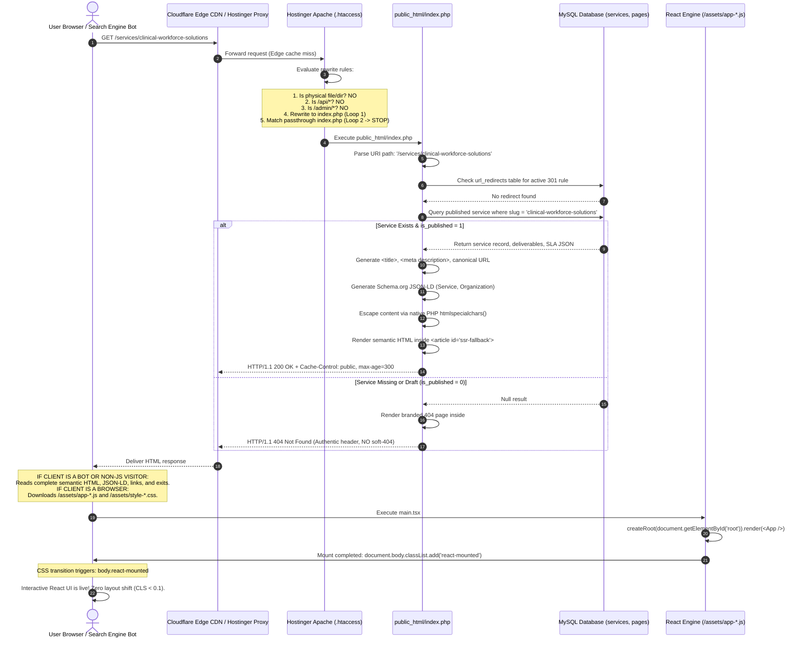

# SEO, Public Rendering and Routing Architecture

**Document Reference:** `docs/phase-02/07_SEO_RENDERING_AND_ROUTING_ARCHITECTURE.md`  
**Phase:** Phase 2 of 31 — Complete System Architecture  
**Project:** Voak Health Care — Enterprise B2B Healthcare Operations Platform  
**Executing Role:** SEO Rendering Architect & Web Performance Specialist  
**Baseline Authority:** Accepted Phase 0 Strategy (`docs/phase-00/11_SEO_AND_RENDERING_STRATEGY.md`) and Accepted Phase 1 Specifications (`docs/phase-01/12_SEO_ACCESSIBILITY_AND_RESPONSIVENESS.md`)  
**Status:** **AUTHORITATIVE ARCHITECTURAL SPECIFICATION** (Design Only — Implementation Deferred to Phases 16 & 29)

---

## 1. Architectural Validation & Rendering Paradigm Clarification

The intersection of a modern React SPA, a PHP 8.x backend, and Hostinger shared hosting requires a technically precise rendering contract.

### 1.1 What the Architecture Is — and What It Is NOT
To eliminate technical misconceptions and align engineering teams:
1. **PHP HTML Generation is NOT React SSR:**  
   The server generates semantic HTML via PHP templates and string interpolation querying MySQL. It does **not** execute a V8 JavaScript runtime, Node.js process, or call React's `renderToString()`.
2. **React `createRoot` Mounting is NOT Hydration:**  
   The client executes standard `ReactDOM.createRoot(container).render(<App />)`. It mounts into a designated DOM container. It does **not** attach event listeners to existing server DOM nodes via `hydrateRoot()`.
3. **Why True `hydrateRoot` is Inappropriate Here:**  
   React's `hydrateRoot()` requires the server HTML markup to be an exact 1-to-1 byte-for-byte match with React's virtual DOM output. Without running React in a Node.js server or pre-generating React SSR bundles in CI, attempting `hydrateRoot` on PHP-generated HTML results in severe React hydration mismatch warnings, DOM thrashing, and unmounting bugs.
4. **The Validated, Robust Solution: Controlled Progressive Client Takeover:**  
   The platform delivers complete, accessible semantic HTML directly inside `<article id="ssr-fallback">`. The React application initializes in `<div id="root"></div>`. Only after React has successfully initialized and completed its initial paint does it signal readiness by adding the class `react-mounted` to `document.body`. Critical CSS then gracefully transitions `#ssr-fallback` out of the visual tree. If JavaScript fails to load, execute, or crashes, `#ssr-fallback` remains 100% visible, fully readable, accessible, and functional.

---

## 2. End-to-End Request Routing & Execution Flow



---

## 3. Resolving Filesystem & Entry Point Inconsistencies

To ensure absolute operational clarity on Hostinger shared hosting, the relationship between files in `public_html/` is strictly codified:

```
public_html/
├── .htaccess                      # Authoritative Apache rewrite rules
├── index.php                      # Public Front Controller & Hybrid Pre-Renderer
├── admin/                         # Administrative SPA Container
│   └── index.html                 # Admin SPA entry shell (separate from public)
├── api/                           # API Gateway
│   └── index.php                  # REST API Front Controller (/api/v1/*)
├── assets/                        # Compiled production frontend bundles
│   ├── app-a1b2c3d4.js            # Public React application bundle
│   ├── admin-e5f6g7h8.js          # Admin React application bundle
│   ├── style-9i0j1k2l.css         # Compiled Tailwind stylesheet
│   └── uploads/                   # Public WebP media library images
└── sitemap.xml                    # Dynamic rewrite or physical sitemap
```

### 3.1 Authoritative Production `public_html/.htaccess` Configuration

The rewrite ruleset explicitly excludes physical files, physical directories, and resolved target entry points from recursive rewriting, permanently preventing self-rewriting, unexpected fallback routing, or internal redirect loops:

```apache
# ----------------------------------------------------------------------
# 1. Hostinger Environment & Rewrite Engine Initialization
# ----------------------------------------------------------------------
RewriteEngine On
RewriteBase /

# ----------------------------------------------------------------------
# 2. Canonical HTTPS Enforcement (Cloudflare & Hostinger Reverse Proxy Safe)
# ----------------------------------------------------------------------
RewriteCond %{HTTPS} off
RewriteCond %{HTTP:X-Forwarded-Proto} !https
RewriteRule ^ https://%{HTTP_HOST}%{REQUEST_URI} [L,R=301]

# ----------------------------------------------------------------------
# 3. Deny Direct Web Access to Sensitive Files, Dirs, & Private Storage
# ----------------------------------------------------------------------
RewriteRule ^(\.env|\.git|\.agents|config/|storage/|vendor/|cli/|composer\.(json|lock)|package(-lock)?\.json) - [F,L]
RewriteRule \.(bak|config|sql|fla|psd|ini|log|sh|inc|swp|dist|md|json)$ - [F,L]

# ----------------------------------------------------------------------
# 4. Stop Processing Immediately for Real Physical Files & Directories
# ----------------------------------------------------------------------
RewriteCond %{REQUEST_FILENAME} -f [OR]
RewriteCond %{REQUEST_FILENAME} -d
RewriteRule ^ - [L]

# ----------------------------------------------------------------------
# 5. Prevent Self-Rewriting & Infinite Loops for Target Entry Points
# ----------------------------------------------------------------------
RewriteRule ^(index\.php|api/index\.php|admin/index\.html)$ - [L]

# ----------------------------------------------------------------------
# 6. Route API Requests to PHP API Front Controller (/api/index.php)
# ----------------------------------------------------------------------
RewriteRule ^api(/.*)?$ api/index.php [QSA,L]

# ----------------------------------------------------------------------
# 7. Route Admin SPA Client-Side Routes to Admin SPA (/admin/index.html)
# ----------------------------------------------------------------------
RewriteRule ^admin(/.*)?$ admin/index.html [L]

# ----------------------------------------------------------------------
# 8. Route All Public Frontend Page Requests to Public PHP Front Controller
# ----------------------------------------------------------------------
RewriteRule ^ index.php [QSA,L]
```

---

## 4. Layout Shift (CLS) and Parity Preservation

### 4.1 Controlled Progressive Takeover Contract
Relying on `#root:not(:empty)` is architecturally fragile: an unhandled exception in React, a third-party script injecting into `#root`, or a blank loading state would hide the server-rendered fallback before real content rendered, producing blank screens or layout shifts.

The Voak platform enforces **Controlled Progressive Client Takeover**:
1. **Container Geometric Matching:**
   Both `<div id="root">` and `<article id="ssr-fallback">` share identical layout geometry, padding, typography tokens, and CSS container classes:
   ```html
   <!-- Rendered by index.php -->
   <main class="min-h-screen bg-[#F2F0F8] text-[#252B5E] font-sans">
       <div id="root"></div>
       <article id="ssr-fallback" class="max-w-7xl mx-auto px-4 sm:px-6 lg:px-8 py-12">
           <h1 class="font-serif text-4xl sm:text-5xl font-bold mb-6">...</h1>
           <div class="prose max-w-none text-[#50567A]">...</div>
       </article>
   </main>
   ```
2. **Lifecycle-Coupled Transition via Critical CSS:**
   ```css
   /* Inlined critical CSS in <head> */
   #ssr-fallback {
       display: block;
   }
   body.react-mounted #ssr-fallback {
       display: none !important;
   }
   ```
3. **Controlled Handshake in React (`main.tsx`):**
   ```typescript
   // Executed inside React root component after first layout paint
   useLayoutEffect(() => {
     document.body.classList.add('react-mounted');
   }, []);
   ```
4. **Fault Tolerance & Zero-JS Resiliency:**
   If JavaScript fails to download, is blocked by client ad-blockers, or throws an unhandled error during startup:
   - `body.react-mounted` is **never added**.
   - `#ssr-fallback` remains permanently visible and functional.
   - The user continues to read the full page content without layout breakage.
5. **Accessibility & Focus Preservation:**
   Assistive screen readers parse `#ssr-fallback` immediately upon page load. When React mounts, focus is managed gracefully via skip-link targets (`#main-content`) without triggering disorientation or screen-reader resets.

### 4.2 Content Equivalence & Anti-Cloaking Guarantee
Search engines penalize websites that display disparate content to crawlers versus human visitors (cloaking).

**The Voak Architecture Guarantee:**
- Both the PHP pre-renderer (`index.php`) and the React application query the **identical MySQL database tables** (`services`, `industries`, `articles`, `pages`).
- All dynamic strings rendered into `#ssr-fallback` by PHP are safely sanitized server-side using native PHP escaping:
  ```php
  echo htmlspecialchars($value, ENT_QUOTES | ENT_SUBSTITUTE | ENT_HTML5, 'UTF-8');
  ```
  Rich text editorial bodies are sanitized via a strict PHP-side HTMLPurifier allowlist.
- No user-agent sniffing or discrimination occurs; search bots and regular browsers receive the identical initial HTTP payload.

---

## 5. Dynamic Sitemap & Metadata Generation

### 5.1 Dynamic XML Sitemap (`/sitemap.xml`)
The sitemap is dynamically generated or rebuilt upon CMS publishing events:
- **Canonical URLs:** All 22 public pages, published services (`/services/:slug`), published industries (`/industries/:slug`), and published articles (`/insights/:slug`).
- **Exclusion Filters:** Strictly excludes drafts (`is_published = 0`), archived records, `/admin/*` routes, and `/api/*` endpoints.
- **Timestamps:** `<lastmod>` matches the entity's exact `updated_at` timestamp in W3C ISO 8601 format (`YYYY-MM-DD`).

### 5.2 Structured Data (JSON-LD) Schemas
Every public page includes valid Schema.org JSON-LD in the `<head>`:
- **Homepage (`/`):** `Organization` schema (brand name, official URL, logo, contact points).
- **Service Detail (`/services/:slug`):** `Service` schema (service name, provider, operational category, areaServed).
- **Article Detail (`/insights/:slug`):** `Article` schema (headline, author, datePublished, dateModified, publisher).
- **FAQ Page (`/faqs`):** `FAQPage` schema with mapped `Question` and `acceptedAnswer` entities.

---

## 6. Cache Invalidation Architecture

When an administrator edits or publishes content via the Admin CMS:
1. **Database Update:** Entity is updated, revision snapshot is created in `content_revisions`.
2. **Local Cache Invalidation:** The PHP application clears its local query cache for that entity slug.
3. **Sitemap Rebuild Trigger:** The sitemap generator updates the entity's `<lastmod>` entry.
4. **Cloudflare Edge Cache Purge:** If Cloudflare API keys are configured, the backend issues an asynchronous cache purge request for the specific URL (`POST /zones/:id/purge_cache`).
5. **Immediate Discoverability:** The next crawler or visitor request receives fresh content immediately.
