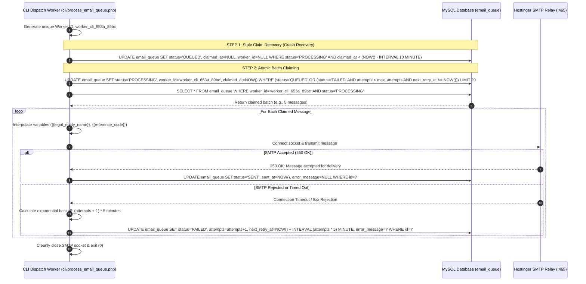

# Email Outbox and Transactional Notification Architecture

**Document Reference:** `docs/phase-02/08_EMAIL_OUTBOX_AND_DELIVERY_ARCHITECTURE.md`  
**Phase:** Phase 2 of 31 — Complete System Architecture  
**Project:** Voak Health Care — Enterprise B2B Healthcare Operations Platform  
**Executing Role:** Site Reliability Engineer & PHP Backend Infrastructure Architect  
**Baseline Authority:** Accepted Phase 1 Email Specification (`docs/phase-01/10_EMAIL_NOTIFICATION_REQUIREMENTS.md`)  
**Status:** **AUTHORITATIVE ARCHITECTURAL SPECIFICATION** (Design Only — Implementation & Live Testing Deferred to Phase 13)

---

## 1. Hosting Constraints & Environmental Reality

Transactional email delivery on shared web hosting environments requires strict defensive engineering:

### 1.1 Hostinger Environmental Constraints Evaluated
- **Queued Status Does Not Equal Delivered Status:**  
  Writing an outbox record with `status = 'QUEUED'` guarantees durable transactional persistence in MySQL, but does **not** guarantee delivery to the recipient's inbox. Final delivery depends on SMTP transport availability, DNS SPF/DKIM/DMARC records, recipient mail server anti-spam filters, and worker execution.
- **PHP Execution Limits:** Web HTTP requests are subject to strict maximum execution time limits (typically 30 seconds). Performing synchronous SMTP socket handshakes across external mail relays during a web request risks execution timeouts, gateway 504 errors, and blocked user interfaces.
- **Unreliable Non-Blocking Hooks:** Mechanisms such as `fastcgi_finish_request()` or `register_shutdown_function()` are **NOT guaranteed** to operate in a non-blocking background manner across all shared hosting FastCGI configurations and are strictly rejected as primary background worker mechanisms.
- **Cron Granularity & Status (UNVERIFIED):** Hostinger scheduled tasks (cron jobs) are available on select plans, but their minimum execution interval (e.g. 15 minutes on basic tiers versus 1 minute on cloud tiers) and execution reliability remain **UNVERIFIED** for this specific hosting account. **A 1-minute cron schedule cannot be assumed.**
- **Network Sockets & TLS:** Outbound SMTP connections over port 465 (SMTPS) or 587 (STARTTLS) to `smtp.hostinger.com` are supported, but subject to strict network latency, connection timeouts, and daily volume caps (typically 500 emails/day on shared hosting).

---

## 2. Tri-Tier Notification Dispatch Architecture

To decouple user request latency from email transport networks while ensuring critical administrative events are not lost, the platform implements a **tri-tier delivery architecture**:

```
                                APPLICATION EVENT
                         (User Action / Inbound Form)
                                      │
                 ┌────────────────────┴────────────────────┐
                 ▼                                         ▼
   URGENT SECURITY NOTIFICATIONS             STANDARD BUSINESS NOTIFICATIONS
   (Password Reset, MFA Alert, Invite)       (Inquiries, RFPs, Applications)
                 │                                         │
                 ▼                                         ▼
   TIER 1: SYNCHRONOUS FAST-PATH             TIER 2: DURABLE OUTBOX (email_queue)
   - Bounded Socket Timeout (max 4s)         - Instantaneous database insert (< 5ms)
   - Immediate success feedback              - Atomic queue claiming
   - Fallback to outbox on timeout           - Decoupled from user HTTP cycle
                                                           │
                                   ┌───────────────────────┴───────────────────────┐
                                   ▼                                               ▼
                     HOSTINGER CLI CRON TASK                        TIER 3: ADMIN OUTBOX CONSOLE
                     (Primary Dispatch Worker)                      (Manual Retry & HMAC Webhook Fallback)
                     - Claim batch of 20                            - Module 12 Telemetry Dashboard
                     - Exponential backoff                          - Single-click manual retry API
                     - Stale claim recovery                         - External HMAC webhook fallback
```

### 2.1 Tier 1: Bounded Synchronous Fast-Path for Urgent Security Events
For single-recipient, security-sensitive actions where a user is waiting actively in their browser session:
- **Eligible Events:** Admin Password Reset link, Staff Account Invitation, Suspicious Login Alert.
- *(Note: RFC 6238 TOTP Authenticator codes do NOT use email; they are generated on mobile authenticator apps independently of email infrastructure).*
- **Bounded Socket Configuration:**
  - Connection Timeout: **3.0 seconds**.
  - Read/Write Timeout: **4.0 seconds**.
  - Total Maximum Socket Ceiling: **5.0 seconds**.
- **Resilience Behavior:** If the SMTP relay accepts the message, it is marked `SENT`. If a network timeout or connection refusal occurs, the script catches the exception, marks the outbox record as `FAILED`, and enqueues it for background retry, while returning clear guidance and an incident reference code to the user. The web request **never crashes**.

### 2.2 Tier 2: Durable Database Outbox (`email_queue`)
For all non-urgent business notifications (Contact Inquiries, RFP Submissions, Job Application acknowledgments):
- Decouples HTTP request cycles completely: writing to `email_queue` requires `< 5 milliseconds`.
- Guarantees durability: messages persist across server restarts, network outages, and SMTP maintenance windows.

### 2.3 Tier 3: Admin Outbox Telemetry & Dispatch Fallback Mechanisms
To handle hosting environments where automated background cron jobs may be throttled or unavailable:
1. **Primary Dispatch (Scheduled CLI Task):**  
   `php /home/u123456789/domains/voakhealthcare.com/cli/process_email_queue.php` configured via Hostinger hPanel Scheduled Tasks.
2. **Fallback Dispatch 1 (Manual Admin Triage & Retry):**  
   Administrators inspect failed or pending queues in Admin Module 12 (`/admin/email-templates/outbox`) and trigger manual single-click re-dispatch via `POST /api/v1/admin/email-queue/{id}/retry`.
3. **Fallback Dispatch 2 (HMAC-Authenticated Webhook Trigger):**  
   If native cron is restricted, an external monitoring service (e.g., UptimeRobot) can trigger a secure, rate-limited dispatch run via `POST /api/v1/admin/email-queue/dispatch` authenticated via a shared secret header (`X-Voak-Signature: sha256=...`).
4. **Explicit Production Blocker Condition:**  
   If the hosting environment provides no supported automated dispatch mechanism (neither CLI cron nor external HTTP webhook capability), unattended notification delivery is marked **BLOCKED**, requiring a hosting upgrade before going live.

---

## 3. Atomic Queue Claiming & Concurrency Control

To prevent duplicate emails when multiple workers or webhooks run concurrently, the dispatch worker executes **Atomic Queue Claiming** using MySQL row-level locking:



---

## 4. Exponential Backoff, Dead-Letter & Error Classification

### 4.1 Retry Schedule & Maximum Attempts
- **Maximum Attempt Ceiling:** Exactly 3 attempts (`max_attempts = 3`).
- **Exponential Backoff Formula:**
  $$\text{next\_retry\_at} = \text{NOW}() + (\text{attempts} \times 5\text{ minutes})$$
  - Attempt 1 Failure: Retries after **5 minutes**.
  - Attempt 2 Failure: Retries after **10 minutes**.
  - Attempt 3 Failure: Retries after **15 minutes**.
- **Dead-Letter State:** After 3 consecutive failures, the message transitions permanently to `FAILED`. It is never retried automatically by the background worker, preventing infinite loops and mail server blacklisting. It remains visible in Module 12 for manual administrative triage.

### 4.2 SMTP Error Classification & Triage
The email service parses SMTP response codes to determine whether a retry is warranted:

| SMTP Response Code | Error Category | Action Taken | Backoff Applied |
| :---: | :--- | :--- | :---: |
| **`421` / `450` / `451`** | Transient Mail Server Error | Enqueue for retry | Yes (Exponential) |
| **`452`** | Storage / Rate Limit Exceeded | Enqueue for retry | Yes (15m Delay) |
| **`550` / `551`** | Mailbox Does Not Exist | Mark `FAILED` permanently; do NOT retry | No Retry |
| **`552`** | Message Size Exceeded Ceiling | Mark `FAILED` permanently; do NOT retry | No Retry |
| **`554`** | Transaction Failed / Anti-Spam Rejection | Mark `FAILED`; alert administrator | No Retry |
| **Network Timeout** | Socket Read/Connect Timeout | Enqueue for retry | Yes (Exponential) |

---

## 5. Security, Secrets & Privacy Architecture

1. **SMTP Credential Protection:**  
   Hostinger production SMTP credentials (`SMTP_HOST`, `SMTP_PORT`, `SMTP_USER`, `SMTP_PASS`) are stored strictly in the server `.env` file (`chmod 0600`) located outside the web root. They are **never** committed to version control (`FR-SEC-006`).
2. **Personal Data Privacy & Redaction:**  
   The `payload_json` column stores template parameters. To comply with privacy standards, sensitive recruitment notes or candidate resumes are **never** stored inside the email queue table; only secure, short-lived reference codes are interpolated.
3. **Template Injection Defense:**  
   All variable replacements (`{{full_name}}`, `{{inquiry_details}}`) undergo strict HTML entity escaping (`htmlspecialchars($value, ENT_QUOTES, 'UTF-8')`) prior to insertion into email bodies, preventing HTML and template injection.
4. **Mandatory Configuration Variables:**  
   Every outgoing email template enforces dynamic rendering of `{{legal_entity_name}}`, `{{registered_address}}`, and `{{privacy_policy_url}}` in the footer.
