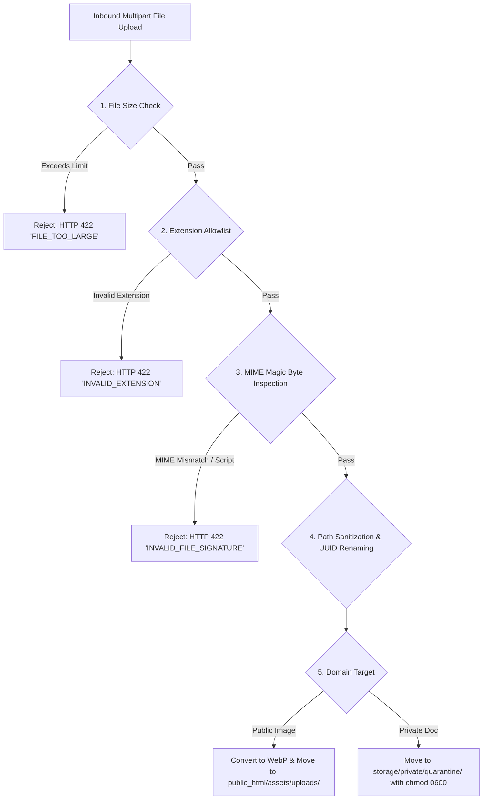

# Media Storage and Document Security Architecture

**Document Reference:** `docs/phase-02/09_MEDIA_STORAGE_AND_SECURITY.md`  
**Phase:** Phase 2 of 31 — Complete System Architecture  
**Project:** Voak Health Care — Enterprise B2B Healthcare Operations Platform  
**Executing Role:** Application Security Architect & Storage Systems Specialist  
**Baseline Authority:** Accepted Phase 0 Security Baseline (`docs/phase-00/10_SECURITY_AND_PRIVACY_BASELINE.md`) and Accepted Phase 1 Specifications (`docs/phase-01/14_SECURITY_PRIVACY_AND_AUDIT_REQUIREMENTS.md`)  
**Status:** **AUTHORITATIVE ARCHITECTURAL SPECIFICATION** (Security Architecture Only — Implementation Deferred to Phase 10)

---

## 1. Storage Partitioning & Security Enclaves

To strictly enforce data protection, the platform partitions storage into two physically and logically segregated domains:

```
                            STORAGE ARCHITECTURE
                                     │
                 ┌───────────────────┴───────────────────┐
                 ▼                                       ▼
     PUBLIC MARKETING ASSETS                   PRIVATE SENSITIVE DOCUMENTS
   (Images, Icons, WebP Assets)            (Candidate Resumes, RFP Tender Files)
                 │                                       │
                 ▼                                       ▼
    LOCATION: public_html/assets/uploads/    LOCATION: storage/private/quarantine/
    - Web-accessible via Apache              - STRICTLY OUTSIDE public_html
    - Optimized to WebP (max 1920px)         - Blocked from direct web access
    - Long-term browser caching (1 year)     - Zero execution permissions (chmod 0600)
    - Mandatory alt text enforced            - Streamed ONLY via Authenticated PHP
    - Open to public browsers & CDN          - Object-level authorization & audit log
```

---

## 2. Inbound File Validation & Anti-Malware Pipeline

Validating file extensions or trusting client-submitted `Content-Type` headers is **completely insufficient** for healthcare enterprise security. Every file upload undergoes a strict 5-stage validation pipeline:



### 2.1 Technical Pipeline Specifications

#### Stage 1: File Size Ceilings
- Public Marketing Images: Maximum **5 MB**.
- Candidate Resumes: Maximum **10 MB**.
- Enterprise RFP Tender Files: Maximum **15 MB**.
- *(Enforced by PHP `upload_max_filesize = 20M` and `post_max_size = 25M` in `.user.ini`).*

#### Stage 2: Extension Allowlists
- Images: strictly `.jpg`, `.jpeg`, `.png`, `.webp`. (All `.svg` uploads by non-Super Admins are rejected due to XML/XSS vector risks).
- Resumes & Tender Documents: strictly `.pdf`, `.docx`.

#### Stage 3: Server-Side MIME Magic Byte Inspection
The server reads the actual binary header using PHP's `finfo_open(FILEINFO_MIME_TYPE)`:
- `application/pdf` must match magic bytes `%PDF-` (`25 50 44 46`).
- `application/vnd.openxmlformats-officedocument.wordprocessingml.document` must match PKZIP header `PK\x03\x04` and contain `[Content_Types].xml`.
- If an attacker renames a `.php` or `.exe` file to `resume.pdf`, the magic byte check halts execution and emits `HTTP 422 Unprocessable Entity`.

#### Stage 4: Filename & Path Sanitization
Original client filenames are **never used on the server filesystem**:
- The file is assigned a cryptographically random UUIDv4:
  $$\text{stored\_filename} = \text{UUIDv4}() + \text{'.' } + \text{sanitized\_extension}$$
  *Example:* `doc_550e8400-e29b-41d4-a716-446655440000.pdf`.
- Stored in a hashed subfolder structure (`storage/private/quarantine/ab/cd/`) to avoid inode limits.
- The user's original filename is preserved exclusively in the database record (`original_file_name`) for safe presentation upon download.

---

## 3. Authenticated Document Streaming & Content-Disposition

### 3.1 Direct Access Denial Guarantee
The directory `storage/private/quarantine/` is located strictly **above the Apache document root** within the isolated domain directory:
- Physical Hostinger Path: `/home/u123456789/domains/voakhealthcare.com/storage/private/quarantine/`
- Document Root: `/home/u123456789/domains/voakhealthcare.com/public_html/`
- Because the directory is outside `public_html/`, the Apache web server cannot map any URL to these files.
- As defense-in-depth, an `.htaccess` file inside `storage/` enforces `Require all denied`.

### 3.2 Secure Streaming Proxy Controller
When an authorized user requests a document (e.g., `GET /api/v1/admin/proposals/42/download`), the PHP streaming controller coordinates the download:

```php
namespace Voak\Health\Modules\Proposals;

use Voak\Health\Core\Http\Response;
use Voak\Health\Core\Exceptions\NotFoundException;
use Voak\Health\Core\Exceptions\ForbiddenException;

class ProposalDocumentStreamer
{
    public function stream(int $proposalId, AdminUser $currentUser): void
    {
        // 1. Object-Level Authorization Check
        if (!$currentUser->hasPermission('proposals.download_tender')) {
            throw new ForbiddenException('Unauthorized to download tender files.');
        }

        // 2. Retrieve Database Record
        $proposal = $this->proposalRepository->find($proposalId);
        if (!$proposal) {
            throw new NotFoundException('Proposal not found.');
        }

        $filePath = $proposal->quarantined_file_path;
        if (!file_exists($filePath) || !is_readable($filePath)) {
            throw new NotFoundException('File asset missing from quarantine storage.');
        }

        // 3. Sanitized Safe Download Filename
        $safeDownloadName = preg_replace('/[^a-zA-Z0-9_\-\.]/', '_', $proposal->original_file_name);

        // 4. Cryptographic Audit Log Event
        $this->auditService->log(
            domain: 'PROPOSALS',
            action: 'PROPOSAL_DOCUMENT_DOWNLOADED',
            userId: $currentUser->id,
            entityType: 'proposal',
            entityId: $proposalId,
            diff: ['file_name' => $safeDownloadName, 'size_bytes' => filesize($filePath)]
        );

        // 5. Emit Strict Secure Download Headers
        header('Content-Type: application/pdf');
        header('Content-Disposition: attachment; filename="' . $safeDownloadName . '"');
        header('Content-Length: ' . filesize($filePath));
        header('Content-Transfer-Encoding: Binary');
        header('X-Content-Type-Options: nosniff');
        header('Cache-Control: private, no-cache, no-store, must-revalidate');
        header('Pragma: no-cache');
        header('Expires: 0');

        // 6. Stream in 64KB Chunks to Conserve Memory
        $handle = fopen($filePath, 'rb');
        while (!feof($handle)) {
            echo fread($handle, 65536);
            flush();
        }
        fclose($handle);
        exit;
    }
}
```

---

## 4. Public Media Asset Optimization & Deletion Safety

### 4.1 Automated WebP Conversion
Uploaded marketing images undergo automated processing via GD/Imagick:
1. Resized proportionally to a maximum width of **1920 pixels**.
2. Converted to WebP format at **82% quality** (reducing bandwidth by 60–80% without noticeable visual fidelity loss).
3. Responsive thumbnails generated: `_thumb.webp` (400px width for bento grid cards).
4. Stored in `public_html/assets/uploads/YYYY/MM/`.

### 4.2 Referential Integrity Deletion Protection
To prevent broken images across the live corporate website, `media_assets` enforces referential integrity:
- Before deleting an asset (`DELETE /api/v1/admin/media/{id}`), the service queries:
  - `pages.content_json`
  - `services.deliverables_json`
  - `articles.content_html`
- If the media ID is referenced anywhere on the live platform, deletion is **strictly blocked** with `HTTP 409 Conflict` and a list of referencing pages (`FR-ADM-009`).

---

## 5. Candidate Privacy & Data Retention Disposal

In compliance with healthcare B2B recruitment privacy standards:
1. **Retention Expiry Timestamp:** Every candidate application is tagged with `retention_expiry_date = NOW() + INTERVAL 6 MONTH`.
2. **Automated Anonymization & File Shredding:** A scheduled CLI task (`php cli/cleanup_retention.php`) locates expired applications:
   - Overwrites the physical resume file on disk before deleting (`unlink()`).
   - Replaces candidate personal fields in `career_applications` with `[ANONYMIZED]`.
   - Records an audit ledger event: `RECRUITMENT_RECORD_ANONYMIZED`.
