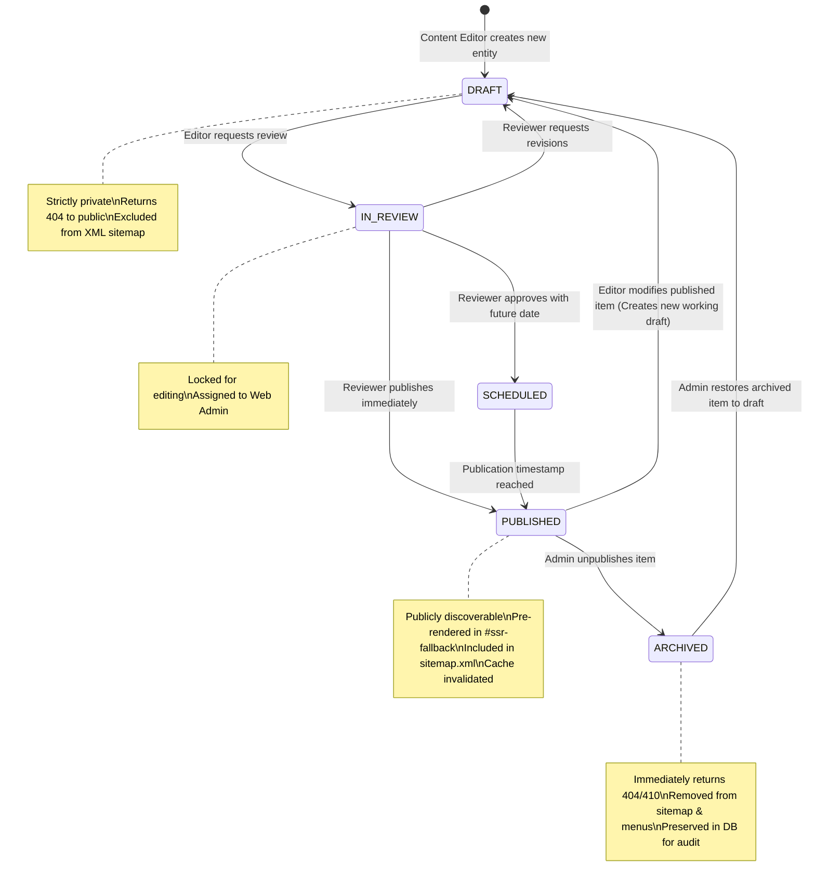
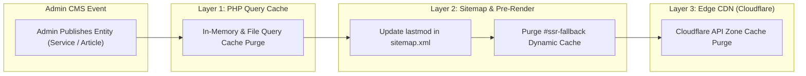

# CMS Publishing Workflows and Cache Invalidation Architecture

**Document Reference:** `docs/phase-02/10_CMS_WORKFLOWS_AND_CACHE_INVALIDATION.md`  
**Phase:** Phase 2 of 31 — Complete System Architecture  
**Project:** Voak Health Care — Enterprise B2B Healthcare Operations Platform  
**Executing Role:** Principal Full-Stack Software Architect & Editorial Systems Specialist  
**Baseline Authority:** Accepted Phase 1 CMS Workflows (`docs/phase-01/09_CMS_AND_PUBLISHING_WORKFLOWS.md`)  
**Status:** **AUTHORITATIVE ARCHITECTURAL SPECIFICATION** (Design Only — Implementation Deferred to Phases 7–16)

---

## 1. Editorial Lifecycle State Machine & Hierarchy

The platform enforces a deterministic, multi-stage editorial state machine across all publishable entities (Pages, Services, Industries, Articles, Case Studies):



---

## 2. Optimistic Concurrency Control (OCC) Architecture

When multiple administrative editors collaborate on shared corporate content (e.g., Homepage hero copy or Service SLA specifications), the platform prevents **mid-air collisions** (where Editor B silently overwrites changes just published by Editor A):

### 2.1 Concurrency Protocol Sequence
1. **Timestamp Ingestion:** When the React Admin CMS fetches an entity for editing (`GET /api/v1/admin/services/4`), the response includes the database's exact UTC timestamp: `"updated_at": "2026-10-16T08:30:00Z"`.
2. **Timestamp Submission:** When the editor clicks "Save Changes", the payload MUST include the original `updated_at` value.
3. **Atomic SQL Verification:**
   ```sql
   UPDATE services 
   SET title = :title, 
       deliverables_json = :deliverables, 
       updated_at = NOW() 
   WHERE id = :id AND updated_at = :original_updated_at;
   ```
4. **Collision Handling:**
   - If `rowCount === 1`: Mutation succeeded.
   - If `rowCount === 0`: A collision occurred. Another editor saved changes in the interim.
   - The backend halts the transaction and emits `HTTP 409 Conflict`:
     ```json
     {
       "success": false,
       "error": {
         "code": "CONCURRENCY_CONFLICT",
         "message": "This entity was modified by another user while you were editing.",
         "server_entity": { ... },
         "client_diff": { ... }
       }
     }
     ```
   - The React Admin UI presents a visual side-by-side diff modal allowing the editor to merge changes or overwrite intentionally.

---

## 3. Safe Slug Renaming & Circular Redirect Defense

Modifying a slug on an active service (`/services/clinical-workforce-solutions`) or article can break incoming external links, institutional bookmarks, and search engine indices.

### 3.1 Automated 301 Redirect Generation Pipeline
When an administrator modifies a slug:
1. **Reserved Slug Check:** The system verifies the proposed slug does not collide with reserved system routes (`/about`, `/admin`, `/api`, `/careers`, etc.).
2. **Duplicate Check:** Verifies the slug is not already used by an active entity.
3. **Automatic Redirect Insertion:**
   ```sql
   INSERT INTO url_redirects (source_path, target_path, http_status_code, is_active)
   VALUES ('/services/old-slug', '/services/new-slug', 301, 1);
   ```
4. **Circular Loop Detection & Chain Flattening:**
   If an administrator renames `A -> B` and later renames `B -> C`:
   - System updates the existing redirect (`A -> B` becomes `A -> C`) rather than creating a multi-hop chain (`A -> B -> C`).
   - If an admin renames `B -> A`, the circular reference is detected, the old redirect is deactivated, and zero infinite browser redirect loops occur (`FR-WF-006`).

---

## 4. Multi-Layer Cache Invalidation Architecture

To achieve rapid public page loads while ensuring editorial changes propagate immediately, the platform coordinates cache invalidation across three distinct layers:



1. **Layer 1: Local Query Cache Invalidation:**  
   The PHP repository layer invalidates cached serialized query results matching the modified entity ID and category.
2. **Layer 2: Pre-Renderer & Sitemap Invalidation:**  
   The front controller (`index.php`) marks the pre-rendered HTML cache for that slug as stale. The sitemap generator updates the `<lastmod>` date for that canonical URL.
3. **Layer 3: Cloudflare Edge Cache Purge:**  
   If Cloudflare credentials are configured in `.env`, the background worker dispatches a single-URL edge cache purge request via Cloudflare REST API (`POST /zones/:id/purge_cache`).

---

## 5. Unverified Content Strict Isolation Policy

In accordance with enterprise governance and Australian Consumer Law guidelines:
- **Zero Fabricated Proof:** Partner logos, hospital network affiliations, client satisfaction statistics, and executive testimonials are held in strict quarantine.
- **Mandatory Consent Release Flag:** The CMS blocks publication of case studies unless `client_consent_verified = 1` is explicitly confirmed with an attached legal release document reference (`FR-ADM-016`).
- **Total DOM Collapse:** When proof records are unverified or unpublished (`is_published = 0`), the public pre-renderer and React components completely omit the corresponding HTML containers from the DOM. Zero empty placeholder boxes, zero broken image frames, and zero generic hospital mockups are ever displayed.
