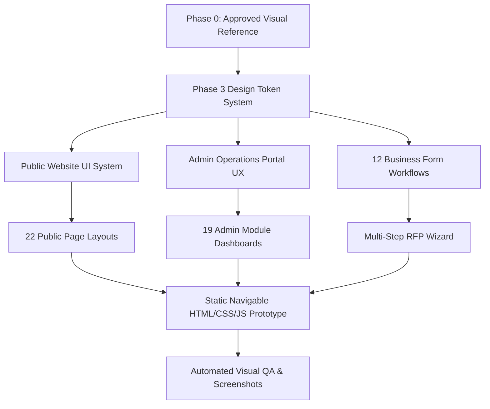

# Phase 3: Professional UI/UX Design — Executive Summary
## Voak Health Care — Corporate Digital Brand Guidelines & Visual System

**Document Reference:** `docs/phase-03/00_PHASE_3_EXECUTIVE_SUMMARY.md`  
**Phase:** Phase 3 of 31 — Professional UI/UX Design  
**Status:** COMPLETE (Ready for Visual Verification)  
**Next Phase:** Phase 4 — PHP Backend Foundation (STRICTLY NOT AUTHORIZED)  
**Roadmap Integrity:** Exactly 32 phases (Phase 0 through Phase 31)  
**Visual Authorities:**
1. Approved Second Generated Homepage Design Reference (`Screenshot_2026-10-16_073113.png` / `design/phase-03/references/approved_homepage_reference_image_2.png`)
2. Approved Enterprise Admin Portal Reference (`Screenshot_2026-10-16_073635.png` / `design/phase-03/references/approved_admin_reference_portal.png`)

---

### 1. Executive Mission & Strategic Design Philosophy

The primary objective of **Phase 3** is to translate the foundational requirements established in Phase 0, the comprehensive functional specifications from Phase 1, and the robust technical architecture from Phase 2 into a **complete, unified, premium, and inspectable UI/UX design system** for Voak Health Care.

Voak Health Care is an Australian B2B healthcare services enterprise partnering with public and private hospital networks, residential aged care facilities, NDIS community healthcare organizations, and specialized surgical centers. The digital identity must embody:
- **Authoritative Enterprise Competence:** Delivering institutional confidence, regulatory compliance, and clinical governance.
- **Human-Centred Warmth:** Departing from sterile, cold blue/white hospital templates in favor of a warm, optimistic, approachable visual palette.
- **Disciplined Editorial Elegance:** Pairing expressive serif headlines with crisp geometric sans-serif body typography, asymmetric bento grids, and rounded pastel surfaces.
- **Mathematical Accessibility:** Guaranteeing strict WCAG 2.2 AA contrast compliance across all interactive controls, text pairings, and form states.

---

### 2. Core Visual Benchmark & Approved Design Invariants

All design decisions strictly adhere to the approved visual benchmark:

1. **Page Architecture Shell:**
   - Soft lavender canvas background (`#F2F0F8`).
   - White rounded main page shell (`#FFFFFF`, `border-radius: 36px` desktop, `28px` mobile) with subtle elevation shadow (`0 12px 24px -4px rgba(37, 43, 94, 0.08)`).
2. **Hero Composition:**
   - Gentle lavender gradient backdrop (`#F4F1FA` to `#EBE6F7`).
   - Expressive dark navy serif headline (`#252B5E`, `Fraunces 64px`).
   - Authentic healthcare executive doctor portrait framed with pastel pink background collage shape (`#EEAFD7`) and warm buttercup yellow organic accent (`#FBDC62`).
   - Floating illustrated healthcare badges with drop shadows.
3. **Three Colorful Feature Cards:**
   - **Card 1 (Pastel Pink `#EEAFD7`):** Healthcare Services & Workforce.
   - **Card 2 (Warm Yellow `#FBDC62`):** Industries We Serve.
   - **Card 3 (Mint Green `#54CB96`):** Partner With Us & Strategic RFP.
4. **Services Bento Architecture:**
   - Asymmetric 12-column grid featuring double-width (8-col) and standard (4-col) cards with pastel tinted backgrounds and high-contrast navy typography.
5. **Admin Operations UX (Restrained Enterprise Style):**
   - Deep slate-navy sidebar (`#0F172A`), white card workspaces, high-contrast KPI metric cards, clear triage queue data tables with color-coded status chips, and `Ctrl+K` global search.

---

### 3. Summary of Deliverables & Artifacts

| Category | Deliverable Path | Coverage & Scope | Status |
| :--- | :--- | :--- | :---: |
| **Design Documentation** | `docs/phase-03/` (Files 00 to 17) | 18 Comprehensive markdown specifications covering tokens, typography, bento grids, 22 public pages, 19 admin modules, 12 forms, motion, and WCAG audit. | **COMPLETE** |
| **Visual Prototype** | `design/phase-03/index.html` `design/phase-03/styles.css` `design/phase-03/app.js` | Navigable, self-contained interactive prototype with master switcher for Desktop Homepage, Mobile Simulator, 22 Public Pages, 19 Admin Modules, and Components. | **VERIFIED** |
| **Local Preview Server** | `design/phase-03/serve.js` | Node.js lightweight static server running on `http://127.0.0.1:4173/`. | **VERIFIED** |
| **Screenshot Evidence** | `design/phase-03/screenshots/` (6 High-Resolution Captures) | Automated headless Edge captures verifying Desktop Homepage, Mobile 390px, Public Pages Gallery, Admin Dashboard, Component System, and References. | **CAPTURED** |
| **Asset Manifest** | `design/phase-03/assets/` | Original generated high-res healthcare photography (`hero_doctor.jpg`, `operations_manager.jpg`), inline SVG brand logos, and reference images. | **RECORDED** |

---

### 4. Roadmap Integrity & Stop Condition

- **Current Phase:** Phase 3 — Professional UI/UX Design.
- **Strict Stop Condition:** Stop upon delivery of Phase 3.
- **Prohibitions:** Zero PHP backend controllers, zero MySQL production migrations, zero production React implementation, and zero Hostinger deployment changes.
- **Total Roadmap Count:** Exactly 32 phases (Phase 0 to 31).
