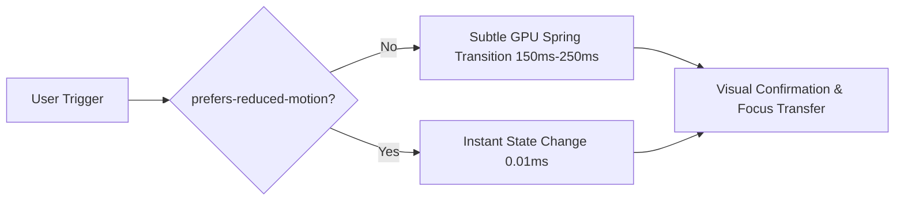

# Motion Design, Micro-Interactions & Animation Specifications
## Voak Health Care — Corporate Digital Brand Guidelines

**Document Reference:** `docs/phase-03/11_MOTION_AND_MICROINTERACTIONS.md`  
**Phase:** Phase 3 of 31 — Professional UI/UX Design  
**Implementation Target:** Motion for React (`framer-motion`) in Phase 19  
**Core Standard:** Dignified, Purposeful, Accessible (`prefers-reduced-motion` Strictly Enforced)

---

### 1. Motion Design Principles for B2B Healthcare

In an enterprise healthcare operations context, animation must never distract, cause cognitive disorientation, or introduce layout shift. Motion is utilized strictly to:
1. **Provide Tactile Feedback:** Affirming user actions, button presses, and successful form submissions.
2. **Clarify Spatial Relationships:** Showing where drawers emerge, how modals layer over content, and how wizard steps advance.
3. **Enhance Polish Without Performance Cost:** Utilizing GPU-accelerated CSS properties (`transform`, `opacity`) and avoiding heavy CPU reflows.



---

### 2. Comprehensive Micro-Interactions Catalog

#### A. Navigation & Header Motion
- **Sticky Elevation:** When scrolled > 20px, the header transitions background opacity from 0.94 to 0.98 and elevates shadow from `--shadow-md` to `--shadow-lg` over `200ms ease`.
- **Active Tab Underline:** Smooth layout spring transition moving the 2px purple underline beneath the active nav link.
- **Mobile Drawer:** Slides smoothly from `translateX(100%)` to `translateX(0)` with spring damping: `damping: 25, stiffness: 200`.

#### B. Button & Interactive Action Triggers
- **Hover State:** `transform: translateY(-2px); box-shadow: 0 6px 20px rgba(102, 92, 233, 0.45); transition: 150ms cubic-bezier(0.16, 1, 0.3, 1);`.
- **Active Click State:** `transform: scale(0.98); transition: 100ms ease;`.
- **Loading State:** Button text fades out (`opacity: 0`), and an inline SVG spinner fades in with infinite rotation (`animation: spin 1s linear infinite`).

#### C. Bento & Feature Card Hover States
- **Card Hover:** `transform: translateY(-4px); box-shadow: var(--shadow-md); transition: 250ms cubic-bezier(0.16, 1, 0.3, 1);`.
- **Feature Cards (Pink, Yellow, Mint):** `transform: translateY(-6px); box-shadow: var(--shadow-lg); transition: 250ms cubic-bezier(0.16, 1, 0.3, 1);`.

#### D. Floating Illustrated Sticker Badges
- **Idle Subtle Float:** Badges translate vertically `translateY(-8px)` over a 4-second sinusoidal loop:
  ```css
  @keyframes floatSubtle {
    0%, 100% { transform: translateY(0); }
    50% { transform: translateY(-8px); }
  }
  ```
- *Accessibility Bypass:* Inactive when `prefers-reduced-motion: reduce` is active.

#### E. Accordion Expansion (FAQ & Service Details)
- **Content Expansion:** Height transitions smoothly from `0` to `auto` via CSS grid or spring height.
- **Chevron Rotation:** SVG arrow rotates `180deg` over `200ms ease-in-out`.

#### F. Proposal Wizard Step Transitions (FORM-03)
- **Step Change:** Current step fades out and translates `-10px` left (`opacity: 0, x: -10`); new step enters from `+10px` right (`opacity: 1, x: 0`) over `200ms ease-out`.
- **Step Circle Indicator:** Smooth background color transition to mint green (`#54CB96`) upon completion with spring checkmark reveal.

#### G. Modal Dialogs & Drawers
- **Backdrop:** Fades in from `opacity: 0` to `opacity: 1` over `200ms`.
- **Card Container:** Scales from `0.95` to `1.0` and translates from `y: 20px` to `y: 0` with cubic-bezier easing `(0.16, 1, 0.3, 1)`.

#### H. Toast Notifications
- **Slide In:** Enters from top-right (`translateX(100%)` to `translateX(0)`) over `250ms`. Auto-dismisses after 5000ms with smooth fade out.

---

### 3. Strict Accessibility & Reduced Motion Standards

To ensure zero accessibility violations under WCAG 2.2 Success Criterion 2.3.3 (Animation from Interactions), all transitions automatically disable for users who have requested reduced motion:

```css
@media (prefers-reduced-motion: reduce) {
  *, *::before, *::after {
    animation-duration: 0.01ms !important;
    animation-iteration-count: 1 !important;
    transition-duration: 0.01ms !important;
    scroll-behavior: auto !important;
  }
  .floating-badge {
    animation: none !important;
  }
}
```
