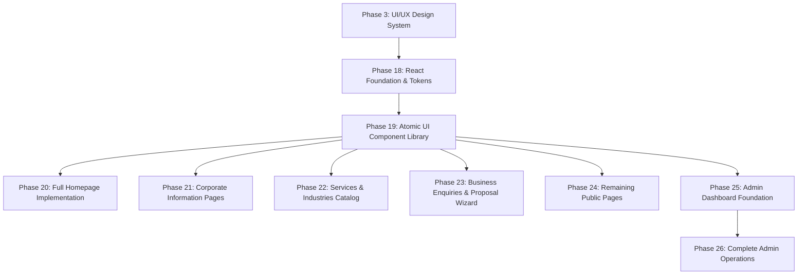

# Design to React Component Handoff Architecture
## Voak Health Care — Corporate Digital Brand Guidelines

**Document Reference:** `docs/phase-03/14_DESIGN_TO_REACT_COMPONENT_MAPPING.md`  
**Phase:** Phase 3 of 31 — Professional UI/UX Design  
**Implementation Target Phases:** Phase 18 through Phase 26  
**Technology Target:** React 19 + TypeScript + Tailwind CSS v3 + Motion for React (`framer-motion`)  
**Strict Phase 3 Constraint:** Specifications and Contracts Only (Zero Production React Code Built in Phase 3)

---

### 1. Future Implementation Phase Roadmapping

The design system established in Phase 3 will be implemented across future engineering phases:



---

### 2. Comprehensive Component Contract Specifications

#### A. `Button` Component (Phase 19 Target)
```typescript
export interface ButtonProps extends React.ButtonHTMLAttributes<HTMLButtonElement> {
  variant?: 'primary' | 'secondary' | 'outline' | 'ghost' | 'pill-pink' | 'pill-yellow' | 'pill-mint';
  size?: 'sm' | 'md' | 'lg';
  isLoading?: boolean;
  leftIcon?: React.ReactNode;
  rightIcon?: React.ReactNode;
}
```
- **Design Tokens:** `var(--voak-purple-cta)`, `var(--voak-purple-hover)`, `var(--radius-full)`.
- **Motion Spec:** `whileHover={{ y: -2 }}`, `whileTap={{ scale: 0.98 }}` via `framer-motion`.
- **Accessibility:** Minimum tap target `44x44px`, visible focus double-ring (`focus-visible:ring-2`).

#### B. `VoakHero` Component (Phase 20 Target)
```typescript
export interface VoakHeroProps {
  pillLabel: string;
  headline: string;
  description: string;
  primaryCtaText: string;
  primaryCtaLink: string;
  secondaryCtaText: string;
  secondaryCtaLink: string;
  doctorImageSrc: string;
  doctorImageAlt: string;
  badges?: Array<{ title: string; subtitle: string; iconType: 'purple' | 'yellow' }>;
}
```
- **Design Tokens:** Background `linear-gradient(135deg, #F4F1FA, #EBE6F7)`, radius `36px`, pink backdrop `#EEAFD7`, yellow accent `#FBDC62`.
- **Responsive Behavior:** 2-column grid at desktop (≥ 1024px); single column stacked at mobile (< 1024px).

#### C. `FeatureCard` Component (Phase 20 Target)
```typescript
export interface FeatureCardProps {
  theme: 'pink' | 'yellow' | 'mint';
  tagLabel: string;
  title: string;
  description: string;
  actionText: string;
  actionLink: string;
}
```
- **Tokens:** Pink (`#EEAFD7`), Yellow (`#FBDC62`), Mint (`#54CB96`), Text (`#252B5E`).
- **Motion:** Hover elevation `y: -6`, shadow transition `250ms`.

#### D. `BentoCard` Component (Phase 19–20 Target)
```typescript
export interface BentoCardProps {
  colSpan?: 4 | 6 | 8 | 12;
  tint?: 'pink' | 'yellow' | 'mint' | 'sky' | 'white';
  icon: React.ReactNode;
  title: string;
  description: string;
  chips?: Array<{ label: string; variant: 'purple' | 'info' | 'success' | 'warning' }>;
}
```
- **Tokens:** Radius `36px`, border `1px solid var(--voak-border-subtle)`.
- **Responsive:** Auto-collapses to `colSpan=12` on mobile (< 900px).

#### E. `ProposalWizard` Component (Phase 23 Target)
```typescript
export interface ProposalWizardProps {
  isOpen: boolean;
  onClose: () => void;
  onSuccess: (referenceId: string) => void;
}
```
- **State Machine:** Steps 1 through 5 with in-memory validation and persistence.
- **Form Controls:** Text inputs, selects, file dropzone (FORM-09), review card.
- **Accessibility:** `aria-modal="true"`, focus trap inside modal, close on `Escape`.

#### F. `AdminTable` Component (Phase 25–26 Target)
```typescript
export interface AdminTableColumn<T> {
  key: string;
  header: string;
  render?: (row: T) => React.ReactNode;
}

export interface AdminTableProps<T> {
  columns: AdminTableColumn<T>[];
  data: T[];
  isLoading?: boolean;
  emptyMessage?: string;
  onRowClick?: (row: T) => void;
}
```
- **Tokens:** Header background `#F1F5F9`, row hover `#F8FAFC`, border `#E2E8F0`.
- **Mobile Behavior:** Horizontal scroll container with sticky frozen identifier column.

---

### 3. Acceptance Verification Checklist for Future Development

When Phases 18–26 are implemented, they must satisfy these design criteria:
- [ ] Render 1:1 against the approved Phase 3 prototype screens.
- [ ] Use CSS custom properties derived from `docs/phase-03/02_COMPLETE_DESIGN_TOKEN_SYSTEM.md`.
- [ ] Achieve zero text clipping and zero horizontal scrolling from 320px to 1920px.
- [ ] Maintain measured WCAG 2.2 AA contrast ratios.
- [ ] Pass automated Axe-core accessibility testing with 0 critical or serious violations.
