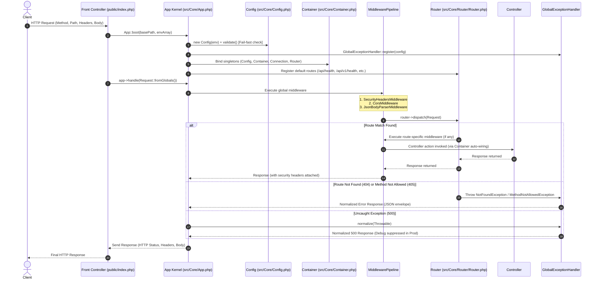

# Voak Health Care — PHP Backend Foundation Architecture

**Document Reference:** `DOC-PH4-01-FOUNDATION-ARCHITECTURE`  
**Phase:** Phase 4 — PHP Backend Foundation  
**Date:** October 20, 2026  
**Status:** **CONDITIONALLY AUTHORIZED** (Ratified via `DOC-PH3-21-PHASE-4-CONDITIONAL-START-REQUEST`)  
**Lead Roles:** Senior Software Architect, PHP Backend Engineer, Application Security Engineer  

---

## 1. Architectural Overview & Design Philosophy

The Voak Health Care PHP Backend Foundation serves as the foundational runtime layer for all subsequent server-side capabilities (Phases 5 through 17). Designed for high resilience, enterprise security, and compatibility with Hostinger CloudLinux shared hosting, this foundation prioritizes:

1. **Deterministic Request Lifecycle:** Strict pipeline routing requests through global middleware, route-level middleware, parameter extraction, controller dispatch, and centralized error normalization.
2. **Fail-Fast Configuration:** Preventing insecure deployment states by enforcing zero debug leakage (`APP_DEBUG=false`) and cryptographic key validation (`APP_KEY` >= 32 chars) on boot in production environments (`FR-SEC-005`).
3. **Strict Scope Separation (Conditional Governance):** Clean encapsulation of foundational plumbing without premature implementation of Phase 5+ relational schemas, authentication schemes, or administrative CRUD modules.
4. **Lazy Infrastructure Initialisation:** Zero mandatory database connectivity during container instantiation or basic application liveness checking (`GET /api/health`), preventing cascading failures when external databases are cold or unreachable.
5. **Contract Conformance:** Seamless compatibility with Phase 2 API specification envelopes (`success`, `data`, `error`, `code`, `details`, `request_id`, `timestamp`).

---

## 2. Directory Structure

The backend foundation is encapsulated entirely within the `backend/` directory, respecting the project's multi-tier workspace topology:

```
backend/
├── .env.example                       # Safe environment variable configuration template
├── composer.json                      # PSR-4 package definition (Voak\Health\ and Voak\Health\Tests\)
├── public/                            # Web root directory (Hostinger public_html target)
│   ├── .htaccess                      # Apache rewrite rules routing requests to index.php
│   ├── index.php                      # Application front controller
│   └── api/
│       └── index.php                  # API front controller fallback
├── src/
│   ├── Core/
│   │   ├── App.php                    # Application Kernel & master orchestrator
│   │   ├── Config.php                 # Fail-fast environment configuration manager
│   │   ├── Container.php              # Lightweight PSR-11 dependency injection container
│   │   ├── Exceptions/
│   │   │   ├── AppException.php       # Base typed application exception
│   │   │   ├── BadRequestException.php # HTTP 400 Bad Request
│   │   │   ├── ConfigurationException.php # Fatal 500 configuration violation
│   │   │   ├── DatabaseException.php  # Database connectivity and execution failure
│   │   │   ├── GlobalExceptionHandler.php # Production-safe centralized error handler
│   │   │   ├── HttpException.php      # Base HTTP exception with status code & error codes
│   │   │   ├── MethodNotAllowedException.php # HTTP 405 with Allow header
│   │   │   ├── NotFoundException.php  # HTTP 404 Resource/Route not found
│   │   │   └── ValidationException.php# HTTP 422 Unprocessable Entity
│   │   ├── Http/
│   │   │   ├── Request.php            # Immutable HTTP Request with correlation ID tracking
│   │   │   └── Response.php           # Immutable HTTP Response with standard JSON envelope factories
│   │   └── Router/
│   │       ├── Route.php              # Route definition with regex param parsing & middleware
│   │       └── Router.php             # REST router with parameterized matching & 404/405 resolution
│   ├── Database/
│   │   ├── Connection.php             # Lazy PDO connection manager with mock injection support
│   │   ├── Transaction.php            # Managed atomic PDO transaction runner
│   │   └── Migration/
│   │       ├── MigrationInterface.php # Contract for forward/reverse schema migrations
│   │       └── MigrationManager.php   # Blueprint discovery and tracking framework
│   ├── Middleware/
│   │   ├── CorsMiddleware.php         # Strict origin filtering and preflight handling
│   │   ├── JsonBodyParserMiddleware.php# Strict JSON parsing for mutation methods
│   │   ├── MiddlewareInterface.php    # Standard middleware contract
│   │   ├── MiddlewarePipeline.php     # Chain-of-responsibility execution pipeline
│   │   └── SecurityHeadersMiddleware.php # CSP, nosniff, DENY, and correlation ID injection
│   └── Modules/
│       ├── Health/
│       │   └── HealthController.php   # Liveness endpoints (/api/health and /api/v1/health)
│       └── Scaffolding/
│           └── PartnersClientsScaffolding.php # Isolated scaffolding for PAGE-PUB-10 (OPEN-03 isolation)
├── storage/
│   ├── logs/                          # Runtime diagnostic error logs
│   └── migrations/                    # Schema migration blueprints
└── tests/
    ├── Integration/
    │   ├── AppKernelTest.php          # Full kernel dispatch and error routing integration tests
    │   └── HttpSmokeTest.php          # Real HTTP smoke tests on built-in server (127.0.0.1:8199)
    ├── TestFramework.php              # Lightweight zero-dependency test runner & assertions
    ├── run_tests.php                  # Backend test suite runner
    └── Unit/
        ├── ConfigTest.php             # Config loading, redaction, and fail-fast validation tests
        ├── DatabaseConnectionTest.php # Lazy instantiation, mock PDO, and transaction tests
        ├── ExceptionHandlerTest.php   # Exception normalization and debug redaction tests
        ├── MiddlewareTest.php         # Pipeline order, security headers, CORS, and JSON parser tests
        ├── MigrationManagerTest.php   # Migration discovery and ordering tests
        ├── RequestResponseTest.php    # Request/Response immutability and envelope format tests
        └── RouterTest.php             # Parameter matching, 404, 405, and DI dispatch tests
```

---

## 3. Application Startup & Initialization Flow

The application initialization sequence is centralized in [`backend/src/Core/App.php](../../backend/src/Core/App.php) and executes as follows:



---

## 4. Component Architecture & Conventions

### 4.1 Configuration Management (`Config.php`)
- **Immutability:** Configuration is loaded once at boot and accessed via typed methods (`get()`, `getString()`, `getInt()`, `getBool()`).
- **Fail-Fast Production Validation (`validate()`):**
  - If `APP_ENV === 'production'`, `APP_DEBUG` must be strictly `false` (`FR-SEC-005`).
  - If `APP_ENV === 'production'`, `APP_KEY` must be at least 32 characters and cannot be a default placeholder (`base64:CHANGEME...`).
- **Secret Redaction (`allSafe()`):** Redacts sensitive environment variables (`APP_KEY`, `DB_PASSWORD`, `JWT_SECRET`, `SMTP_PASSWORD`) to prevent credential leakage in telemetry or diagnostic dumps.

### 4.2 Dependency Injection Container (`Container.php`)
- **PSR-11 Compliance:** Implements `get()` and `has()`.
- **Auto-Wiring:** Uses PHP 8 Reflection to automatically resolve and instantiate controller dependencies and type-hinted service classes.
- **Singletons:** Core infrastructure components (`Config`, `Container`, `Connection`, `Router`) are registered as shared singletons.

### 4.3 HTTP Abstractions (`Request.php` & `Response.php`)
- **Correlation ID:** Every request extracts `X-Request-ID` or generates a unique `req_[16 hex chars]` identifier, which is echoed in response headers and API envelopes for end-to-end tracing.
- **Safe JSON Parsing:** Request bodies are parsed using `json_decode()` with `JSON_THROW_ON_ERROR` wrapped to guarantee clean 400 Bad Request error envelopes instead of unhandled PHP fatals.
- **Phase 2 Envelopes:**
  - `Response::success($data, $statusCode, $meta)` produces:
    ```json
    {
      "success": true,
      "data": { ... },
      "meta": { "timestamp": "...", "request_id": "req_..." }
    }
    ```
  - `Response::error($message, $code, $statusCode, $details, $requestId)` produces:
    ```json
    {
      "success": false,
      "error": {
        "code": "BAD_REQUEST",
        "message": "...",
        "details": [ ... ]
      },
      "request_id": "req_...",
      "timestamp": "..."
    }
    ```

### 4.4 REST Router (`Router.php` & `Route.php`)
- **Parameterized Route Matching:** Compiles patterns like `/api/v1/services/{slug}` into regex matchers and injects captured route parameters into the `Request` attributes (`$request->getAttribute('slug')`).
- **HTTP Method Disambiguation:** Differentiates between unregistered paths (HTTP 404 `NOT_FOUND`) and existing paths invoked with an invalid HTTP method (HTTP 405 `METHOD_NOT_ALLOWED` with RFC-compliant `Allow` header).
- **Flexible Dispatching:** Handlers can be anonymous closures, invokable classes, or `[ControllerClass::class, 'methodName']` tuples resolved through the DI container.

### 4.5 Middleware Pipeline (`MiddlewarePipeline.php`)
Requests flow through an extensible middleware stack implementing `MiddlewareInterface`:
1. **`SecurityHeadersMiddleware`:**
   - `Content-Security-Policy: default-src 'self'; frame-ancestors 'none'; object-src 'none'; base-uri 'self';`
   - `X-Content-Type-Options: nosniff`
   - `X-Frame-Options: DENY`
   - `Referrer-Policy: strict-origin-when-cross-origin`
   - Injects correlation ID into `X-Request-ID`.
2. **`CorsMiddleware`:**
   - Validates incoming `Origin` against configured allowed origins (`CORS_ALLOWED_ORIGINS`).
   - Rejects dangerous wildcard origins (`*`) when credentials are supported.
   - Automatically intercepts and resolves HTTP `OPTIONS` preflight requests with `204 No Content` and appropriate CORS headers (`Access-Control-Allow-Methods`, `Access-Control-Allow-Headers`, `Access-Control-Max-Age: 86400`).
3. **`JsonBodyParserMiddleware`:**
   - Enforces valid JSON payloads on mutation requests (`POST`, `PUT`, `PATCH`) having `Content-Type: application/json`.
   - Returns a structured 400 Bad Request envelope if malformed JSON is received.

### 4.6 Centralized Error Handling (`GlobalExceptionHandler.php`)
- Converts all PHP `Throwable` instances and unhandled errors into deterministic JSON responses.
- Catches typed domain exceptions (`NotFoundException`, `ValidationException`, `BadRequestException`, `MethodNotAllowedException`, `DatabaseException`).
- **Production Information Leak Prevention:**
  - When `APP_DEBUG === false`: Internal error messages, database queries, and stack traces are suppressed. Clients receive generic messages (e.g. "Internal server error") accompanied by a unique `reference_id` (`REF-ERR-[hex]`) logged to disk for developer investigation.
  - When `APP_DEBUG === true`: Stack trace, file, line, and exception class are returned in the `details` field for local debugging.

### 4.7 Database Abstraction & Safety Boundaries (`Connection.php` & `Transaction.php`)
- **Lazy Connection Invariant:** Instantiating `Connection` or registering it in the container makes zero connection attempts. The PDO instance is only established upon invoking `getPdo()`.
- **Mock PDO Support:** `setMockPdo(PDO $pdo)` allows full unit and integration testing without requiring a live MySQL database.
- **Connection Configuration:** Enforces `PDO::ATTR_ERRMODE => PDO::ERRMODE_EXCEPTION`, `PDO::ATTR_DEFAULT_FETCH_MODE => PDO::FETCH_ASSOC`, `PDO::ATTR_EMULATE_PREPARES => false`, and `utf8mb4` charset.
- **Transaction Safety:** `Transaction::run(Connection $connection, callable $callback)` wraps operations in atomic transactions, automatically executing commit on success and rollback on any exception.
- **Zero Production Mutations:** Phase 4 executes zero schema changes and issues zero DDL/DML queries against live environments.

### 4.8 Migration Framework (`MigrationManager.php`)
- Implements migration discovery and tracking conventions (`YYYYMMDDHHMMSS_name.php`) implementing `MigrationInterface` (`up()`, `down()`, `getDescription()`).
- Establishes safe boundary rules: migrations cannot run automatically during application boot.

---

## 5. Hostinger Shared Hosting Compatibility

The foundation is engineered specifically for deployment on Hostinger CloudLinux shared hosting:
1. **Directory Structure:** Front controller located in `public/index.php`, allowing `public/` to map cleanly to Hostinger's `public_html` root while protecting `src/`, `storage/`, and `.env` outside the web root.
2. **Web Server Rewrites:**
   - Apache `.htaccess` provided in `public/` with `RewriteEngine On`, `RewriteCond %{REQUEST_FILENAME} !-f`, `RewriteCond %{REQUEST_FILENAME} !-d`, and `RewriteRule ^ index.php [QSA,L]`.
   - Compatible with Nginx reverse proxy configurations.
3. **PHP Runtime Requirements:**
   - PHP `8.2` or `8.3` (Hostinger allows PHP version selection up to 8.3).
   - Core extensions required: `ext-pdo`, `ext-pdo_mysql`, `ext-json`, `ext-mbstring`, `ext-openssl`.
4. **Shared Environment Constraints:**
   - Zero background daemons required (standard PHP FastCGI execution).
   - File logging to `storage/logs/` with graceful directory creation fallback.
   - Strict session and storage permission handling.

---

## 6. API Specification Alignment

The foundation establishes immediate compatibility with accepted Phase 2 API specifications:
- **Phase 4 Canonical Roadmap Gate:**
  - Route: `GET /api/health`
  - Response: `{"status":"ok"}`
  - Status Code: `200 OK`
- **Module 01 Canonical Health Endpoint:**
  - Route: `GET /api/v1/health`
  - Envelope: Phase 2 standard envelope containing service status, version (`0.4.0-phase4`), environment, and timestamp.
  - Status Code: `200 OK`
- **OPEN-03 Isolation Scaffolding:**
  - Route: `GET /api/v1/public/partners-preview`
  - Isolated in `src/Modules/Scaffolding/PartnersClientsScaffolding.php` to prevent premature coupling to either `PAGE-PUB-01` or `PAGE-PUB-10` while `OPEN-03` remains unresolved.

---

## 7. Security Architecture Summary

| Security Domain | Control Implemented | Verification Test |
|---|---|---|
| Information Disclosure | `APP_DEBUG=false` in production suppresses stack traces, file paths, and database details. | `ExceptionHandlerTest::testSuppressesInternalDetailsInProduction()` |
| Configuration Tampering | Fail-fast validation checks for missing `APP_KEY` and debug flags on boot. | `ConfigTest::testFailsFastIfDebugIsTrueInProduction()` |
| Clickjacking & Sniffing | `X-Frame-Options: DENY`, `X-Content-Type-Options: nosniff`, strict CSP. | `MiddlewareTest::testSecurityHeadersMiddleware()` |
| Cross-Origin Security | Strict CORS origin verification; wildcard origin forbidden when credentials enabled. | `MiddlewareTest::testCorsMiddlewareAllowedOrigin()` |
| Request Correlation | Automatic generation and propagation of `X-Request-ID` (`req_*`). | `RequestResponseTest::testGeneratesCorrelationId()` |
| Malformed Payload Denial | `JsonBodyParserMiddleware` safely catches malformed JSON before controller dispatch. | `MiddlewareTest::testJsonBodyParserMiddlewareRejectsMalformedJson()` |
| SQL Injection Prevention | PDO configured with `PDO::ATTR_EMULATE_PREPARES => false`. | `DatabaseConnectionTest::testConnectionIsLazy()` |

---

## 8. Verification & Test Architecture

The foundation includes a zero-dependency automated test framework (`tests/TestFramework.php`) executing:
- **Unit Tests:** 33 unit tests verifying Config, Container, Router, Request, Response, Middleware, ExceptionHandler, and DatabaseConnection.
- **Integration Tests:** 6 kernel integration tests verifying end-to-end request dispatching and pipeline interception.
- **HTTP Smoke Tests:** 6 live HTTP smoke tests executing real network requests against a live PHP server (`127.0.0.1:8199`).
- **All 45 tests pass with 161 assertions and 0 failures.**
