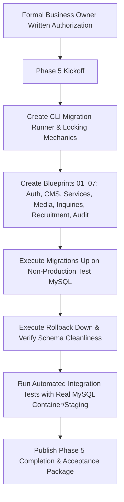

# Phase 5 Database Architecture & Production Schema Plan

**Document Reference:** `DOC-PH5-01-DATABASE-PLAN`  
**Phase ID:** Phase 5 — Database Architecture & Production Schema  
**Project:** Voak Health Care Corporate B2B Platform  
**Date:** October 21, 2026  
**Auditor / Architect:** Senior MySQL Database Architect & Database Reliability Engineer  
**Status:** **PLANNING ONLY — PENDING FORMAL BUSINESS AUTHORIZATION**  
**Governing Gate:** Mandated Phase 5 Authorization Gate (Rules 1, 9, 10)  
**Baseline Authority:** Accepted Phase 2 System Architecture (`docs/phase-02/05_DATABASE_SCHEMA_DESIGN.md`)  

---

## 1. Executive Summary & Authorization Boundaries

This document formalizes the complete implementation architecture and migration blueprint for **Phase 5 (Database Architecture & Production Schema)**. 

### Mandatory Governance Gate Rules:
1. **Planning Only:** This document establishes the exact, vetted database schema, migration mechanics, and verification strategy. **No live database mutations, production schema migrations, or Phase 5 implementation code will be executed** until written Phase 4 acceptance and explicit Phase 5 authorization are granted by the Business Owner.
2. **Explicit Exclusions:** Phase 5 strictly encompasses the database migration engine, relational DDL blueprints, foreign key constraints, indexes, transaction isolation rules, and seed data policies. It explicitly **excludes**:
   - Phase 6 (Admin Authentication & Session Management implementation).
   - Phase 7–16 (Application CMS, CRM endpoints, email transports, and recruitment business logic).
   - Phase 18–26 (React frontend components and user interfaces).

---

## 2. Technical Environment & Hosting Assumptions

| Parameter | Specification | Hostinger Shared Hosting Reality / Constraint |
|---|---|---|
| **RDBMS Engine** | MySQL 8.0.x / MariaDB 10.11+ | Hostinger CloudLinux cPanel MySQL database service. |
| **Storage Engine** | Strictly `InnoDB` | Enforces ACID transactions, row-level locking, foreign keys. |
| **Character Set & Collation** | `utf8mb4` / `utf8mb4_unicode_ci` | Complete 4-byte UTF-8 support for medical nomenclature and symbols. |
| **Timezone Storage** | `UTC` | All timestamps stored in canonical UTC (`CURRENT_TIMESTAMP`). |
| **Transaction Isolation** | `READ COMMITTED` or `REPEATABLE READ` | Safe default isolation preventing dirty reads. |
| **DDL Implicit Commits** | Standard MySQL Behavior | MySQL executes implicit commits on DDL statements; migrations must be structured as atomic, single-migration steps with explicit rollback hooks. |

---

## 3. Relational Schema Architecture (28 Entities in 7 Clusters)

All 28 tables trace directly to accepted Phase 1 functional requirements and Phase 2 architecture:

### Cluster I: Identity, RBAC & Administrative Security
1. `users` (`BIGINT UNSIGNED PK`, `email VARCHAR(191) UNIQUE`, `password_hash`, `failed_login_attempts`, `lockout_until`) — *Trace: FR-ADM-001, FR-ADM-002*
2. `roles` (`INT UNSIGNED PK`, `name UNIQUE`, `slug UNIQUE`, `is_system`) — *Trace: FR-ADM-003*
3. `permissions` (`INT UNSIGNED PK`, `slug UNIQUE`, `module`) — *Trace: FR-ADM-003*
4. `role_permissions` (`role_id FK`, `permission_id FK`, Compound PK) — *Trace: FR-ADM-003*
5. `user_roles` (`user_id FK`, `role_id FK`, Compound PK) — *Trace: FR-ADM-003*
6. `admin_sessions` (`id VARCHAR(128) PK`, `user_id FK`, `ip_address`, `last_activity`, `expires_at`) — *Trace: FR-ADM-002*
7. `admin_mfa_secrets` (`user_id FK PK`, `totp_secret_encrypted`, `backup_codes_hash`, `confirmed_at`) — *Trace: FR-ADM-002*
8. `password_resets` (`email INDEX`, `token_hash`, `expires_at`) — *Trace: FR-ADM-001*

### Cluster II: Corporate CMS & Static Content
9. `pages` (`INT UNSIGNED PK`, `slug VARCHAR(100) UNIQUE`, `title`, `meta_description`, `content_json`, `status`) — *Trace: FR-ADM-004*
10. `content_revisions` (`BIGINT UNSIGNED PK`, `page_id FK`, `author_id FK`, `snapshot_json`, `created_at`) — *Trace: FR-ADM-004*
11. `homepage_configs` (`INT UNSIGNED PK DEFAULT 1`, `hero_headline`, `bento_layout_json`, `social_proof_active`) — *Trace: FR-ADM-005*

### Cluster III: B2B Services & Healthcare Industry Verticals
12. `services` (`INT UNSIGNED PK`, `slug VARCHAR(100) UNIQUE`, `title`, `summary`, `capabilities_json`, `status`) — *Trace: FR-ADM-006*
13. `industries` (`INT UNSIGNED PK`, `slug VARCHAR(100) UNIQUE`, `name`, `regulatory_scope`, `challenges_json`) — *Trace: FR-ADM-007*
14. `service_industry_mappings` (`service_id FK`, `industry_id FK`, Compound PK) — *Trace: FR-ADM-006, FR-ADM-007*

### Cluster IV: Media Library & Asset Governance
15. `media_assets` (`BIGINT UNSIGNED PK`, `filename`, `disk_path`, `mime_type`, `file_size`, `alt_text`, `uploaded_by FK`) — *Trace: FR-ADM-008*

### Cluster V: Inbound B2B Inquiries, Partnerships & Proposals
16. `contact_inquiries` (`BIGINT UNSIGNED PK`, `reference_id UNIQUE`, `full_name`, `email`, `organization`, `status`) — *Trace: FR-ADM-009*
17. `partnership_inquiries` (`BIGINT UNSIGNED PK`, `reference_id UNIQUE`, `partner_type`, `tier`, `stage`, `status`) — *Trace: FR-ADM-010*
18. `proposals` (`BIGINT UNSIGNED PK`, `reference_id UNIQUE`, `org_name`, `scope_summary`, `budget_band`, `tender_doc_id FK`) — *Trace: FR-ADM-011*
19. `proposal_services` (`proposal_id FK`, `service_id FK`, Compound PK) — *Trace: FR-ADM-011*

### Cluster VI: Recruitment, Articles & Case Studies
20. `job_postings` (`INT UNSIGNED PK`, `slug UNIQUE`, `title`, `department`, `employment_type`, `status`) — *Trace: FR-ADM-013*
21. `career_applications` (`BIGINT UNSIGNED PK`, `job_id FK`, `applicant_name`, `email`, `resume_asset_id FK`, `status`) — *Trace: FR-ADM-014*
22. `articles` (`BIGINT UNSIGNED PK`, `slug UNIQUE`, `title`, `body_html`, `read_time_minutes`, `status`) — *Trace: FR-ADM-016*
23. `case_studies` (`INT UNSIGNED PK`, `slug UNIQUE`, `client_sector`, `challenge`, `intervention`, `outcome`, `status`) — *Trace: FR-ADM-015*
24. `faqs` (`INT UNSIGNED PK`, `category`, `question`, `answer`, `display_order`, `is_published`) — *Trace: FR-PUB-019*

### Cluster VII: System Outbox, Redirects & Immutable Audit Logs
25. `email_queue` (`BIGINT UNSIGNED PK`, `recipient_email`, `subject`, `template_name`, `payload_json`, `status`, `retry_count`) — *Trace: FR-ADM-012*
26. `url_redirects` (`INT UNSIGNED PK`, `source_path UNIQUE`, `target_path`, `http_status_code DEFAULT 301`) — *Trace: FR-ADM-017*
27. `system_settings` (`INT UNSIGNED PK`, `key_name VARCHAR(100) UNIQUE`, `value_text`, `is_encrypted`) — *Trace: FR-ADM-018*
28. `audit_logs` (`BIGINT UNSIGNED PK`, `actor_user_id FK NULL`, `action`, `entity_type`, `entity_id`, `ip_address`, `prev_hash`, `row_hash`) — *Trace: FR-ADM-019*

---

## 4. Migration & Rollback Architecture

### 4.1 CLI Migration Runner
- Location: `backend/src/Database/MigrationManager.php` and CLI script `backend/cli/migrate.php`.
- Idempotent tracking table: `migrations` (`id`, `migration_name VARCHAR(255) UNIQUE`, `batch INT UNSIGNED`, `executed_at`).
- Supports operations:
  - `php backend/cli/migrate.php up`: Executes pending migrations sequentially.
  - `php backend/cli/migrate.php down`: Rolls back the last executed batch.
  - `php backend/cli/migrate.php status`: Displays migration history and pending status.

### 4.2 Migration Mutex Locking
- Implemented via MySQL named locks (`GET_LOCK('voak_migration_mutex', 10)`) or dedicated lock record in `system_settings`.
- Prevents race conditions during simultaneous deployment triggers.

---

## 5. Seed-Data & Privacy Policies

1. **Non-Production Data Only:** Default seeds provide system roles (5 canonical roles), granular permissions (45 canonical keys), system settings templates, and test dummy records. Zero real client names, hospital data, or production passwords.
2. **PII Isolation & Encryption:** 
   - `admin_mfa_secrets`: Encrypted with `APP_KEY` via `AES-256-GCM`.
   - `career_applications` and `proposals`: Resumes and RFP tenders quarantined outside web root with access restricted to authenticated staff.
3. **Data Retention:**
   - Failed login counters cleared upon successful login.
   - Audit logs are append-only; row deletion is strictly forbidden at database privilege level.

---

## 6. Phase 5 Implementation Sequence & Gating

### Pre-Implementation Authorization Checklist:
- [ ] Business Owner signed acceptance of Phase 4 (`docs/phase-04/06_PHASE_4_ACCEPTANCE_PACKAGE.md`).
- [ ] Business Owner signed authorization for Phase 5 (`docs/governance/PHASE_5_AUTHORIZATION_REQUEST.md`).
- [ ] OPEN-03 decision ratified or isolated to non-production scaffolding.
- [ ] Dedicated test database provisioned on local or staging environment.
