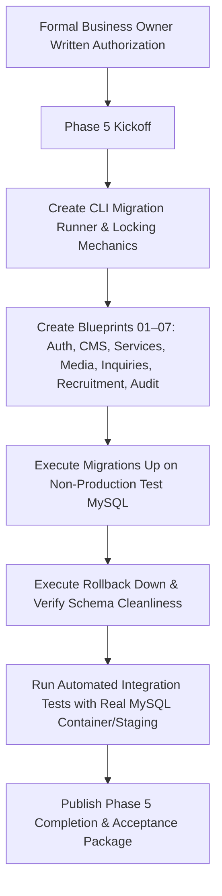

# Phase 5 Database Architecture & Production Schema Plan

**Document Reference:** `DOC-PH5-01-DATABASE-PLAN`  
**Phase ID:** Phase 5 — Database Architecture & Production Schema  
**Project:** Voak Health Care Corporate B2B Platform  
**Date:** October 21, 2026  
**Auditor / Architect:** Senior MySQL Database Architect & Database Reliability Engineer  
**Status:** **IMPLEMENTATION COMPLETE — PENDING GATE D ACCEPTANCE**  
**Governing Gate:** Mandated Phase 5 Authorization Gate (Rules 1, 9, 10 — Satisfied October 21, 2026)  
**Baseline Authority:** Accepted Phase 2 System Architecture (`docs/phase-02/05_DATABASE_SCHEMA_DESIGN.md`)  

---

## 1. Executive Summary & Authorization Boundaries

This document formalizes the complete implementation architecture and migration blueprint for **Phase 5 (Database Architecture & Production Schema)**. 

### Mandatory Governance Gate Rules:
1. **Authorized Implementation:** Phase 4 acceptance and explicit Phase 5 authorization were granted by the Business Owner on October 21, 2026. Implementation is active.
2. **Explicit Exclusions:** Phase 5 strictly encompasses the database migration engine, relational DDL blueprints, foreign key constraints, indexes, transaction isolation rules, and seed data policies. It explicitly **excludes**:
   - Phase 6 (Admin Authentication & Session Management implementation).
   - Phase 7–16 (Application CMS, CRM endpoints, email transports, and recruitment business logic).
   - Phase 18–26 (React frontend components and user interfaces).

### 1.3 Formal Change Request (CR-PH5-001): 20-Table Baseline Roadmap vs. 28-Entity Canonical Schema (FORMALLY APPROVED)

> [!NOTE]
> **GOVERNANCE STATUS: CR-PH5-001 FORMALLY APPROVED (October 21, 2026)**  
> Change Request CR-PH5-001 was formally approved by the Business Owner. The canonical 28-entity schema (plus 1 migrations tracking table) is adopted as the authoritative Phase 5 scope.

**Background:** The early high-level roadmap summary in `docs/phase-00/13_COMPLETE_32_PHASE_TRACEABILITY.md` (Phase 5 row) originally referenced "20 relational tables" as a preliminary pre-decomposition estimate established during Phase 0.

**Technical Evaluation:** During Phase 1 (Functional Specifications in `docs/phase-01/11_API_AND_DATABASE_REQUIREMENT_MAPPING.md`) and Phase 2 (System Architecture in `docs/phase-02/05_DATABASE_SCHEMA_DESIGN.md`), exhaustive domain analysis identified exactly **8 additional required relational entities** to support relational integrity, security isolation, and business requirements without unnormalized JSON antipatterns:
1. `role_permissions` (Cluster I, FR-ADM-003): Normalized many-to-many junction between administrative roles and the 45 granular canonical permissions.
2. `user_roles` (Cluster I, FR-ADM-003): Normalized junction supporting multi-role assignments.
3. `admin_mfa_secrets` (Cluster I, FR-ADM-002): Dedicated isolated credential store for encrypted RFC 6238 TOTP secrets and hashed recovery codes, separated from user profile records to prevent accidental exposure in user queries.
4. `service_industry_mappings` (Cluster III, FR-ADM-006, FR-ADM-007): Normalized many-to-many junction between the 6 healthcare service pillars and 6 industry verticals.
5. `proposal_services` (Cluster V, FR-ADM-011): Normalized junction mapping multi-service selections to enterprise RFP submissions.
6. `content_revisions` (Cluster II, FR-ADM-004): Historical JSON audit snapshots for static CMS pages.
7. `email_queue` (Cluster VII, FR-ADM-012): Durable asynchronous transactional outbox required for reliable SMTP delivery.
8. `url_redirects` (Cluster VII, FR-ADM-017): Automated 301 SEO redirect engine to prevent broken links on slug updates.

**Adopted Scope (CR-PH5-001 Approved):**  
In accordance with approved Change Request `CR-PH5-001`, Phase 5 adopts **exactly 28 relational domain entities** categorized into 7 functional clusters, plus 1 migration tracking table (`migrations`). All 28 entities and tracking tables have been implemented and verified.

---

## 2. Technical Environment & Hosting Assumptions

| Parameter | Specification | Hostinger Shared Hosting Reality / Constraint |
|---|---|---|
| **RDBMS Engine** | MySQL 8.0.x / MariaDB 10.11+ | Hostinger CloudLinux cPanel MySQL database service. |
| **Storage Engine** | Strictly `InnoDB` | Enforces ACID transactions, row-level locking, foreign keys. |
| **Character Set & Collation** | `utf8mb4` / `utf8mb4_unicode_ci` | Complete 4-byte UTF-8 support for medical nomenclature and symbols. |
| **Timezone Storage** | `UTC` | All timestamps stored in canonical UTC (`CURRENT_TIMESTAMP`). |
| **Transaction Isolation** | `READ COMMITTED` or `REPEATABLE READ` | Safe default isolation preventing dirty reads. |
| **DDL Implicit Commits** | Standard MySQL Behavior | MySQL executes implicit commits on DDL statements; migrations must be structured as atomic, single-migration steps with explicit rollback hooks. |

---

## 3. Relational Schema Architecture (28 Entities in 7 Clusters)

All 28 tables trace directly to accepted Phase 1 functional requirements and Phase 2 architecture:

### Cluster I: Identity, RBAC & Administrative Security
1. `users` (`BIGINT UNSIGNED PK`, `email VARCHAR(191) UNIQUE`, `password_hash`, `failed_login_attempts`, `lockout_until`) — *Trace: FR-ADM-001, FR-ADM-002*
2. `roles` (`INT UNSIGNED PK`, `name UNIQUE`, `slug UNIQUE`, `is_system`) — *Trace: FR-ADM-003*
3. `permissions` (`INT UNSIGNED PK`, `slug UNIQUE`, `module`) — *Trace: FR-ADM-003*
4. `role_permissions` (`role_id FK`, `permission_id FK`, Compound PK) — *Trace: FR-ADM-003*
5. `user_roles` (`user_id FK`, `role_id FK`, Compound PK) — *Trace: FR-ADM-003*
6. `admin_sessions` (`id VARCHAR(128) PK`, `user_id FK`, `ip_address`, `last_activity`, `expires_at`) — *Trace: FR-ADM-002*
7. `admin_mfa_secrets` (`user_id FK PK`, `totp_secret_encrypted`, `backup_codes_hash`, `confirmed_at`) — *Trace: FR-ADM-002*
8. `password_resets` (`email INDEX`, `token_hash`, `expires_at`) — *Trace: FR-ADM-001*

### Cluster II: Corporate CMS & Static Content
9. `pages` (`INT UNSIGNED PK`, `slug VARCHAR(100) UNIQUE`, `title`, `meta_description`, `content_json`, `status`) — *Trace: FR-ADM-004*
10. `content_revisions` (`BIGINT UNSIGNED PK`, `page_id FK`, `author_id FK`, `snapshot_json`, `created_at`) — *Trace: FR-ADM-004*
11. `homepage_configs` (`INT UNSIGNED PK DEFAULT 1`, `hero_headline`, `bento_layout_json`, `social_proof_active`) — *Trace: FR-ADM-005*

### Cluster III: B2B Services & Healthcare Industry Verticals
12. `services` (`INT UNSIGNED PK`, `slug VARCHAR(100) UNIQUE`, `title`, `summary`, `capabilities_json`, `status`) — *Trace: FR-ADM-006*
13. `industries` (`INT UNSIGNED PK`, `slug VARCHAR(100) UNIQUE`, `name`, `regulatory_scope`, `challenges_json`) — *Trace: FR-ADM-007*
14. `service_industry_mappings` (`service_id FK`, `industry_id FK`, Compound PK) — *Trace: FR-ADM-006, FR-ADM-007*

### Cluster IV: Media Library & Asset Governance
15. `media_assets` (`BIGINT UNSIGNED PK`, `filename`, `disk_path`, `mime_type`, `file_size`, `alt_text`, `uploaded_by FK`) — *Trace: FR-ADM-008*

### Cluster V: Inbound B2B Inquiries, Partnerships & Proposals
16. `contact_inquiries` (`BIGINT UNSIGNED PK`, `reference_id UNIQUE`, `full_name`, `email`, `organization`, `status`) — *Trace: FR-ADM-009*
17. `partnership_inquiries` (`BIGINT UNSIGNED PK`, `reference_id UNIQUE`, `partner_type`, `tier`, `stage`, `status`) — *Trace: FR-ADM-010*
18. `proposals` (`BIGINT UNSIGNED PK`, `reference_id UNIQUE`, `org_name`, `scope_summary`, `budget_band`, `tender_doc_id FK`) — *Trace: FR-ADM-011*
19. `proposal_services` (`proposal_id FK`, `service_id FK`, Compound PK) — *Trace: FR-ADM-011*

### Cluster VI: Recruitment, Articles & Case Studies
20. `job_postings` (`INT UNSIGNED PK`, `slug UNIQUE`, `title`, `department`, `employment_type`, `status`) — *Trace: FR-ADM-013*
21. `career_applications` (`BIGINT UNSIGNED PK`, `job_id FK`, `applicant_name`, `email`, `resume_asset_id FK`, `status`) — *Trace: FR-ADM-014*
22. `articles` (`BIGINT UNSIGNED PK`, `slug UNIQUE`, `title`, `body_html`, `read_time_minutes`, `status`) — *Trace: FR-ADM-016*
23. `case_studies` (`INT UNSIGNED PK`, `slug UNIQUE`, `client_sector`, `challenge`, `intervention`, `outcome`, `status`) — *Trace: FR-ADM-015*
24. `faqs` (`INT UNSIGNED PK`, `category`, `question`, `answer`, `display_order`, `is_published`) — *Trace: FR-PUB-019*

### Cluster VII: System Outbox, Redirects & Immutable Audit Logs
25. `email_queue` (`BIGINT UNSIGNED PK`, `recipient_email`, `subject`, `template_name`, `payload_json`, `status`, `retry_count`) — *Trace: FR-ADM-012*
26. `url_redirects` (`INT UNSIGNED PK`, `source_path UNIQUE`, `target_path`, `http_status_code DEFAULT 301`) — *Trace: FR-ADM-017*
27. `system_settings` (`INT UNSIGNED PK`, `key_name VARCHAR(100) UNIQUE`, `value_text`, `is_encrypted`) — *Trace: FR-ADM-018*
28. `audit_logs` (`BIGINT UNSIGNED PK`, `actor_user_id FK NULL`, `action`, `entity_type`, `entity_id`, `ip_address`, `prev_hash`, `row_hash`) — *Trace: FR-ADM-019*

---

## 4. Migration & Rollback Architecture

### 4.1 Planned CLI Migration Runner & Entrypoint Reconciliation (Deferred to Phase 5 Implementation)

> [!IMPORTANT]
> **Current Repository Implementation Baseline (Phase 4):**  
> As delivered in Phase 4, the repository contains only the core migration blueprint discovery abstraction:
> - `backend/src/Database/Migration/MigrationInterface.php` (interface contract)
> - `backend/src/Database/Migration/MigrationManager.php` (discovery and class loading)
> - `backend/tests/Unit/MigrationManagerTest.php` (unit tests for discovery)
> 
> The standalone CLI script (`backend/cli/migrate.php`), root compatibility shim (`database/migrate.php`), and discrete schema migration files (`backend/database/migrations/*.php`) are **NOT YET IMPLEMENTED**. They represent Phase 5 implementation deliverables and remain strictly held pending formal written approval of `CR-PH5-001` and Gate C authorization.

**Planned Architecture Upon Phase 5 Authorization:**
To reconcile entrypoint paths across prior specifications without altering Phase 0 baselines:
- **Planned Canonical CLI Runner:** `backend/cli/migrate.php` (to be created, executing `MigrationManager`).
- **Planned Phase 0 Compatibility Shim:** `database/migrate.php` (to be created at repository root, forwarding all arguments to `backend/cli/migrate.php` to preserve the Phase 0 baseline command).
- **Planned Idempotent Tracking Table:** `migrations` (`id`, `migration_name VARCHAR(255) UNIQUE`, `batch INT UNSIGNED`, `executed_at`).
- **Planned Unified Commands (Post-Authorization):**
  - `php database/migrate.php up`: Phase 0 baseline invocation from repository root.
  - `php backend/cli/migrate.php up`: Phase 5 plan invocation from repository root.
  - `cd backend && php cli/migrate.php up`: Phase 2 architecture invocation within backend root.
  - All planned entrypoints will support `up`, `down`, and `status` flags uniformly.

### 4.2 Migration Mutex Locking
- Implemented via MySQL named locks (`GET_LOCK('voak_migration_mutex', 10)`) or dedicated lock record in `system_settings`.
- Prevents race conditions during simultaneous deployment triggers.

---

## 5. Seed-Data & Privacy Policies

1. **Non-Production Data Only:** Default seeds provide system roles (5 canonical roles), granular permissions (45 canonical keys), system settings templates, and test dummy records. Zero real client names, hospital data, or production passwords.
2. **PII Isolation & Encryption:** 
   - `admin_mfa_secrets`: Encrypted with `APP_KEY` via `AES-256-GCM`.
   - `career_applications` and `proposals`: Resumes and RFP tenders quarantined outside web root with access restricted to authenticated staff.
3. **Data Retention:**
   - Failed login counters cleared upon successful login.
   - Audit logs are append-only; row deletion is strictly forbidden at database privilege level.

---

## 6. Phase 5 Implementation Sequence & Gating

### Pre-Implementation Authorization Checklist:
- [X] Business Owner signed acceptance of Phase 4 (`docs/phase-04/06_PHASE_4_ACCEPTANCE_PACKAGE.md`).
- [X] Business Owner signed authorization for Phase 5 (`docs/governance/PHASE_5_AUTHORIZATION_REQUEST.md`).
- [X] OPEN-03 decision ratified to Option A (`docs/governance/DECISION_RECORD_OPEN_03_REQUIREMENT_TRACEABILITY.md`).
- [X] Dedicated test database provisioned on local or staging environment.
