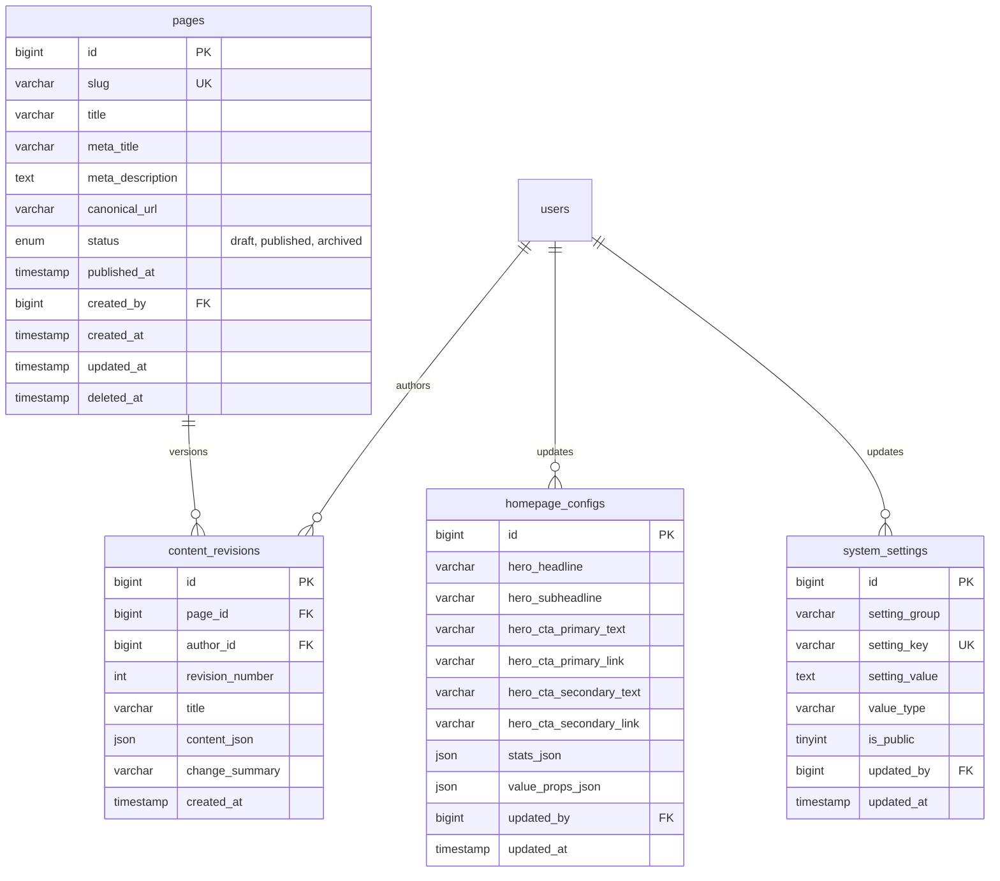

# Phase 7 Website Content Management Implementation Plan & Technical Specification

**Document Reference:** `DOC-PH7-01-IMPLEMENTATION-PLAN`  
**Phase ID:** Phase 7 — Website Content Management (Corporate CMS APIs, Revisions & Homepage Config)  
**Project:** Voak Health Care Corporate B2B Platform  
**Repository:** `https://github.com/surya7989/voakhealthcare.git`  
**Current Branch:** `main`  
**Date:** October 22, 2026  
**Authoring Roles:** Lead Technical Architect, Staff Backend Engineer & Application Security Specialist  
**Authoritative Architectural Baselines:**
- `docs/phase-00/13_COMPLETE_32_PHASE_TRACEABILITY.md` (Stage 2: Phase 7 Definition)
- `docs/phase-01/01_MASTER_FUNCTIONAL_REQUIREMENTS.md` (`FR-ADM-004`, `FR-ADM-005`, `FR-ADM-018`)
- `docs/phase-01/06_COMPLETE_RBAC_PERMISSION_MATRIX.md` (Permissions: `pages.view`, `pages.create`, `pages.edit`, `pages.publish`, `pages.delete`, `settings.view`, `settings.edit`)
- `docs/phase-02/05_DATABASE_SCHEMA_DESIGN.md` (Cluster II: `pages`, `content_revisions`, `homepage_configs`, `system_settings`)
- `docs/phase-02/07_API_DESIGN_AND_RESPONSE_CONTRACTS.md` (CMS API Specifications)

---

## 1. Executive Summary

Phase 7 implements the content management infrastructure powering both public website content presentation and administrative editorial workflows for Voak Health Care.

This phase provides:
1. **Public Content Delivery:** High-performance, cached, read-only JSON endpoints delivering corporate page content (`/pages/:slug`), homepage hero configurations, and general branding/contact metadata.
2. **Administrative CMS Operations:** Secure authenticated REST CRUD endpoints allowing authorized staff to curate corporate static pages (About Us, Why Choose Voak, How We Work, Quality & Compliance).
3. **Immutable Content Versioning:** Structured `content_revisions` capturing full historical snapshots on every edit, with one-click revision rollback and differential tracking.
4. **Publishing Workflow:** Draft versus Published state machine, scheduled publishing timestamps, and slug uniqueness enforcement.
5. **Security & Governance:** Strict RBAC enforcement via `RequirePermissionMiddleware`, CSRF token validation, HTML sanitization against Stored XSS, and immutable audit logging via `AuditLogger`.

---

## 2. Relational Database Schema Tracing (Active Cluster II & VII)

Phase 5 blueprints already provisioned the exact relational schema required for Phase 7:

---

## 3. API Response Contracts & Route Architecture

### 3.1 Public Content Routes (`Public/`)

| Method | Endpoint | Description | Auth / Security |
|---|---|---|---|
| `GET` | `/api/v1/public/pages/:slug` | Retrieves published page content with metadata | Public, rate-limited, ETag caching |
| `GET` | `/api/v1/public/homepage` | Retrieves active homepage hero, statistics & value props | Public, rate-limited, ETag caching |
| `GET` | `/api/v1/public/settings` | Retrieves public branding, contact info, and business hours | Public, rate-limited (`is_public = 1` only) |

### 3.2 Administrative CMS Routes (`Admin/`)

All administrative routes require `AdminAuthenticateMiddleware` and `CsrfProtectionMiddleware`.

| Method | Endpoint | Permission Required | Description |
|---|---|---|---|
| `GET` | `/api/v1/admin/pages` | `pages.view` | Paginated list of pages with filter by status |
| `POST` | `/api/v1/admin/pages` | `pages.create` | Creates new page with initial draft revision |
| `GET` | `/api/v1/admin/pages/:id` | `pages.view` | Retrieves single page with active content and revision list |
| `PUT` | `/api/v1/admin/pages/:id` | `pages.edit` | Updates page content, generates new `content_revision` |
| `PATCH` | `/api/v1/admin/pages/:id/status` | `pages.publish` | Updates status (`draft` / `published` / `archived`) |
| `POST` | `/api/v1/admin/pages/:id/rollback/:rev` | `pages.publish` | Reverts page content to specified revision number |
| `DELETE` | `/api/v1/admin/pages/:id` | `pages.delete` | Soft deletes page (`deleted_at = CURRENT_TIMESTAMP`) |
| `GET` | `/api/v1/admin/homepage` | `pages.view` | Retrieves current homepage configurations |
| `PUT` | `/api/v1/admin/homepage` | `pages.edit` | Updates homepage hero, stats, and value propositions |
| `GET` | `/api/v1/admin/settings` | `settings.view` | Lists all platform settings grouped by category |
| `PUT` | `/api/v1/admin/settings` | `settings.edit` | Batch updates platform settings with validation |

---

## 4. Security & Data Integrity Controls

1. **XSS Sanitization:** Rich-text content submitted via API must pass through strict HTML sanitization stripping malicious tags (`<script>`, `<iframe onload>`, `javascript:`) before persistence.
2. **Slug Normalization:** Page slugs are strictly sanitized (`^[a-z0-9]+(?:-[a-z0-9]+)*$`), preventing directory traversal or URL parameter manipulation.
3. **Audit Ledger Linkage:** Every page creation, edit, publish, rollback, and setting mutation records a row in `audit_logs` anchored by the user's ID and SHA-256 hash chaining.
4. **Private Settings Isolation:** Internal credentials and secret configurations are never exposed via the public `/api/v1/public/settings` endpoint (`WHERE is_public = 1`).

---

## 5. Implementation Roadmap & Verification Gates

Upon receipt of Phase 7 authorization from the Business Owner:
- **Task 7.1:** Implement `PageService`, `HomepageService`, and `SettingService`.
- **Task 7.2:** Implement `PublicContentController` and `AdminPageController`.
- **Task 7.3:** Register routes in `backend/src/Core/App.php`.
- **Task 7.4:** Implement comprehensive unit and integration test suite (`tests/Unit/PageServiceTest.php`, `tests/Integration/ContentApiTest.php`).
- **Task 7.5:** Run full regression suite, secret scanner, and CI workflow.
