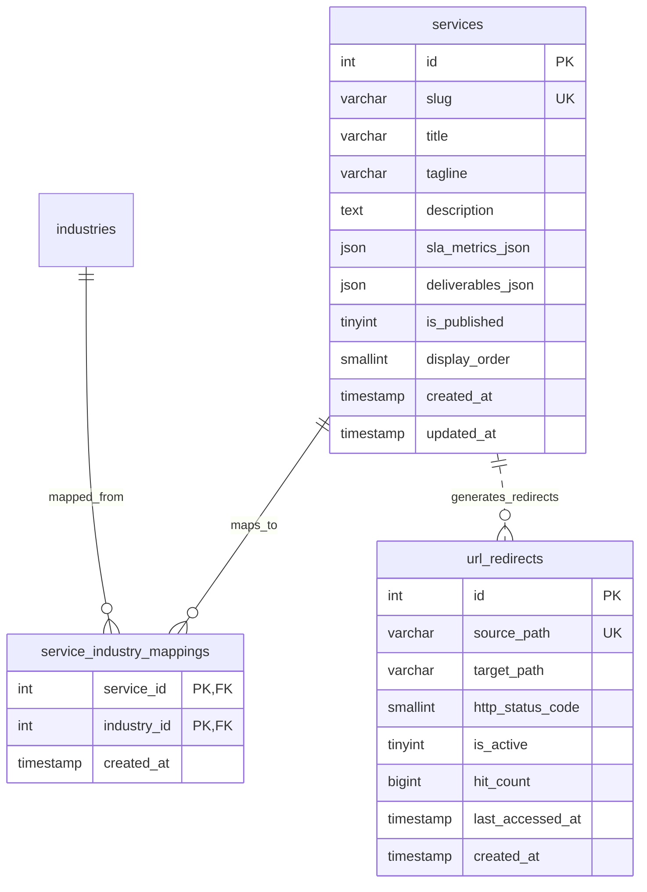

# Phase 8: Services Catalog Management Specification
## Architecture, Public & Admin APIs, 301 Redirect Engine, and RBAC Boundaries

**Document Reference:** `docs/phase-08/01_SERVICES_MANAGEMENT_PLAN.md`  
**Phase:** Phase 8 of 32 — Services Management Backend  
**Canonical Governance Authority:** Approved Phase 1 Functional Specification (`01_MASTER_FUNCTIONAL_REQUIREMENTS.md`, `04_SERVICES_AND_INDUSTRIES_FUNCTIONAL_SPEC.md`, `05_ADMIN_19_MODULE_SPECIFICATIONS.md`), Phase 2 Architecture (`02_PHP_BACKEND_MODULE_ARCHITECTURE.md`, `05_DATABASE_SCHEMA_DESIGN.md`), and Phase 6 RBAC Matrix (`06_COMPLETE_RBAC_PERMISSION_MATRIX.md`).

---

### 1. Executive Summary & Phase Objectives

Phase 8 implements the enterprise **Services Catalog Management** backend for VOAK Health Care, providing high-performance public delivery and administrative lifecycle management for the 6 core B2B healthcare operational service pillars:
1. **Clinical Workforce Solutions** (`clinical-workforce-solutions`)
2. **Healthcare Facility Operations** (`healthcare-facility-operations`)
3. **Health Administration & Medical Support** (`health-administration-support`)
4. **Healthcare Compliance & Clinical Governance** (`clinical-compliance-governance`)
5. **Healthcare Logistics & Supply Chain Support** (`healthcare-logistics-supply`)
6. **Healthcare Consulting & Operational Advisory** (`healthcare-consulting-advisory`)

Key architectural deliverables:
- **ServiceService Engine:** Complete CRUD lifecycle, structured deliverables and SLA metric storage via native MySQL JSON, slug collision defense, display ordering, and publishing state management.
- **Automated 301 SEO Redirect Engine (`FR-WF-006`):** Slug mutation automatically logs previous slugs in `url_redirects` (`source_path = '/services/' . $oldSlug`, `target_path = '/services/' . $newSlug`, `http_status_code = 301`), preserving search engine equity and customer bookmarks.
- **Public Service APIs:** Cached, rate-limited public catalog (`GET /api/v1/public/services`) with deterministic SHA-256 ETags and HTTP 304 support; dynamic slug resolution (`GET /api/v1/public/services/:slug`) strictly isolating drafts and archived records.
- **Administrative CMS Controller:** Protected admin endpoints (`/api/v1/admin/services`) strictly enforcing authentication, fail-closed actor identity, CSRF tokens on mutations, and granular RBAC permissions.
- **Least-Privilege RBAC Matrix:** Content Editors can draft and update services (`service:create`, `service:update`) but cannot publish (`service:publish`) or delete (`service:delete`), which are strictly restricted to Super Admin and Website Admin.
- **Cryptographic Audit Log Guarantee:** All service mutations record immutable events (`SERVICE_CREATED`, `SERVICE_UPDATED`, `SERVICE_SLUG_CHANGED`, `SERVICE_STATUS_CHANGED`, `SERVICES_REORDERED`, `SERVICE_DELETED`) with automated compensating transactions reversing state if audit logging fails.

---

### 2. Database Schema & Entities

The Services module connects three canonical database tables established in Phase 5:

---

### 3. API Contract Specifications

#### 3.1 Public Services Endpoints (`PublicContent/`)

| Method | Endpoint | Description | Cache / Auth |
|---|---|---|---|
| `GET` | `/api/v1/public/services` | Returns all published service pillars ordered by `display_order ASC` | Public, ETag cached, 304 support |
| `GET` | `/api/v1/public/services/:slug` | Returns detailed published service record | Public, ETag cached, 301 on renamed slug, 404 on draft |
| `GET` | `/api/services` | Legacy/shorthand alias for `/api/v1/public/services` | Public, ETag cached |
| `GET` | `/api/services/:slug` | Legacy/shorthand alias for `/api/v1/public/services/:slug` | Public, ETag cached |

#### 3.2 Administrative CMS Endpoints (`Admin/`)

| Method | Endpoint | Required Permission | Description |
|---|---|---|---|
| `GET` | `/api/v1/admin/services` | `service:update` | Lists all services (drafts, published, archived) with pagination & filters |
| `POST` | `/api/v1/admin/services` | `service:create` | Creates a new service offering (CSRF required, actor fail-closed) |
| `GET` | `/api/v1/admin/services/:id` | `service:update` | Retrieves full service details including industry mappings |
| `PUT` | `/api/v1/admin/services/:id` | `service:update` | Updates service; auto-generates 301 redirect if slug changes (CSRF required) |
| `PATCH` | `/api/v1/admin/services/:id/status` | `service:publish` | Toggles publication state (`is_published`) (CSRF required) |
| `PATCH` | `/api/v1/admin/services/reorder` | `service:update` | Batch updates display sequence order (CSRF required) |
| `DELETE` | `/api/v1/admin/services/:id` | `service:delete` | Soft deletes or unpublishes service (CSRF required) |

---

### 4. RBAC Permission Matrix

| Role | `service:create` | `service:update` | `service:publish` | `service:delete` |
|---|:---:|:---:|:---:|:---:|
| **Super Admin** | ALLOW | ALLOW | ALLOW | ALLOW |
| **Website Admin** | ALLOW | ALLOW | ALLOW | ALLOW |
| **Content Editor** | ALLOW | ALLOW | **DENY (403)** | **DENY (403)** |
| **BD Manager** | **DENY (403)** | **DENY (403)** | **DENY (403)** | **DENY (403)** |
| **HR Manager** | **DENY (403)** | **DENY (403)** | **DENY (403)** | **DENY (403)** |
